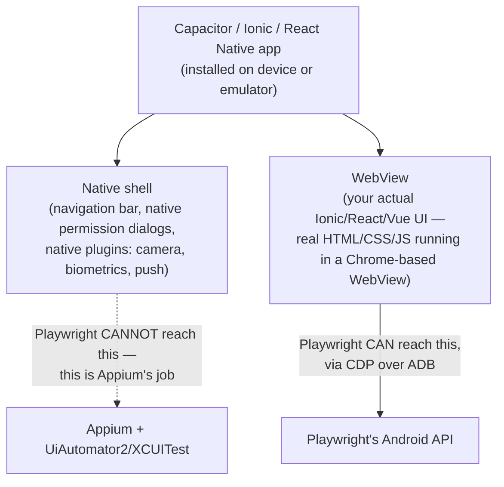

# Mobile Web & Hybrid App Testing With Playwright

## Scope of This File

[01_Playwright_vs_Appium_Full_Comparison.md](01_Playwright_vs_Appium_Full_Comparison.md) already covers the basics of mobile emulation in Playwright — the `devices` list, `playwright.config.ts` device projects, and a first pass at network interception. This file goes past the basics into the parts that don't have a clean, memorizable answer: touch gestures beyond a simple tap, and — the genuinely hard question — **can Playwright test a Capacitor/Ionic/React Native app at all, and what exactly can it reach?**

Every API claim in this file is checked against [playwright.dev](https://playwright.dev)'s own documentation, not written from memory. Where the honest answer is "Playwright can't do this, Appium can," it's stated as plainly as that — per this folder's own [CONTEXT.md](CONTEXT.md) rule: *"Do NOT claim Playwright can replace Appium for native UI."*

---

## Basics — What You Already Have (Recap)

```typescript
import { test, expect, devices } from "@playwright/test";

const context = await browser.newContext({
  ...devices["Pixel 7"],
});
```

A device descriptor (per Playwright's own emulation docs) is a plain object bundling several settings at once: `viewport`, `userAgent`, `deviceScaleFactor`, `isMobile`, `hasTouch`, and `screenSize`. Spreading `...devices['Pixel 7']` into `newContext()` sets all of them in one call — there's no magic beyond "this is a preset object of context options."

**The one property that unlocks everything below:** `hasTouch: true`. Playwright's own docs state it directly — *"Methods on the touchscreen can only be used in browser contexts that have been initialized with `hasTouch` set to true."* Every device descriptor Playwright ships for a phone or tablet sets this for you; if you're building a custom mobile context by hand instead of using a preset, forgetting `hasTouch: true` is the single most common reason `page.touchscreen` calls silently do nothing.

---

## Concept 1 — Touch Gestures: What `Touchscreen` Actually Offers

Here's the part that trips people up, confirmed against Playwright's own API reference: **`Touchscreen` has exactly one method — `tap(x, y)`.** That's the whole class. There is no `.swipe()`, no `.drag()`, no `.pinch()`. The docs are explicit about this: the class is *"limited to emulating tap gestures,"* and gestures beyond a tap require dispatching raw touch events yourself.

```typescript
// This works — Touchscreen.tap() is real:
await page.touchscreen.tap(200, 400);

// This does NOT exist in Playwright's API — a common mistake to copy from
// outdated blog posts or AI-generated code that assumes swipe() exists:
// await page.touchscreen.swipe(200, 400, 200, 100); // ❌ no such method
```

**The correct way to simulate a swipe** — manually dispatching the three-event sequence a real touch gesture produces:

```typescript
async function swipe(page: Page, fromX: number, fromY: number, toX: number, toY: number, steps = 10) {
  await page.dispatchEvent('body', 'touchstart', {
    touches: [{ identifier: 0, clientX: fromX, clientY: fromY }],
  });

  // touchmove needs intermediate points, or many apps' scroll/swipe handlers
  // (which often check velocity, not just start/end position) won't fire correctly
  for (let i = 1; i <= steps; i++) {
    const x = fromX + ((toX - fromX) * i) / steps;
    const y = fromY + ((toY - fromY) * i) / steps;
    await page.dispatchEvent('body', 'touchmove', {
      touches: [{ identifier: 0, clientX: x, clientY: y }],
    });
  }

  await page.dispatchEvent('body', 'touchend', { touches: [] });
}

// Usage: swipe up (list scroll) or swipe left (dismiss a card)
await swipe(page, 200, 400, 200, 100); // swipe up
```

🔴 **Why the intermediate `touchmove` steps matter, not just start and end:** a real finger swipe fires dozens of `touchmove` events as it travels — a JavaScript swipe handler that computes gesture *velocity* (common in carousel/dismiss-to-delete UI patterns) needs several intermediate points to compute a meaningful speed. Dispatching only `touchstart` immediately followed by `touchend` at a different position produces a *teleport*, not a swipe, and can fail to trigger the same code path a real gesture would.

**When to reach for `locator.tap()` instead:** for anything that's really just "tap this specific element," `locator.tap()` (auto-waits, auto-scrolls the element into view, resolves the correct coordinates itself) is simpler and more robust than computing raw coordinates for `touchscreen.tap()`. Reach for the raw `Touchscreen`/manual-dispatch APIs specifically when the gesture *itself* is what you're testing — a swipeable card, a pull-to-refresh, a drag-to-reorder list — not as the default way to tap a button.

---

## Concept 2 — Geolocation and Permissions

Mobile apps ask for location and notification permissions constantly; testing both the granted and denied paths is a real coverage gap most test suites skip.

```typescript
// Set geolocation for the whole context (per Playwright's own docs,
// this applies to ALL pages in the context — there's no per-page override)
const context = await browser.newContext({
  ...devices['Pixel 7'],
  geolocation: { latitude: 37.7749, longitude: -122.4194 }, // San Francisco
  permissions: ['geolocation'],
});

// Or change it mid-test:
await context.setGeolocation({ latitude: 51.5074, longitude: -0.1278 }); // London

// Grant/deny other permissions explicitly
await context.grantPermissions(['notifications']);
```

Testing the **denial** path matters just as much as the granted one — a location-based feature that crashes or shows nothing useful when the user says "Don't Allow" is a real, common bug that only shows up if you deliberately test it:

```typescript
test('shows manual city entry when location permission is denied', async ({ browser }) => {
  const context = await browser.newContext({ ...devices['Pixel 7'] }); // no permissions granted
  const page = await context.newPage();
  await page.goto('/weather');

  // App should detect the denial and fall back gracefully, not hang or crash
  await expect(page.getByText('Enter your city')).toBeVisible();
});
```

---

## Real-World Problem — "I Built This in Capacitor/Ionic. Can Playwright Test It?"

This is the question this whole file exists to answer honestly, and the honest answer has three different parts depending on what you're actually asking about.



**Part 1 — the WebView content itself: yes, genuinely.** A Capacitor or Ionic app's UI is real web content (HTML/CSS/JS) running inside an Android **WebView** (a Chrome-based rendering surface) or iOS **WKWebView**. Playwright's official — but explicitly **experimental** — Android API supports connecting to exactly this:

```typescript
import { _android as android } from 'playwright';

// Requires ADB — same daemon this bootcamp's DOC_07 covers in depth.
// Playwright's own docs state this directly: "Raw USB operation is not
// yet supported, so you need ADB."
const [device] = await android.devices();

await device.shell('am force-stop com.example.myionicapp');
await device.shell('am start com.example.myionicapp/.MainActivity');

// Get the WebView context INSIDE the running native app
const webview = await device.webView({ pkg: 'com.example.myionicapp' });
const page = webview.page(); // a normal Playwright Page from here on

await page.getByRole('button', { name: 'Log In' }).tap();
await expect(page.getByText('Welcome back')).toBeVisible();
```

**Part 2 — the native shell around it: no, and this isn't a workaround-able limitation.** The status bar, any native navigation transitions, a native "Allow Camera Access?" system dialog, biometric prompts, native push notification permission screens — none of this is reachable through Playwright, because none of it is a WebView. This is precisely [Appium's actual job](01_Playwright_vs_Appium_Full_Comparison.md), driving the same UiAutomator2/XCUITest layer this bootcamp's [Appium Inspector content](Flutter_Bootcamp/Reference/DOC_07_ADB_and_Dev_Tooling.md#appium-inspector--the-same-device-connection-a-different-job) covers for locator discovery. A test suite for a real hybrid app very often needs **both** tools — Playwright for the WebView-rendered screens, Appium for anything that crosses into native chrome.

**Part 3 — React Native specifically is a different case entirely, worth not confusing with Capacitor/Ionic.** Most of a React Native app's UI is rendered through **native components** (`<View>`, `<Text>` compile to real native widgets, not HTML) — there is no WebView for most of the screen at all, and Playwright genuinely cannot reach any of it; that's squarely Appium's territory. The one place Playwright-style WebView automation applies to React Native is a `<WebView>` **component** specifically embedded inside an RN screen (an in-app browser, an embedded checkout page) — that one embedded surface is a real WebView and is reachable the same way the Capacitor example above works, but it does not generalize to "React Native apps" as a whole the way it does for Capacitor/Ionic, where the entire UI is a WebView by design.

---

## Solution — Deciding Which Tool for a Given Hybrid Screen

| Question | Answer |
|----------|--------|
| Is this screen's content real HTML rendered in a WebView (a Capacitor/Ionic screen, an embedded `<WebView>` in React Native)? | Playwright's Android API can reach it, via ADB (see [DOC_07](Flutter_Bootcamp/Reference/DOC_07_ADB_and_Dev_Tooling.md) for the connection mechanics) |
| Is this a native system dialog, the status bar, or a native navigation transition? | Appium only — not reachable from Playwright at all |
| Is this a React Native screen built from native `<View>`/`<Text>` components, no WebView involved? | Appium only |
| Do I need to test the WebView content AND a native permission dialog in the same user flow? | Both tools, likely as two separate test suites covering different layers of the same flow |

**The practical recommendation most teams land on:** use Playwright to cover the WebView-rendered screens thoroughly (it's faster, has better debugging tools, and the same auto-waiting/locator ergonomics as regular web testing) — and reserve Appium specifically for the native-boundary interactions Playwright genuinely cannot reach, rather than trying to force one tool to cover everything.

---

## Challenges

### 🐛 Bug Hunt — The Swipe That Never Fires

```typescript
async function swipeLeft(page: Page) {
  await page.dispatchEvent('body', 'touchstart', {
    touches: [{ identifier: 0, clientX: 300, clientY: 400 }],
  });
  await page.dispatchEvent('body', 'touchend', {
    touches: [{ identifier: 0, clientX: 50, clientY: 400 }],
  });
}
```

This is called on a dismissible card component (the same shape as [Week 10's swipe-to-dismiss content](Flutter_Bootcamp/Phase_2_Core_UI/Week_10b_Gesture_Challenges.md#-boss-battle--build-dismissibles-core-mechanic-from-raw-gestures) elsewhere in this repo, just tested from the outside instead of built from the inside). The card never dismisses. Two separate mistakes are hiding in this snippet — find both.

<details><summary>Diagnosis</summary>

🔴 **Mistake 1:** there's no `touchmove` event at all — only `touchstart` and `touchend`. A real swipe fires `touchmove` events as the finger travels; jumping straight from start to end is a teleport a gesture handler measuring distance/velocity over `touchmove` events will never see.

🔴 **Mistake 2:** `touchend`'s `touches` array still lists a touch point at `clientX: 50`. Per the touch event model, `touchend`'s `touches` array should be **empty** (or omit the lifted finger) — the event signals "this touch point is no longer active," so including it as still-touching is contradictory and can confuse handlers that check `event.touches.length === 0` to detect gesture completion.

Fixed version:

```typescript
async function swipeLeft(page: Page) {
  await page.dispatchEvent('body', 'touchstart', {
    touches: [{ identifier: 0, clientX: 300, clientY: 400 }],
  });
  await page.dispatchEvent('body', 'touchmove', {
    touches: [{ identifier: 0, clientX: 175, clientY: 400 }], // intermediate point
  });
  await page.dispatchEvent('body', 'touchend', { touches: [] }); // empty — nothing touching anymore
}
```

</details>

---

### 🎭 Two Truths and a Lie — Playwright's Android API

**A.** Playwright's Android API requires ADB — it explicitly does not support raw USB operation without it.

**B.** `device.webView()` gives you a standard Playwright `Page` object once you have it — the same locators, the same auto-waiting, the same `expect()` assertions as any other Playwright test.

**C.** Playwright's Android API is a fully-supported, stable part of the framework, suitable for the same production CI reliability guarantees as regular browser automation.

<details><summary>Which one's the lie</summary>

**C is the lie.** Playwright's own documentation is explicit that this API is **experimental** — device availability quirks (a device needs to be awake to produce screenshots, for instance) and incomplete test coverage against it are called out directly in the official docs. Treat it as genuinely useful for reaching WebView content in a hybrid app, not as a drop-in, fully-hardened replacement for regular Playwright browser testing.

🔴 A and B are both true and are exactly what makes this API worth knowing about at all — A is why [DOC_07's ADB content](Flutter_Bootcamp/Reference/DOC_07_ADB_and_Dev_Tooling.md) is a prerequisite, not a tangent, for hybrid app testing; B is why, once connected, testing a Capacitor/Ionic screen feels identical to testing any other web page — the WebView's content is just DOM, and Playwright doesn't need special-case APIs to interact with it.

</details>

---

**→ Related files:**
- [01_Playwright_vs_Appium_Full_Comparison.md](01_Playwright_vs_Appium_Full_Comparison.md) — the foundational device-emulation and network-interception content this file builds on
- [Flutter_Bootcamp/Reference/DOC_07_ADB_and_Dev_Tooling.md](Flutter_Bootcamp/Reference/DOC_07_ADB_and_Dev_Tooling.md) — the ADB mechanics Playwright's Android API depends on, and Appium Inspector's use of the same layer
- [Flutter_Bootcamp/Reference/DOC_09_Mobile_Debugging_Toolkit.md](Flutter_Bootcamp/Reference/DOC_09_Mobile_Debugging_Toolkit.md) — Playwright's Trace Viewer/Inspector debugging tools in full, plus the cross-tool hybrid-app diagnosis flow this file's boundary table sets up
- [02_Android_Native_Dev_And_Testing.md](02_Android_Native_Dev_And_Testing.md) / [03_iOS_Native_Dev_And_Testing.md](03_iOS_Native_Dev_And_Testing.md) — the native-side Appium/Espresso/XCUITest coverage this file's "native shell" boundary points to
