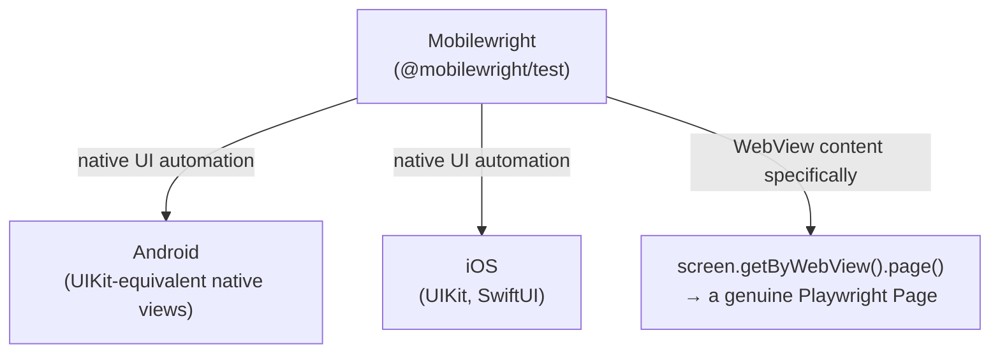

# Mobilewright — Playwright-Powered Native Mobile Automation

## A Correction Worth Stating Plainly

Earlier content in this repo (`05_Mobile_Web_And_Hybrid_Playwright.md`, the `Playwright_Mobile_TypeScript/` track) covers **Playwright's own** mobile capabilities — browser-level device emulation, and Playwright's experimental Android API for WebView content. That content is accurate and stays useful. But **Mobilewright is a separate, real framework** — built by Mobile Next, hosted at [mobilewright.dev](https://mobilewright.dev), with its own npm packages, its own CLI, and its own native-automation engine. It is not "Playwright, but for mobile" in the sense of being the same product — it's a *different* tool that borrows Playwright's API design and, for WebView content specifically, its actual engine. This file covers the real thing, grounded in mobilewright.dev's own documentation.

---

## What It Actually Is



Mobilewright positions itself directly against **Appium** — a unified, single API for driving both Android and iOS native UI, with a Playwright-inspired syntax (auto-waiting, chainable locators, `test`/`expect` from `@mobilewright/test`) instead of Appium's WebDriver-over-HTTP model. It also supports React Native and Expo apps, not just fully-native UIKit/SwiftUI ones.

---

## Setup

```bash
npm install mobilewright @mobilewright/test
npm init mobilewright@latest    # scaffolds mobilewright.config.ts + an example test
npx mobilewright test           # runs the suite
npx mobilewright test --reporter html && npx mobilewright show-report
```

`mobilewright.config.ts` centralizes: target platform (iOS or Android), the app's bundle ID, a device-name pattern to match against connected devices/simulators, the app's install path, and timeout settings — conceptually the same "one config file, everything centralized" shape as `playwright.config.ts` from the [TypeScript track's Level 1](Playwright_Mobile_TypeScript/Level_01_Setup_and_First_Mobile_Test.md), deliberately.

---

## The `screen` / `device` Fixture Model

```typescript
import { test, expect } from '@mobilewright/test';

test('app launches and shows home screen', async ({ screen }) => {
  await expect(screen.getByText('Welcome')).toBeVisible();
});

test.describe('login flow', () => {
  test('shows login form', async ({ screen }) => {
    await expect(screen.getByLabel('Email')).toBeVisible();
    await expect(screen.getByLabel('Password')).toBeVisible();
  });

  test('rejects invalid credentials', async ({ screen }) => {
    await screen.getByLabel('Email').fill('bad@example.com');
    await screen.getByLabel('Password').fill('wrong');
    await screen.getByRole('button', { name: 'Sign In' }).tap();
    await expect(screen.getByText('Invalid credentials')).toBeVisible();
  });
});

test('deep link opens profile', async ({ device, screen }) => {
  await device.openUrl('myapp://profile/123');
  await expect(screen.getByText('Profile')).toBeVisible();
});
```

`screen` is the fixture you interact with the UI through (locators, actions, assertions). `device` is for device-level operations — opening deep links, and (per the actions API below) hardware buttons. This mirrors Playwright's own `page`/`context` split conceptually: one fixture for "what's on screen," one for "the environment around it."

---

## Locators — Cross-Platform Role Normalization

```typescript
// getByRole() normalizes native types across platforms —
// strips android.widget./androidx.*/XCUIElementType prefixes and
// matches the bare name against a role mapping table
screen.getByRole('textfield'); // matches Android's EditText AND iOS's TextField

// Other locator methods:
screen.getByLabel('Email');       // by accessibility label text
screen.getByTestId('submit-btn'); // by test identifier
screen.getByType('UILabel');      // raw native class name, NO normalization — an escape hatch
```

**The real limitation worth knowing before you rely on `getByRole`:** per Mobilewright's own docs, *"Anything not listed [in the role mapping table] has no role mapping — `getByRole()` won't find it."* For a custom native component with no standard role mapping, `getByType()` (exact native class name, platform-specific, no normalization) or `getByTestId()`/`getByLabel()` are the fallbacks — the same "most resilient, least semantic" trade-off [Level 2's `getByTestId` guidance](Playwright_Mobile_TypeScript/Level_02_Locators_and_Assertions.md#basics--the-locator-priority-order-straight-from-playwrights-own-docs) already covered for web.

---

## Actions — Locator-Scoped vs Screen-Level

```typescript
// LOCATOR actions — resolve an element first, auto-wait until actionable
await screen.getByRole('button', { name: 'Submit' }).tap();
await screen.getByText('Photo').doubleTap();
await screen.getByText('Message').longPress(1_500); // optional duration in ms
await screen.getByRole('textbox', { name: 'Email' }).fill('user@example.com');
await screen.getByRole('textbox', { name: 'Email' }).clear();
await screen.getByText('Card').swipe({ direction: 'left' });
await screen.getByText('Delete account').scrollIntoViewIfNeeded();

// SCREEN actions — raw coordinates or hardware, no element resolution at all
await screen.tap(200, 400);
await screen.longPress(200, 400, 1_500);
await screen.swipe('up');
await screen.pressButton('HOME'); // also: BACK, POWER, VOLUME_UP/DOWN, ENTER, DPAD_*, APP_SWITCH, LOCK
await screen.goBack(); // Android shorthand for the BACK button specifically
await screen.gesture(/* multi-touch paths with precise timing */);
```

**Why the split matters:** locator actions are what most tests should use — find the semantically-correct element, let auto-waiting handle timing. Screen-level actions exist for things that have no "element" to speak of at all — pressing a hardware volume button, or a coordinate-based interaction where no locator strategy could possibly apply.

---

## Auto-Waiting — Four Checks, Every Action

Before performing any locator action, Mobilewright verifies, per its own documentation:

1. **Exists** in the view hierarchy
2. **Is visible** — `isVisible` is `true`
3. **Is enabled** — `isEnabled` is `true`
4. **Has stable bounds** — position/size unchanged between two consecutive checks (catches mid-animation elements)

Default timeout: **5 seconds**, checked every 100ms (50ms specifically for the stability check, to detect "animation has stopped" quickly). This is meaningfully more automatic than Appium's traditional explicit-wait model — [DOC_09's Appium debugging content](Flutter_Bootcamp/Reference/DOC_09_Mobile_Debugging_Toolkit.md#2-element-not-found-nosuchelementexception) covers a real `NoSuchElementException` case caused by an element "not rendered yet," requiring a manually-written `WebDriverWait`; Mobilewright's four-check auto-wait handles that exact race condition without you writing any wait logic at all.

---

## The Genuinely Distinctive Feature — WebView Bridging Into Real Playwright

```typescript
test('hybrid app WebView content is real Playwright', async ({ screen }) => {
  const webview = screen.getByWebView(); // attach to the WebView inside the native app
  const page = webview.page(); // returns an ACTUAL Playwright-compatible Page

  await page.goto('https://checkout.example.com'); // or it's already loaded — just interact
  await page.getByRole('button', { name: 'Pay Now' }).click();
  await expect(page.getByText('Payment successful')).toBeVisible();
});
```

This is the standout capability worth understanding precisely: Mobilewright injects *Playwright's own selector-and-assertion engine* directly into the WebView, so the returned `page` genuinely supports `getByRole`/`getByText`/`getByLabel`, navigation methods, `click`/`fill`/`type`/`press`/`hover`, and auto-retrying web-first assertions — **identical code** to a normal web test. Compare this against [05_Mobile_Web_And_Hybrid_Playwright.md's coverage of Playwright's own official Android API](05_Mobile_Web_And_Hybrid_Playwright.md#real-world-problem--i-built-this-in-capacitorionic-can-playwright-test-it): that API is Android-only, requires ADB directly, and is explicitly experimental. Mobilewright's WebView bridge works across **both** Android and iOS through one consistent API — a genuine advantage for a cross-platform hybrid app's test suite specifically.

**The honest limitations, stated directly by Mobilewright's own docs:** network interception, screenshots, dialogs, downloads, and multiple tabs are **not** supported through this bridged `page` — meaning [Level 5's `page.route()` mocking](Playwright_Mobile_TypeScript/Level_05_Network_Interception_and_Mocking.md) doesn't carry over to a Mobilewright-bridged WebView page. There are also platform-specific quirks: `page.url()` can lag after an in-app redirect on Android, and `toBeFocused()` assertions are documented as unreliable there.

---

## Deciding Between Mobilewright, Appium, and Playwright-for-Web

| Question | Answer |
|---|---|
| Testing a fully-native screen (native buttons, native nav, no WebView)? | Mobilewright or Appium — both drive the native accessibility tree; Mobilewright's simpler auto-waiting model and Playwright-familiar syntax are the trade-off against Appium's much larger, more battle-tested ecosystem and tooling (Appium Inspector, more drivers, wider community support) |
| Testing a Capacitor/Ionic screen's WebView content, need cross-platform (iOS + Android) coverage with one test? | Mobilewright's `getByWebView().page()` bridge — one API, both platforms |
| Testing only the WebView content, and only need Android (or are fine with the experimental-API caveat)? | Playwright's own official Android API, per [05_Mobile_Web_And_Hybrid_Playwright.md](05_Mobile_Web_And_Hybrid_Playwright.md) — no extra framework dependency if you're already using Playwright for everything else |
| Need network interception, screenshots, or multi-tab support *inside* a hybrid app's WebView? | Neither Mobilewright's bridge nor a plain WebView connection covers this fully — check current framework docs for the specific capability, this is a fast-moving area |
| Team already has deep Appium expertise, drivers, and CI infrastructure? | Appium remains the safer choice — a newer framework with less ecosystem maturity carries real switching risk regardless of how clean its API is |

---

**→ Related files:**
- [01_Playwright_vs_Appium_Full_Comparison.md](01_Playwright_vs_Appium_Full_Comparison.md) — the foundational Appium/Playwright landscape this file adds a third option to
- [05_Mobile_Web_And_Hybrid_Playwright.md](05_Mobile_Web_And_Hybrid_Playwright.md) — Playwright's own (non-Mobilewright) Android WebView API, for direct comparison
- [Flutter_Bootcamp/Reference/DOC_09_Mobile_Debugging_Toolkit.md](Flutter_Bootcamp/Reference/DOC_09_Mobile_Debugging_Toolkit.md) — the `NoSuchElementException`/`StaleElementReferenceException` content Mobilewright's auto-waiting and locator re-resolution both sidestep
- [Mobilewright_TypeScript/00_ROADMAP.md](Mobilewright_TypeScript/00_ROADMAP.md) — this file's reference-doc summary, taken level-by-level into a full 13-level progressive curriculum (locator priority mechanics, deep links, multi-platform config, sharding, the fixture gap, the missing visual-regression assertion, the Inspector, and a real cross-platform CI pipeline)
