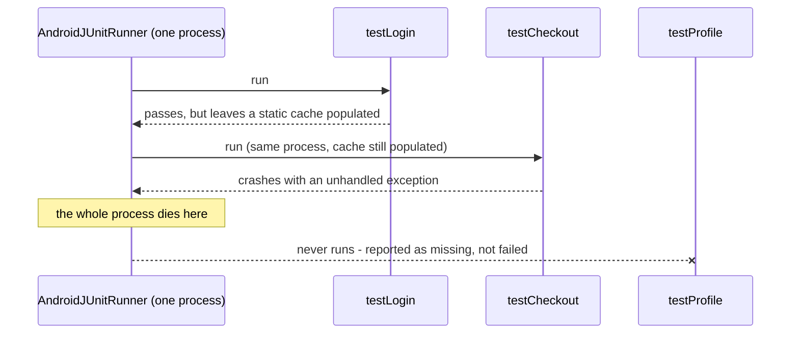
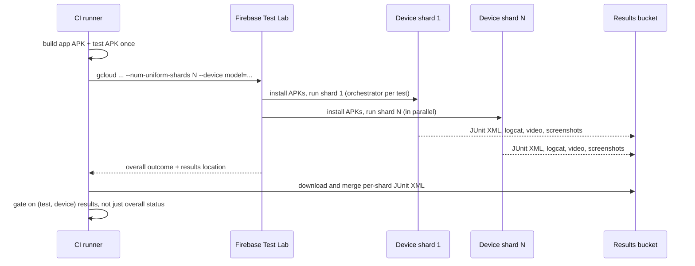

# Cross-Platform Mobile Testing Infrastructure at Scale

### Builds on: [Mobilewright Level 7 — Sharding](Mobilewright_TypeScript/Level_07_Sharding_for_CI_Speed.md) · [Mobilewright Level 12 — Docker & Cloud Devices](Mobilewright_TypeScript/Level_12_Docker_Cloud_Devices_and_Troubleshooting.md) · [Playwright Level 13 — CI/CD Capstone](Playwright_Mobile_TypeScript/Level_13_Capstone_CICD_Pipeline.md)

> **Reading contract**: Both progressive tracks stop at the same honest boundary — "this is where a real device farm would be needed." This file is what's on the other side of that boundary. It teaches how to choose a device matrix from data instead of habit, the four places tests can actually run and what each one costs, how sharding really works on Android and iOS (down to the formula AndroidJUnitRunner uses to assign a test to a shard), why test isolation is a tradeoff and not a free win, how to read flakiness when the same suite runs on twenty device models, and how to do the cost math before someone asks you to defend a device-farm invoice. This is the *mechanism* layer — the judgment of whether to invest in any of this at all belongs to the senior-judgment material, and the release-gating process belongs to the release playbook; this file is "how it works and how to build it."
>
> **Verified, not recalled (2026-10):** every tool flag in this file was checked against its official docs — [Firebase Test Lab gcloud reference](https://firebase.google.com/docs/test-lab/android/command-line), [Gradle Managed Devices](https://developer.android.com/studio/test/gradle-managed-devices), the [AndroidJUnitRunner source](https://android.googlesource.com/platform/frameworks/testing/+/android-support-test/runner/src/main/java/android/support/test/internal/runner/TestRequestBuilder.java), [Smart Flank](https://flank.github.io/flank/smart_flank/), and Apple's `xcodebuild` test options. Vendor *prices* are deliberately absent: they change too often to be worth memorizing, so Section 7 teaches the cost model and you plug in your own quote.

---

## Table of Contents

1. [Why "At Scale" Is Its Own Problem](#1-why-at-scale-is-its-own-problem)
2. [Choosing the Device Matrix From Data](#2-choosing-the-device-matrix-from-data)
3. [The Four Places a Mobile Test Can Run](#3-the-four-places-a-mobile-test-can-run)
4. [Sharding Mechanics, Platform by Platform](#4-sharding-mechanics-platform-by-platform)
5. [Isolation — Android Test Orchestrator and Its Price](#5-isolation--android-test-orchestrator-and-its-price)
6. [Flakiness Across a Fragmented Matrix](#6-flakiness-across-a-fragmented-matrix)
7. [The Cost Model](#7-the-cost-model)
8. [The Tiered Pipeline — Putting It Together](#8-the-tiered-pipeline--putting-it-together)
9. [Common Mistakes and Their Symptoms](#9-common-mistakes-and-their-symptoms)
10. [Challenges](#10-challenges)
11. [Interview Q&A](#11-interview-qa)

---

## 1. Why "At Scale" Is Its Own Problem

Start with the arithmetic, because every decision in this file is a response to it:

```
TOTAL DEVICE-TIME  =  (number of tests)  ×  (number of device configs)  ×  (avg time per test)

A modest real suite:   400 UI tests × 30 s each        = 200 minutes on ONE device
Run it on a matrix:    200 min × 12 device configs     = 2,400 device-minutes  (40 hours)
Run it on every PR:    × 25 PRs/day                    = 60,000 device-minutes/day
```

Nobody runs 60,000 device-minutes a day, so something has to give. There are exactly four levers, and the rest of this file is how to pull each one honestly:

| Lever | Pulls down | Section |
|---|---|---|
| Fewer device configs per run | the middle factor | 2, 8 |
| More parallel devices | wall-clock time (not device-minutes — those stay the same) | 4 |
| Fewer tests per run | the first factor | 8 |
| Cheaper device-minutes | the bill, not the time | 3, 7 |

Note the second row carefully: **parallelism reduces how long you wait, never how much device-time you consume.** Sharding a 200-minute suite across 10 devices gives you a ~20-minute wait and still burns ~200 device-minutes — plus per-shard setup overhead, so slightly *more*. Confusing those two is the root of most surprise invoices.

---

## 2. Choosing the Device Matrix From Data

The beginner matrix is "the phones the team happens to own." The senior matrix is derived from three inputs, in this order:

```
INPUT 1 — your own analytics: which device models and OS versions do YOUR
          users actually run? (Not global market share — your audience.)

INPUT 2 — risk dimensions from 07_Test_Design_And_Documentation.md's
          mobile-dimensions table: screen size/density, OS version (API
          behavior changes), low-end hardware, OEM skins (Android).

INPUT 3 — the coverage curve: sort configs by user share, accumulate.
```

A worked example (illustrative numbers — the method is the point):

| Rank | Config | User share | Cumulative |
|---|---|---|---|
| 1 | Pixel-class, Android 15 | 18% | 18% |
| 2 | Samsung mid-range, Android 14 | 16% | 34% |
| 3 | iPhone, iOS 18 | 15% | 49% |
| 4 | iPhone, iOS 17 | 11% | 60% |
| 5 | Samsung flagship, Android 15 | 9% | 69% |
| 6 | Budget Android (2–3 GB RAM), Android 13 | 7% | 76% |
| ... | long tail of ~80 configs | 24% | 100% |

Two things this table makes visible that "phones we own" never does:

1. **Six configs cover ~76% of users; the remaining 24% is spread across ~80 configs.** Testing the tail exhaustively is where cost explodes for almost no coverage gain per config — the classic diminishing-returns curve.
2. **Row 6 is in the matrix because of risk, not share.** A budget device with 2–3 GB RAM is exactly where [Android Ch10's ANR/memory problems](03_Android/10_Performance_Memory_And_ANR_Profiling.md#1-why-this-is-a-correctness-chapter-not-just-a-performance-one) and [iOS's Jetsam kills](08_iOS_Performance_Memory_And_Instruments.md#7-jetsam--when-the-os-kills-you-for-using-too-much-memory) show up first. A matrix built purely by share would drop it; a matrix built by share **plus** risk keeps it.

**The rule:** rank by user share, cut where marginal coverage flattens, then add back a small number of configs *specifically* for risk dimensions (oldest supported OS, lowest-RAM device, one OEM skin known for aggressive background-process killing, one tablet if you support tablets). Then revisit quarterly — the matrix ages as users upgrade.

---

## 3. The Four Places a Mobile Test Can Run

| Substrate | What it is | Strengths | What it genuinely can't do |
|---|---|---|---|
| **Local emulator / simulator** | Developer machine or a CI runner booting one | Free, fast feedback, fully scriptable | One or two configs at a time; doesn't show real-hardware behavior (thermal throttling, real GPU, OEM skin quirks) |
| **Gradle Managed Devices (Android)** | Gradle itself defines, boots, runs, and tears down emulators | Device definitions live in version control; reproducible; can shard | Emulators only — same real-hardware blind spots as above |
| **Self-hosted device lab** | Physical devices on USB hubs, driven by your own infra (often via ADB / Appium / a Mobilewright Docker setup) | Real hardware, fixed cost, full control | You own the hardware failures: batteries swelling, devices dropping off USB, OS auto-updates, cables. This is an operations job, not a script |
| **Cloud device farm** | Firebase Test Lab, BrowserStack App Automate, AWS Device Farm, Sauce Labs | Huge real-device catalog, no hardware to maintain, elastic parallelism | Per-minute cost that scales with usage; network latency to devices; less control over device state |

Gradle Managed Devices deserve a closer look, because they're the cheapest path from "works on my emulator" to "reproducible in CI" for Android:

```kotlin
// app/build.gradle.kts — the device is now a reviewed, versioned artifact
android {
    testOptions {
        managedDevices {
            localDevices {
                create("pixel2api30") {
                    device = "Pixel 2"
                    apiLevel = 30
                    systemImageSource = "aosp-atd"   // Automated Test Device image
                }
            }
            groups {
                create("phoneAndTablet") {
                    targetDevices.add(devices["pixel2api30"])
                    // targetDevices.add(devices["nexus9api30"]) ...
                }
            }
        }
    }
}
```

```bash
./gradlew pixel2api30DebugAndroidTest            # one device
./gradlew phoneAndTabletGroupDebugAndroidTest    # a whole group
```

The `-atd` system image is an **Automated Test Device**: pre-installed apps removed, background services disabled, hardware rendering disabled — everything a human user needs and a test doesn't. It boots faster and consumes less, which matters precisely because of Section 1's multiplication. (Per the official docs, ATD images currently support API level 30 only — check the docs before standardizing on them.)

---

## 4. Sharding Mechanics, Platform by Platform

[Mobilewright Level 7](Mobilewright_TypeScript/Level_07_Sharding_for_CI_Speed.md#solution--the-balance-assumption-sharding-depends-on) introduced the core truth: **wall-clock time is the duration of the slowest shard, not the average.** What it couldn't show is *how* each platform decides which test goes where — and the answer determines whether your shards balance.

### Android — AndroidJUnitRunner: hash-based assignment

```bash
# Shard 0 of 4, on device A:
adb -s DEVICE_A shell am instrument -w \
  -e numShards 4 -e shardIndex 0 \
  com.example.app.test/androidx.test.runner.AndroidJUnitRunner
```

Inside the runner, a `ShardingFilter` decides whether each test runs on this shard:

```java
// from AndroidJUnitRunner's TestRequestBuilder (ShardingFilter)
(Math.abs(description.hashCode()) % numShards) == shardIndex
```

Trace what that means. The test's *description* (class + method name) is hashed; the hash modulo the shard count picks the shard. Consequences you can derive directly from the formula:

- **Assignment is by name, not by duration.** A 4-minute test and a 2-second test are equally likely to land anywhere. Four slow tests can land on one shard by pure chance.
- **It's deterministic.** The same test always lands on the same shard for the same `numShards` — good for reproducing a failure, bad because an unlucky imbalance repeats on every run.
- **Changing `numShards` reshuffles everything**, so "which shard does this test run on" is not a stable fact across configuration changes.

### Android in the cloud — Firebase Test Lab and Flank

```bash
gcloud firebase test android run \
  --type instrumentation \
  --app app-debug.apk \
  --test app-debug-androidTest.apk \
  --device model=MODEL_ID,version=OS_VERSION_ID,locale=en,orientation=portrait \
  --num-uniform-shards 8 \
  --num-flaky-test-attempts 2 \
  --use-orchestrator \
  --timeout 20m
```

`--num-uniform-shards` distributes tests evenly *by count* across shards running in parallel on separate devices (docs cap it at 50 for physical devices, 200 for Arm virtual, 500 for x86 virtual). `--test-targets-for-shard` lets you hand-assign packages/classes per shard instead. Neither is duration-aware.

**Smart Flank** (open source, wraps Firebase Test Lab) is the duration-aware option, and its mechanism is worth knowing because it's the general solution to the imbalance problem:

```
1. After each run, merge the JUnit XML timing data with prior data and store it
   (smartFlankGcsPath in Google Cloud Storage).
2. Next run: read historical durations for every test.
3. Pack tests into maxTestShards buckets of roughly EQUAL TOTAL TIME.
4. Tests with no history are assumed to take 10 seconds.
5. Only successful tests' timings are kept — a failed test's partial duration
   would poison the estimate.
```

Step 5 is the subtle one: a test that times out after 20 minutes once would, if recorded, be packed alone into a shard forever after.

### iOS — xcodebuild parallel testing

```bash
xcodebuild build-for-testing -scheme MyApp \
  -destination 'platform=iOS Simulator,name=iPhone 16'

xcodebuild test-without-building -scheme MyApp \
  -destination 'platform=iOS Simulator,name=iPhone 16' \
  -parallel-testing-enabled YES \
  -parallel-testing-worker-count 4 \
  -retry-tests-on-failure -test-iterations 3
```

`build-for-testing` once, then `test-without-building` as many times as you want — the iOS equivalent of building the APK once and fanning it out. With parallel testing, Xcode clones the simulator into workers and hands out work at **test-class granularity**: one enormous test class can't be split across workers, so it becomes the slowest shard by construction. Teams that have hit this (Grab's engineering blog documents one such case) fix it by splitting giant UI-test classes — the iOS version of "balance your spec files" from Mobilewright Level 7.

### The general principle across all three

```
Count-based or hash-based sharding  → balanced only if test durations are similar
Duration-aware sharding (Smart Flank) → balanced as long as history is accurate
Class-granularity sharding (Xcode)   → balanced only if classes are similar in size
```

Every one of these is "balance by *something*." Know what yours balances by, and the imbalance it produces stops being a mystery.

---

## 5. Isolation — Android Test Orchestrator and Its Price

By default, every instrumented test in a run shares **one instrumentation process**. Watch what that does in order:



Two separate problems are visible in that trace: **state leaks forward** (B ran against A's leftovers), and **one crash takes out every test after it** (C never runs at all).

Android Test Orchestrator (`--use-orchestrator` in Firebase Test Lab, or the `ANDROIDX_TEST_ORCHESTRATOR` execution option locally) changes the shape: **each test runs in its own Instrumentation invocation.** A crash kills one test's process, the orchestrator starts the next one fresh. Paired with clearing package data between tests, each test also starts from clean app state.

**The price**, derivable from the mechanism: a fresh process per test means paying process-startup cost per test. With 400 tests at even a couple of seconds of overhead each, that's double-digit minutes added to every device in the matrix — multiplied, per Section 1, by every config.

**The senior call** isn't "always isolate" or "never isolate." It's: isolate when crash-blast-radius and order-dependence are costing you more than the startup overhead does. A suite whose failures routinely cascade ("47 tests failed" when one test crashed) should pay for isolation; a fast, clean suite with no shared state may not need it. iOS's equivalent knob is `-test-repetition-relaunch-enabled`, which runs each repetition in a new process — same tradeoff, same reasoning.

---

## 6. Flakiness Across a Fragmented Matrix

Both platforms ship a retry knob — `--num-flaky-test-attempts` (Firebase Test Lab), `-retry-tests-on-failure` (xcodebuild, default max 3 iterations). Retries are useful **as a measurement, not as a cure.** The question a retry answers is "does this fail deterministically?" — and at matrix scale, the interesting data is *where* it fails:

```
                  Pixel A15   Samsung A14   iPhone 18   iPhone 17   Budget A13
testCheckout        PASS        PASS          PASS        PASS      FAIL, FAIL, FAIL
testUpload          PASS        PASS*         PASS        PASS*     PASS*
testSearch          PASS        PASS          PASS        PASS      PASS

PASS* = failed first attempt, passed on retry
```

Read the matrix row by row and the three rows mean three completely different things:

| Pattern | Diagnosis | Action |
|---|---|---|
| `testCheckout` fails **every attempt** on **one config** only | Not flaky. A deterministic, device-specific bug — likely memory or timing on low-end hardware | File a real bug against the app; do **not** quarantine the test |
| `testUpload` passes on retry **across several configs** | Genuinely flaky — a test-side race (missing wait, network dependency) | Fix the test's synchronization; quarantine only if it blocks others while you do |
| `testSearch` clean everywhere | Healthy | Nothing |

The trap retries create: a CI dashboard that only shows "green after retries" collapses all three rows into "passed," and `testCheckout`'s budget-device failure — a real crash real users on cheap phones are hitting — disappears. **Always record attempts-to-pass per (test, device) pair, not just final status.** That's the entire difference between a retry that's a diagnostic tool and a retry that hides bugs, and it's the matrix-scale version of the retry anti-pattern [Playwright Level 12](Playwright_Mobile_TypeScript/Level_12_Debugging_Flaky_Tests.md) already warns about for a single browser.

---

## 7. The Cost Model

Prices change; the model doesn't. Build it with variables:

```
CLOUD (per-device-minute billing):
  monthly_cloud_cost = device_minutes_per_month × price_per_device_minute

  device_minutes_per_month =
      Σ over pipeline tiers ( runs_per_month × configs × (suite_minutes + setup_minutes_per_shard × shards) )

SELF-HOSTED LAB (mostly fixed cost):
  monthly_lab_cost = (hardware_cost / months_of_useful_life)
                   + hosting_and_power
                   + maintenance_hours_per_month × engineer_hourly_cost
```

Break-even is where the two lines cross:

```
device_minutes_per_month × price_per_device_minute  =  monthly_lab_cost

break_even_minutes = monthly_lab_cost / price_per_device_minute
```

A worked example with **hypothetical, clearly-made-up rates** (plug in your real quotes):

```
Assume:  price_per_device_minute = $0.10   (hypothetical)
         monthly_lab_cost        = $2,500  (hypothetical: hardware amortized + ~15
                                            engineer-hours/month of device babysitting)

break_even = 2,500 / 0.10 = 25,000 device-minutes/month
```

Below ~25,000 device-minutes a month, cloud is cheaper; above it, the lab is. Three things the formula makes visible that a gut feeling won't:

1. **The maintenance term dominates small labs.** Hardware is cheap; the engineer-hours spent replacing swollen batteries and re-pairing devices that dropped off USB are not. Teams that leave this term out "prove" a lab is cheaper and then quietly drown in device babysitting.
2. **`setup_minutes_per_shard × shards` grows with parallelism.** Per Section 1, sharding doesn't cut device-minutes — it adds setup overhead per shard. Doubling shards to halve wait time *raises* the bill slightly.
3. **The tier you run on every PR dominates the total**, because `runs_per_month` is largest there. The cheapest lever is almost always "run less on PRs," which is Section 8.

---

## 8. The Tiered Pipeline — Putting It Together

Instead of one matrix for every run, use three tiers that trade breadth against frequency:

| Tier | Runs on | Test scope | Device scope | Target wall-clock |
|---|---|---|---|---|
| **PR** | every push | smoke + tests touching changed areas | 1 Android emulator (GMD/ATD) + 1 iOS simulator | minutes |
| **Nightly / merge to main** | once per day or per merge | full suite | the share-ranked core matrix (Section 2's top configs) — emulators/simulators or cloud virtual devices | under an hour |
| **Pre-release** | before each store submission | full suite + risk-specific tests | core matrix **plus** risk configs, on **real devices** (cloud farm or lab) | hours is acceptable |

The sequence for one cloud-farm run in the nightly tier, end to end:



The last step is Section 6 made operational: the gate reads per-device results, so a deterministic failure on one budget device fails the nightly instead of disappearing into an overall "passed with retries."

This tiering is also exactly why [Mobilewright's capstone](Mobilewright_TypeScript/Level_13_Capstone_Cross_Platform_CI_Pipeline.md) and [Playwright's capstone](Playwright_Mobile_TypeScript/Level_13_Capstone_CICD_Pipeline.md) both put real-device runs in a *separate*, less frequent job: they were each building the first two tiers and deliberately leaving the third for this file.

---

## 9. Common Mistakes and Their Symptoms

### Mistake 1: Treating Parallelism as a Cost Reduction

```
SYMPTOM: Team doubles shard count to "speed up tests"; next month's
         device-farm invoice goes UP, not down.
CAUSE:   Sharding reduces wall-clock time, never device-minutes — and each
         extra shard adds its own install/setup overhead (Section 1, Section 7).
FIX:     Decide shard count from the wait time you need; decide cost from
         how much you run (tiers, Section 8). They're separate levers.
```

### Mistake 2: Quarantining a Device-Specific Failure as "Flaky"

```
SYMPTOM: A test that "only fails on the budget device" is quarantined;
         weeks later, store reviews mention crashes on cheap phones.
CAUSE:   Fails-every-attempt-on-one-config is deterministic, not flaky
         (Section 6's first row). Quarantine hid a real product bug.
FIX:     Only quarantine tests that pass on retry. Deterministic per-device
         failures become product bugs with the device config attached.
```

### Mistake 3: Expecting Hash Sharding to Balance a Suite With Outliers

```
SYMPTOM: 8 shards, but one consistently takes 3x longer than the rest;
         adding more shards barely helps.
CAUSE:   AndroidJUnitRunner assigns by hash of the test name (Section 4) —
         the few very slow tests cluster on one shard by chance, and stay
         there, deterministically, every run.
FIX:     Use duration-aware sharding (Smart Flank), or split the slow tests
         so no single test dominates a shard's runtime.
```

### Mistake 4: A Device Lab Budget With No Maintenance Line

```
SYMPTOM: The lab "costs almost nothing" on paper; in practice an engineer
         spends a day a week reviving devices and the suite is red for
         infrastructure reasons half the time.
CAUSE:   The maintenance term in Section 7's lab-cost formula was left out.
FIX:     Price maintenance hours honestly before choosing lab over cloud —
         and track infra-caused failures separately from test failures.
```

---

## 10. Challenges

### 🐛 Bug Hunt — The Nightly That's Always Green

```yaml
- name: Run nightly matrix on Firebase Test Lab
  run: |
    gcloud firebase test android run --type instrumentation \
      --app app.apk --test test.apk \
      --device model=MODEL_A,version=34 --device model=MODEL_B,version=33 \
      --num-flaky-test-attempts 3
- name: Gate
  run: ./scripts/check_overall_outcome.sh   # reads only the overall Passed/Failed outcome
```

The nightly has been green for six weeks. Production crash reports show a crash in checkout, only on `MODEL_B`. What in this setup let the crash through, given that the test suite does contain a checkout test?

<details><summary>Diagnosis & Fix</summary>

🔴 **Explanation:** two settings compound. `--num-flaky-test-attempts 3` means a test gets up to four executions; if the checkout crash is timing- or memory-dependent on `MODEL_B`, any one passing attempt turns the run green. And the gate reads only the *overall* outcome, so even the per-device "failed three times, passed once" history is thrown away. This is [Section 6](#6-flakiness-across-a-fragmented-matrix)'s trap exactly: retries were used as a cure rather than as a measurement. The fix keeps the retries (they're useful data) but changes what the gate reads — download the per-shard JUnit XML, compute attempts-to-pass per (test, device), and fail the nightly when any (test, device) pair needed more than one attempt *on only one device config* — the signature of a device-specific bug rather than general flakiness.

</details>

---

### 🎭 Two Truths and a Lie — Infrastructure Mechanics

**A.** Running a 200-minute suite as 10 shards on 10 devices uses roughly the same number of device-minutes as running it on one device — slightly more, because of per-shard setup.

**B.** Because AndroidJUnitRunner assigns tests to shards using a hash of the test description, two runs with the same `numShards` put each test on the same shard.

**C.** Enabling Android Test Orchestrator makes a suite faster, because each test starts from clean state and doesn't wait on leftovers from earlier tests.

<details><summary>Which one's the lie</summary>

**C is the lie.** Orchestrator runs each test in its own Instrumentation invocation — which means paying process-startup cost *per test*. It buys isolation (no state leaking forward, one crash no longer kills every later test) at the price of extra time, per [Section 5](#5-isolation--android-test-orchestrator-and-its-price). It can make a suite *more reliable*; it does not make it faster.

🔴 **Explanation:** A is [Section 1](#1-why-at-scale-is-its-own-problem)'s central point — parallelism reduces waiting, never device consumption. B follows directly from the `Math.abs(description.hashCode()) % numShards` formula in [Section 4](#4-sharding-mechanics-platform-by-platform): same input, same output, which is why an unlucky imbalance repeats every run.

</details>

---

### 👹 Boss Battle — Design the Matrix and Pipeline for a Real App

**The spec:** a banking app, Android + iOS. Analytics: 9 device configs cover 80% of users. 600 UI tests averaging 25 seconds each. 40 PRs per day. Store submissions every two weeks. The team has no device lab and one SDET.

Design: (1) the device matrix per tier with your justification for any config included for risk rather than share; (2) the per-tier test scope; (3) a rough monthly device-minute estimate using [Section 7](#7-the-cost-model)'s formula (state your assumptions); (4) whether a self-hosted lab makes sense for this team, and why.

<details><summary>One reasonable design</summary>

**Matrix.** PR tier: one ATD emulator + one iOS simulator. Nightly: the 9 share-ranked configs as cloud virtual devices/simulators. Pre-release: those 9 on real devices, plus three risk configs — the oldest supported OS on each platform (banking apps often have a long-tail of older devices and strict security APIs that changed across versions) and the lowest-RAM supported Android device (memory pressure, per Android Ch10).

**Scope.** PR: ~60 smoke + affected-area tests. Nightly and pre-release: all 600.

**Estimate (assumptions stated).** Suite = 600 × 25 s = 250 min. PR tier on emulators/simulators runs on CI runners, not the farm: ~0 farm minutes. Nightly: 30 nights × 9 configs × ~250 min ≈ 67,500 device-minutes (virtual devices — usually cheaper per minute than physical). Pre-release: 2 releases × 12 configs × ~250 min ≈ 6,000 *physical*-device minutes. The nightly tier dominates — so the first optimization, if the bill is too high, is running the full nightly matrix every other night or trimming its long-tail configs, not touching pre-release.

**Lab?** No, not yet. One SDET cannot absorb the maintenance term from [Section 7](#7-the-cost-model) on top of building and owning the suite, and pre-release physical usage (~6,000 minutes/month) is small. Revisit if physical-device usage grows by an order of magnitude or a second infra-minded engineer joins.

🔴 **Explanation:** the answer is less important than the shape of the reasoning — every choice traces to one of Section 1's four levers, the risk-based configs are named with the specific risk they cover, and the lab decision is made with the maintenance term in the equation rather than hardware cost alone.

</details>

---

## 11. Interview Q&A

**Q: "Our UI suite takes 3 hours on one device. How do you get it under 20 minutes?"**

> "First I'd separate two goals that sound the same: wall-clock time and total device time. Sharding across ~10 devices gets the wait down near 20 minutes, but device-minutes stay the same or go up slightly from per-shard setup. Then I'd check how shards are assigned — AndroidJUnitRunner shards by hash of the test name, so a handful of very slow tests can cluster on one shard, and wall-clock is always the slowest shard. If that's happening, duration-aware sharding like Smart Flank, or splitting the slow tests, fixes it. Separately, I'd ask whether every run needs the whole suite — a tiered pipeline with a smoke subset on PRs and the full suite nightly cuts the actual cost, not just the wait."

**Q: "How do you decide which devices to test on?"**

> "From our own analytics, not market share or the phones on the team's desks. I rank configs by our users' share and cut where marginal coverage flattens — often a handful of configs cover most users and the tail is long and expensive. Then I deliberately add a few configs for risk rather than share: the oldest OS we support, the lowest-RAM device we support, an OEM skin known for aggressive process killing. And I revisit it quarterly, because the right matrix drifts as users upgrade."

**Q: "A test fails on one device model and passes everywhere else. Flaky?"**

> "Not if it fails every attempt on that model. Flaky means it passes on retry; failing deterministically on one config is a device-specific bug — often memory or timing on lower-end hardware — and it should be filed as a product bug with the device attached, not quarantined. That's why I want our gate to record attempts-to-pass per test per device, not just the final green or red; an overall 'passed after retries' status erases exactly that signal."

---

**Back to**: [CONTEXT.md](CONTEXT.md) · Related: [07_Test_Design_And_Documentation.md](07_Test_Design_And_Documentation.md#whats-genuinely-different-about-mobile--the-dimensions-web-testing-doesnt-have) · [04_Flutter_Dev_And_Testing.md](04_Flutter_Dev_And_Testing.md) (Firebase Test Lab for Flutter `integration_test`)

---

## Reality Check

**"More parallel devices means cheaper testing"** — Parallelism trades device-minutes for wall-clock time at roughly one-for-one, plus overhead ([Section 1](#1-why-at-scale-is-its-own-problem), [Mistake 1](#mistake-1-treating-parallelism-as-a-cost-reduction)): the total device-time formula (tests × configs × time — sharding touches none of those three), the per-shard setup cost that makes more shards slightly *more* expensive, and the actual cost levers (fewer configs per run, fewer tests per run via tiers, cheaper minutes). "Parallel means cheaper" confuses a speed knob with a cost knob, and the invoice is where that confusion surfaces.

**"Test on as many devices as possible"** — Coverage per config collapses along the long tail ([Section 2](#2-choosing-the-device-matrix-from-data)): a handful of share-ranked configs typically cover most of your users, while dozens more add a few percent combined at full per-config cost. The senior matrix is share-ranked, cut where marginal coverage flattens, then deliberately extended with a few risk-chosen configs (oldest OS, lowest RAM) that share alone would drop — "as many as possible" spends the budget on the tail and still might miss the one budget device where the real crash lives.

**"Retries fix flaky tests"** — Retries *measure* flakiness; a gate that only reads final status turns them into a bug-hiding mechanism ([Section 6](#6-flakiness-across-a-fragmented-matrix), [the Bug Hunt](#-bug-hunt--the-nightly-thats-always-green)): passes-on-retry-across-several-configs is a flaky test to fix, fails-every-attempt-on-one-config is a deterministic device bug to file, and only per-(test, device) attempt data distinguishes them. "Retries fix it" quarantines real crashes affecting real users on specific hardware.

**"Sharding is solved — just set the shard count"** — Every sharding scheme balances by *something*, and it's rarely the thing you assumed ([Section 4](#4-sharding-mechanics-platform-by-platform)): AndroidJUnitRunner by hash of the test name (deterministic, duration-blind), Firebase Test Lab's uniform shards by count, Xcode's parallel testing by test class, Smart Flank by historical duration (with untested-test defaults and success-only timing data). "Set the count" works only when tests are uniform; knowing what your scheme balances by is what turns a mysteriously slow shard into a predictable, fixable one.

**"A device lab is cheaper than the cloud because hardware is cheap"** — Hardware is the small term; maintenance is the large one ([Section 7](#7-the-cost-model), [Mistake 4](#mistake-4-a-device-lab-budget-with-no-maintenance-line)): device babysitting (swollen batteries, USB dropouts, OS auto-updates) is recurring engineering time, and infrastructure-caused red builds erode trust in the suite itself. The break-even formula decides it honestly — and leaving the maintenance term out is how teams "prove" a lab is cheaper right before it becomes someone's full-time job.
