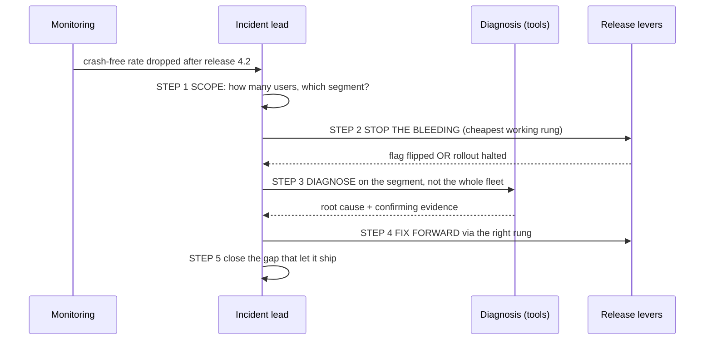

# Senior Mobile Engineering Judgment — Deriving the Reasoning, Not Just the Labels

### For both ladders: the senior mobile software engineer *and* the senior mobile SDET · Companion to [DOC_08 Patterns & Anti-Patterns](Flutter_Bootcamp/Reference/DOC_08_Patterns_and_AntiPatterns.md) (code-level judgment) and the web-side [Ch66 Senior SDET Decision-Making](../21_SDET_Playwright_Automation/08_SDET_to_SDE_Bridge/66_Senior_SDET_Decision_Making.md) (generic decision-making)

> **Reading contract**: every other file in this module teaches a mechanism — how the ANR watchdog fires, how an Instruments generation comparison finds a leak, how a hash decides which shard a test runs on. This file is different on purpose. It teaches *decisions*: which of two defensible options to choose when both have real costs, how to run an incident when the data is partial, what to block a code review on and what to let go. It follows the module's usual rule — derive, don't state — by building every decision out of material that already exists in this module, so the reasoning is checkable instead of asserted. By the end you should be able to take a decision nobody has written a rule for and say *why* you'd decide it that way, in a form someone else can argue with.
>
> **Scope note:** [Ch66](../21_SDET_Playwright_Automation/08_SDET_to_SDE_Bridge/66_Senior_SDET_Decision_Making.md) already derives the *generic* decision tools — risk quadrants, the automate-or-don't inequality, ADR and RFC structure. This file does not repeat them. It derives what is **specific to mobile**, and the specifics all trace back to one fact (Section 1) that web engineering mostly doesn't have.

---

## Table of Contents

1. [The Root Fact — Asymmetric Reversibility](#1-the-root-fact--asymmetric-reversibility)
2. [Native vs. Cross-Platform — Deriving the Decision From Its Consequences](#2-native-vs-cross-platform--deriving-the-decision-from-its-consequences)
3. [Automation ROI When Every Test Is Multiplied by a Matrix](#3-automation-roi-when-every-test-is-multiplied-by-a-matrix)
4. [Build, Wait, or Work Around — Two Worked Cases From the Mobilewright Track](#4-build-wait-or-work-around--two-worked-cases-from-the-mobilewright-track)
5. [Incident Command for a Crash Spike Across a Fragmented Matrix](#5-incident-command-for-a-crash-spike-across-a-fragmented-matrix)
6. [The Release Go/No-Go Call](#6-the-release-gono-go-call)
7. [Review Calibration — What to Block On](#7-review-calibration--what-to-block-on)
8. [Where DOC_08's Code-Level Judgment Ends and This File's Begins](#8-where-doc_08s-code-level-judgment-ends-and-this-files-begins)
9. [Practice Challenges](#9-practice-challenges)
10. [Reality Check](#10-reality-check)

---

## 1. The Root Fact — Asymmetric Reversibility

Almost every mobile-specific piece of senior judgment is a consequence of one asymmetry. Derive it by comparing what "undo a bad release" costs in two worlds:

```
WEB / SERVER-SIDE                          MOBILE (a shipped binary)
─────────────────────────────────          ──────────────────────────────────────────
bug ships                                  bug ships
  → revert deploy                            → the bug is now ON USERS' DEVICES
  → fixed for everyone in minutes            → you can stop MORE people getting it
                                               (halt a staged rollout) but you cannot
                                               remove it from people who already have it
                                             → a fix means: build → submit → store review
                                               (a gatekeeper you do not control) → users
                                               choose when, or whether, to update
                                             → the old version keeps running for as long
                                               as ANY user has it
```

(03_iOS's Reality Check already names the pieces: review that can reject, "the bug shipped to the App Store that takes a review cycle to fix," and "the reason feature flags matter more — to disable without resubmitting.") This chapter makes the consequence explicit as a **reversibility ladder** — every way you can respond to a bad release, ordered from fastest-and-cheapest to slowest-and-most-expensive:

| Rung | Mechanism | Reversal speed | Only exists if you built it beforehand? |
|---|---|---|---|
| 1 | Server-side config / feature flag flip | seconds to minutes | **Yes** — the flag must already be in the shipped binary |
| 2 | Halt a staged rollout | fast, but only stops *new* exposure | Only if you used a staged rollout in the first place |
| 3 | Server-side mitigation (change an API response so the buggy client path isn't hit) | minutes to hours | Depends on the bug and your API's flexibility |
| 4 | Hotfix build through store review | bounded by a review process you don't control | No — but slowest, and users still must update |
| 5 | Wait for natural update adoption | days to weeks, never complete | n/a — the fallback of last resort |

Read the right-hand column twice. **Rungs 1 and 2 are the fast ones, and both must be built before the incident.** A flag nobody shipped can't be flipped; a release that went to 100% on day one can't be halted at 5%. That single observation produces the decision rule everything else in this file leans on:

> **Verification effort should scale with how far down the ladder your *fastest available rung* sits.**
> If a change is behind a flag (rung 1 available), you can verify less up front, because being wrong is cheap to undo. If a change is irreversible short of a hotfix (native crash on launch, a data migration, a payment path with no flag), verify it as hard as you'd verify anything — because rung 4 is your only undo.

Why this beats the generic "test more, ship safer" instinct: it tells you *where* extra testing pays. Most teams spread verification evenly across changes. The ladder says concentrate it on the changes with no cheap undo — and spend your *engineering* effort (not test effort) on converting irreversible changes into reversible ones (put it behind a flag; ship it staged). Both ladders use this: the SWE builds the flag and the staged-rollout hook, the SDET decides how much of the matrix a rung-4-only change must pass before it goes out.

**A data migration is the sharpest case**, because it's irreversible *even after* a rollout halt: users who already ran the new version have already had their local database migrated. This is exactly why [Week 18's fresh-install Bug Hunt and migration exercise](Flutter_Bootcamp/Phase_4_Firebase_and_Storage/Week_18b_Storage_Challenges.md) and [Room's migration section](03_Android/05_Room_Database_And_DataStore.md#8-database-migrations--the-critical-qa-scenario) matter more than they look: a migration bug has no rung 1–3 at all.

---

## 2. Native vs. Cross-Platform — Deriving the Decision From Its Consequences

"Native or Flutter?" is usually argued as a preference. Derive it instead by following each choice through to what it does to everything downstream — most of which this module already shows.

**Consequence 1 — what your test tooling can see.** [04_Flutter's own testing chapter](04_Flutter_Dev_And_Testing.md) states the mechanism: Flutter doesn't create native Android Views for its widgets; it draws everything into a single `SurfaceView` with its own renderer, so UIAutomator2 and XCUITest — which read the *native accessibility tree* — cannot find Flutter widgets. You need Flutter's own semantic tree, an Appium Flutter driver, or `integration_test`. The same question applies to *any* tool that reads the native tree — including Mobilewright, [whose locators are built on it](Mobilewright_TypeScript/Level_02_Cross_Platform_Locators.md); this module has not verified Mobilewright against Flutter apps, so treat "can the tool see Flutter's semantics?" as something to prove in a spike *before* the framework decision, not after. So the framework decision is *also* a test-tooling decision, and an SDET who isn't in the room when it's made inherits the consequences. (That's a concrete reason the SDET ladder includes "participates in architecture decisions early" — it isn't etiquette, it's the testability cost.)

**Consequence 2 — the performance ceiling and who can diagnose it.** [DOC_01's rendering pipeline](Flutter_Bootcamp/Reference/DOC_01_Rendering_Pipeline.md) shows Flutter owns its rendering stack end to end. That buys visual consistency across platforms and costs you the platform's own profilers' direct view into your widgets: the problems in [Android Ch10](03_Android/10_Performance_Memory_And_ANR_Profiling.md) and [the iOS companion](08_iOS_Performance_Memory_And_Instruments.md) still apply underneath, but diagnosing them now means knowing two layers (Flutter's and the platform's). Neither is "worse" — the question is whether your team can diagnose at both layers.

**Consequence 3 — the boundary tax.** Anything Flutter doesn't cover goes through a [platform channel](Flutter_Bootcamp/Reference/DOC_01_Rendering_Pipeline.md#the-platform-channel--calling-native-code) — native code you now write and maintain *twice*. One platform-specific feature is a rounding error; a product whose core value *is* deep platform integration pays this tax on every feature.

**Consequence 4 — the second-platform cost.** The real arithmetic: native means two codebases, two sets of expertise, and every feature built twice (plus every test suite twice — [09's matrix cost](09_Cross_Platform_Mobile_Testing_Infra_At_Scale.md#7-the-cost-model) doubles along a platform axis). Cross-platform means one codebase and one place a bug can live, at the price of Consequences 1–3.

Now turn the four consequences into questions you can answer *about your product*, instead of arguing preference:

| Question | If the answer is "yes" it pushes toward… | Why (which consequence) |
|---|---|---|
| Is deep platform integration the core of the product (camera pipeline, background processing, wearables, OS-level widgets)? | Native | 3 — boundary tax on every feature |
| Do you have, or can you hire, engineers for *both* native stacks? | Native becomes viable | 4 — otherwise you can't staff it |
| Is time-to-both-platforms the dominant constraint, with a small team? | Cross-platform | 4 |
| Does your test strategy depend on tools that read the native accessibility tree? | Native (or budget Flutter-specific tooling) | 1 |
| Is pixel-identical UI across platforms a product requirement? | Flutter | 2 (own renderer) |
| Is a large existing native codebase involved? | Incremental (add-to-app / native modules), not a rewrite | 4 plus the rewrite risk |

**The senior move is not choosing — it's naming which question *actually* decides it for this product and refusing to let the other five be argued as if they did.** Most framework debates are really one question wearing six costumes. (For a decision of this shape written up end to end as a proposal, see the [worked RFC example](career/RFC_TEMPLATE.md#filled-example--pilot-mobilewright-alongside-appium) — it is a *tooling* decision, not a native-vs-Flutter one; a worked native-vs-Flutter proposal has not been written yet. Here the goal is the derivation.)

---

## 3. Automation ROI When Every Test Is Multiplied by a Matrix

[Ch66 §2](../21_SDET_Playwright_Automation/08_SDET_to_SDE_Bridge/66_Senior_SDET_Decision_Making.md) gives the generic inequality: automate when `runs × manual_cost > build_cost + maintenance × periods`. Mobile changes **two terms** and adds **a third decision**, all derivable from [09's arithmetic](09_Cross_Platform_Mobile_Testing_Infra_At_Scale.md#1-why-at-scale-is-its-own-problem):

```
GENERIC (web):      cost of a test  =  build + maintenance

MOBILE:             cost of a test  =  build
                                      + maintenance × (config-specific breakage)
                                      + device_minutes × configs_it_runs_on × price
```

1. **Maintenance is no longer a single number.** A web test breaks when the UI changes. A mobile test additionally breaks when an OS version changes a permission dialog, when one OEM's skin renders differently, when a device's keyboard covers a field. The multiplier isn't "configs" — it's *config-specific failure surface*, which is why a test that touches permissions or the keyboard costs far more to maintain than one that checks a pure-UI label.
2. **The run cost is real money per execution**, per [09's cost model](09_Cross_Platform_Mobile_Testing_Infra_At_Scale.md#7-the-cost-model). Web CI minutes are close to free; device-minutes on a real-device farm are not.
3. **The new decision: *which tier* the test lives in**, not just whether it exists. A test isn't automate/don't-automate — it's one of: PR tier (cheap, 1–2 configs), nightly (core matrix), pre-release (real devices, widest). [09 §8](09_Cross_Platform_Mobile_Testing_Infra_At_Scale.md#8-the-tiered-pipeline--putting-it-together) gives the tiers; the judgment is assigning each test to the **cheapest tier that would still catch the bug it exists for**.

The assignment rule, derived: ask "what is the *narrowest* condition under which this test's bug appears?"

| The bug the test guards against appears… | So it belongs in… | Because |
|---|---|---|
| on every device (core logic, navigation) | PR tier, 1 config | Running it on 12 configs buys no extra detection — same bug everywhere |
| only on specific OS versions (a permission-API change) | Nightly, on the OS versions that differ | Detection needs the variation, but not every device |
| only on low-RAM hardware (the [Ch10](03_Android/10_Performance_Memory_And_ANR_Profiling.md#1-why-this-is-a-correctness-chapter-not-just-a-performance-one) / [Jetsam](08_iOS_Performance_Memory_And_Instruments.md#7-jetsam--when-the-os-kills-you-for-using-too-much-memory) class) | Pre-release, on the real low-RAM device | An emulator can't reproduce real memory pressure at all |
| only with a real sensor / hardware (camera, biometrics) | Pre-release, real device | Nothing cheaper can exercise it |

**This is the mobile senior-vs-mid difference in one sentence:** the mid-level question is "should this be automated?"; the senior question is "what is the cheapest place this can run and still fail when the bug is present?" A test placed too high wastes device-minutes; a test placed too low gives false confidence — it passes on the emulator where the bug cannot appear.

---

## 4. Build, Wait, or Work Around — Two Worked Cases From the Mobilewright Track

The Mobilewright track deliberately taught real framework gaps. Each is a small, real instance of a decision seniors make constantly: a tool lacks something. Three options exist every time — **build it yourself, work around it cheaply, or wait/switch** — and both cases below are derived from what the track already established.

### Case A — The Fixture Gap ([Level 8](Mobilewright_TypeScript/Level_08_The_Fixture_Gap.md))

**The situation:** Mobilewright has no `test.extend()`-equivalent; 30 test files need a "logged in" starting state.

Run the three options through the ladder-style questions (cost now, cost of being wrong, ease of reversal):

| Option | Cost now | If the tool adds fixtures later… | Verdict |
|---|---|---|---|
| Build a fixture-like framework yourself | High | Throw away or fight it | Overbuilt for the need |
| Plain helper + `beforeEach` ([the track's solution](Mobilewright_TypeScript/Level_08_The_Fixture_Gap.md#solution--the-honest-workaround-a-plain-helper-not-a-fake-fixture)) | Low — ~10 lines | Swap helper calls for the real fixture; mechanical | **Chosen** |
| Switch tools | Very high | n/a | Unjustified by one missing feature |

**The judgment is the exit ramp, not the choice.** The helper is correct *because it is reversible*: when fixtures arrive, replacing `loginAsTestUser(screen)` with a real fixture is a search-and-replace. Contrast the "build a framework" option, which is the only one that creates something you'd have to *un*build. This is [Ch66 §3's ADR habit](../21_SDET_Playwright_Automation/08_SDET_to_SDE_Bridge/66_Senior_SDET_Decision_Making.md) (give the reader an exit ramp) applied to a two-line decision — and the same reversibility lens as Section 1, one level down.

### Case B — The Missing Visual-Regression Assertion ([Level 9](Mobilewright_TypeScript/Level_09_Screenshots_and_Missing_Visual_Regression.md))

**The situation:** `screen.screenshot()` captures; nothing compares. Do you build a pixel-diff pipeline?

Here the arithmetic is *less* favorable than Case A, and the track's own Concept section gives the reason: native screens carry meaningless pixel noise (status-bar clock, battery icon), so a naive diff produces false failures, which means a real pipeline also needs **masking, baseline management, and threshold tuning** — recurring maintenance, not a one-time build.

```
Build the pipeline:    build (days) + maintenance (every UI change, every OS update
                       that shifts a font/status bar) — and a noisy pipeline gets
                       ignored, which is worse than none
Failure-screenshot     build (an hour) + near-zero maintenance, gives a human the
artifact (the track's  evidence needed to debug a failure, catches nothing automatically
own recommendation):
```

**The senior answer is conditional, and the condition is derivable:** build the pipeline only if a *specific, recurring, costly class of visual regression* has actually escaped to users before — i.e., you can point to the loss it would have prevented. Without that evidence, the artifact approach buys most of the debugging value for a sliver of the cost. Note what makes this *not* the same answer as Case A: the maintenance term dominates here, and it's unbounded. Same method, different inputs, different verdict — which is exactly what distinguishes judgment from a rule.

---

## 5. Incident Command for a Crash Spike Across a Fragmented Matrix

An incident is the moment [Section 1's ladder](#1-the-root-fact--asymmetric-reversibility) stops being theory. Derive a procedure from what this module's tools can actually tell you, in the order the information becomes available.



**Step 1 — Scope before you diagnose.** The most valuable first question isn't "what's the stack trace," it's *which axis does the crash correlate with?* Segment the crashes by the same dimensions [09's matrix](09_Cross_Platform_Mobile_Testing_Infra_At_Scale.md#2-choosing-the-device-matrix-from-data) is built from — OS version, device model/RAM tier, app version, OEM skin — and see which segmentation collapses the crash into one cell. "3% of all users" is unactionable; "100% of Android 13 devices under 3 GB RAM, none elsewhere" is nearly a diagnosis already (memory pressure → [Ch10](03_Android/10_Performance_Memory_And_ANR_Profiling.md)). This is why a fragmented matrix is *also* a debugging asset: it gives you the axes to cut along.

**Step 2 — Stop the bleeding with the cheapest rung that works.** Walk the ladder from the top. Is it behind a flag? Flip it. Otherwise, halt the rollout so exposure stops growing. Only if neither exists do you start the hotfix clock. **Do this before diagnosis is complete** — the goal of the first minutes is limiting damage, not understanding it. (If you reach for rung 4 first, the postmortem question is "why wasn't there a rung 1 or 2?")

**Step 3 — Diagnose on the segment, with the right tool for the symptom.** Reuse the module's own triage instead of inventing one — [DOC_09's triage table](Flutter_Bootcamp/Reference/DOC_09_Mobile_Debugging_Toolkit.md#the-triage-table--symptom-to-tool) maps symptom to tool, and the platform chapters supply the specifics:

| What the segment's crash looks like | First place to look |
|---|---|
| Android: UI freezes, then the system kills/offers to kill the app | an ANR → [Ch10 §2, §7](03_Android/10_Performance_Memory_And_ANR_Profiling.md#2-anr-fundamentals--the-watchdog-and-the-main-thread) |
| iOS: process vanishes during launch/resume, code `0x8badf00d`, no stack in your code | a watchdog termination → [iOS §2](08_iOS_Performance_Memory_And_Instruments.md#2-ioss-anr-equivalent--watchdog-terminations-and-hang-rate) (check launch-time metrics, not the stack) |
| Memory climbs, then the OS kills the app, mostly on low-RAM devices | a leak or Jetsam → [Ch10 §8](03_Android/10_Performance_Memory_And_ANR_Profiling.md#8-diagnosing-a-real-leak-from-a-heap-dump) / [iOS §9](08_iOS_Performance_Memory_And_Instruments.md#9-diagnosing-a-real-leak-from-the-memory-graph-debugger) |
| One test device fails deterministically while others pass | a device-specific bug, not flakiness → [09 §6](09_Cross_Platform_Mobile_Testing_Infra_At_Scale.md#6-flakiness-across-a-fragmented-matrix) |

**Step 4 — Fix forward via the right rung.** A flagged fix ships as a flag change; a binary fix goes through review and should itself go out *staged*, with halt criteria decided before it ships — don't repeat the original mistake of an all-at-once release in the rush to repair it.

**Step 5 — Close the gap, and be specific about *which* gap.** A blameless postmortem answers, concretely: which tier of [09's pipeline](09_Cross_Platform_Mobile_Testing_Infra_At_Scale.md#8-the-tiered-pipeline--putting-it-together) *should* have caught this, and why didn't it? Three honest answers exist: the matrix didn't contain the failing config (fix: add the *risk* config); the config was in the matrix but the test didn't exercise the path (fix: add the test, in the cheapest tier that would fail — [Section 3](#3-automation-roi-when-every-test-is-multiplied-by-a-matrix)); or the test failed and was retried green ([09 §6](09_Cross_Platform_Mobile_Testing_Infra_At_Scale.md#6-flakiness-across-a-fragmented-matrix)'s trap). Each has a different fix, which is why "we need more testing" is never an acceptable postmortem finding.

**The judgment call hidden inside Step 2:** halt or flip *before* you're sure of the cause costs something (a paused rollout delays a good feature to everyone else). The senior calibration: halting is cheap and reversible (resume it), while continuing to expose users to a crash is not — so when the signal is real but the cause is unknown, **bias toward the reversible action.** That's Section 1 again, applied under time pressure.

---

## 6. The Release Go/No-Go Call

A go/no-go is a decision under uncertainty with an irreversible-ish downside — precisely where a structure beats intuition. Derive the inputs from this module instead of from a checklist you'd have to memorize:

1. **Evidence quality, per config.** From [09 §6](09_Cross_Platform_Mobile_Testing_Infra_At_Scale.md#6-flakiness-across-a-fragmented-matrix): is there any (test, device) pair that failed deterministically? That's a no-go signal unless explicitly accepted. Any pair that needed retries *only on one device*? Investigate before shipping, don't average it away.
2. **Reversibility of what's shipping.** [Section 1](#1-the-root-fact--asymmetric-reversibility): which rung is your fastest undo for *this specific release's riskiest change*? A release whose riskiest change is flagged is a different risk than one containing an unflagged migration.
3. **Blast radius if wrong** — the generic axis from [Ch66 §1](../21_SDET_Playwright_Automation/08_SDET_to_SDE_Bridge/66_Senior_SDET_Decision_Making.md), with the mobile twist that it's multiplied by *how many users update quickly* (a payment path in a frequently-updated app reaches everyone fast).

**The structural insight — a staged rollout converts "go/no-go" from a bet into an experiment.** Instead of one decision at 100%, you decide *go to 5%, with these pre-agreed halt criteria, then decide again*. The decision you actually make is smaller and its downside is capped. The skill is writing the halt criteria **before** the rollout — a specific crash-free-rate floor, a specific ANR/hang threshold — because thresholds invented mid-incident drift toward whatever justifies continuing. (The [release playbook](career/RELEASE_AND_ROLLOUT_PLAYBOOK.md) works this out with the store mechanics verified against official docs: [§4](career/RELEASE_AND_ROLLOUT_PLAYBOOK.md#4-how-long-must-a-stage-run-deriving-soak-time) derives how long a stage must run before a halt rule can mean anything, and [§6](career/RELEASE_AND_ROLLOUT_PLAYBOOK.md#6-the-rollout-plan-and-halt-criteria-template) is the halt-criteria template.)

For the SDET specifically, the no-go call is the part of the role that's easy to avoid: it's uncomfortable, it delays a release, and "tests passed" is always available as cover. The method above is the defense — a no-go justified by *named evidence and a named irreversible risk* is a defensible position; a no-go justified by unease is not, and a go justified by "the dashboard was green" (when the dashboard hid per-device retries) is the failure the whole module has been building tools against.

---

## 7. Review Calibration — What to Block On

A reviewer who blocks on everything trains authors to stop listening; one who blocks on nothing ships the bug. Derive a calibration from one question: **is the failure mode invisible in development but guaranteed at scale?** If yes, it's a block; if it's merely taste, it's a comment.

| Finding in the PR | Visible in dev? | Fails at scale? | Call |
|---|---|---|---|
| Disk/network call on the main thread | No — dev device and network are fast | **Yes** — an ANR on a slow device ([Ch10 §2–3](03_Android/10_Performance_Memory_And_ANR_Profiling.md#3-strictmode--catching-violations-before-users-do)) | **Block** |
| Closure captures `self` strongly, stored on `self` | No — works fine | **Yes** — leaks every screen ([iOS §6](08_iOS_Performance_Memory_And_Instruments.md#6-reading-a-retain-cycle-at-the-tooling-level)) | **Block** |
| Static field holding an Activity/Context | No | **Yes** — leak ([Ch10 §4](03_Android/10_Performance_Memory_And_ANR_Profiling.md#4-memory-fundamentals--heap-gc-and-what-leak-actually-means)) | **Block** |
| Missing `Key` in a dynamic list | Sometimes | Yes under reordering ([DOC_08](Flutter_Bootcamp/Reference/DOC_08_Patterns_and_AntiPatterns.md)) | Block if the list reorders; else comment |
| A schema migration with no test | No | **Yes, irreversibly** ([Section 1](#1-the-root-fact--asymmetric-reversibility)) | **Block** |
| Naming, formatting, minor structure | Yes | No | Comment, never block |

Two properties make this table work. First, **it explains itself** — an author who asks "why is this blocking?" gets an answer ("this passes on your fast device and ANRs on a budget one") instead of "because I said so," which is also what separates mentoring from gatekeeping. Second, **it's the same lens as Section 1**: the findings that block are the ones with no cheap undo after shipping.

**Mentoring is the same skill pointed at a person.** When a junior's PR has a retain cycle, the senior move isn't fixing it; it's asking them to take a Memory Graph snapshot after closing the screen ten times and describe what they see. They learn the *diagnostic method*, which transfers to every future leak, instead of the one fix, which doesn't. That's this module's "derive, don't state" rule applied to people.

---

## 8. Where DOC_08's Code-Level Judgment Ends and This File's Begins

[DOC_08](Flutter_Bootcamp/Reference/DOC_08_Patterns_and_AntiPatterns.md) teaches recognizing a *shape in code*. Each shape has a larger-scale cousin — the same instinct, one level up, applied to systems and teams instead of functions:

| DOC_08 code-level shape | The same shape at strategic scale | Where it's derived |
|---|---|---|
| Optimistic UI with no rollback path | A release with no rung 1–3 undo — optimism without a rollback | [Section 1](#1-the-root-fact--asymmetric-reversibility) |
| Layer violation in Clean Architecture | A framework choice that leaks into the test strategy (Flutter → test tooling) | [Section 2](#2-native-vs-cross-platform--deriving-the-decision-from-its-consequences) |
| Resources created inside `build()` | Infrastructure created per-run that should be provisioned once (a device matrix rebuilt every PR) | [Section 3](#3-automation-roi-when-every-test-is-multiplied-by-a-matrix), [09 §8](09_Cross_Platform_Mobile_Testing_Infra_At_Scale.md#8-the-tiered-pipeline--putting-it-together) |
| Silent `Future.wait` failure coupling | A retry that turns one device's real failure into an overall green | [09 §6](09_Cross_Platform_Mobile_Testing_Infra_At_Scale.md#6-flakiness-across-a-fragmented-matrix) |
| God Widget | A "god pipeline" or "god test suite" nobody can reason about or shard | [09 §4](09_Cross_Platform_Mobile_Testing_Infra_At_Scale.md#4-sharding-mechanics-platform-by-platform) |

The progression a senior engineer makes is exactly this: stop seeing the anti-pattern only in a widget and start seeing it in the release process, the pipeline, and the plan.

### The Same Reasoning, Written Down as a Proposal

Judgment that lives only in your head can't be reviewed, challenged or inherited. The [worked RFC example](career/RFC_TEMPLATE.md#filled-example--pilot-mobilewright-alongside-appium) in `career/` applies this file's reasoning to a real-shaped decision — whether to try a second automation framework — and is worth reading as a demonstration of the habits above rather than as a tool recommendation:

- **It starts from a cause breakdown** (which share of the pain each cause accounts for), so the tool's addressable share is an honest upper bound — the same "scope along the axes before diagnosing" move as [Section 5](#5-incident-command-for-a-crash-spike-across-a-fragmented-matrix).
- **It treats "fix what we have" as the control group,** not a strawman — the build/wait/work-around reasoning of [Section 4](#4-build-wait-or-work-around--two-worked-cases-from-the-mobilewright-track).
- **It is a bounded, removable pilot with written stop conditions,** the reversibility lens of [Section 1](#1-the-root-fact--asymmetric-reversibility) applied to a tooling decision.
- **It places the new tests in the cheapest tier that still fails when the bug is present,** per [Section 3](#3-automation-roi-when-every-test-is-multiplied-by-a-matrix).

The structural reasoning for why each RFC section exists is derived in the web-side [Ch66 §4](../21_SDET_Playwright_Automation/08_SDET_to_SDE_Bridge/66_Senior_SDET_Decision_Making.md); the template adds mobile's two extra sections (reversibility & exit criteria, test-strategy impact).

---

## 9. Practice Challenges

**Challenge 1 — Build your ladder.** For an app you work on (or the Week 27 ChatApp), fill in [Section 1's table](#1-the-root-fact--asymmetric-reversibility) honestly: which rungs *actually exist today*? Which of your riskiest recent changes had no rung 1–3 undo? What would it take to give them one?

**Challenge 2 — Find the deciding question.** Take a framework debate you've witnessed (native vs. Flutter, or Appium vs. Mobilewright). Using [Section 2's table](#2-native-vs-cross-platform--deriving-the-decision-from-its-consequences) as a model, identify the *one* question that actually decided it, and which of the other questions were being argued as if they mattered.

**Challenge 3 — Re-tier your suite.** Take 10 real tests and apply [Section 3's assignment rule](#3-automation-roi-when-every-test-is-multiplied-by-a-matrix): for each, state the narrowest condition under which its bug appears, then the cheapest tier that would fail. How many were running in a tier more expensive (or cheaper — and therefore blind) than needed?

**Challenge 4 — Run a tabletop incident.** *Scenario (hypothetical):* after release 4.2, crash-free sessions drop from 99.6% to 98.1%, and the reports are all hang-style freezes. Segment analysis shows it's concentrated on Android 14, devices with 3 GB RAM or less, only in the checkout flow. There is no flag on the checkout change. Walk Steps 1–5: what rung do you reach for, what do you diagnose with, and what do you ask in the postmortem?

<details><summary>One reasonable walkthrough</summary>

**Step 1 (scope):** the segmentation already isolates the cell — Android 14 × low-RAM × checkout — which points at memory pressure or main-thread work in that one flow rather than a general regression. **Step 2 (stop the bleeding):** no flag (rung 1 gone), so halt the staged rollout (rung 2) immediately, before diagnosis completes — resuming is free, continued exposure isn't. Check whether a server-side mitigation (rung 3) can route checkout around the suspect client path. **Step 3 (diagnose):** the symptom is freezing, so start with the ANR path in [Ch10](03_Android/10_Performance_Memory_And_ANR_Profiling.md#7-diagnosing-a-real-anr-from-a-bug-report): reproduce on a low-RAM device with the System Trace, look for CPU-bound or blocked main-thread work scaling with something in checkout (cart size, image decoding). Low-RAM specificity also warrants a Memory Profiler pass for pressure-induced GC pauses. **Step 4 (fix forward):** a binary fix through review, shipped *staged* with halt criteria written in advance (e.g. a crash-free floor and a hang-rate ceiling for that segment). **Step 5 (postmortem):** the checkout path presumably had tests — the useful question is *which of the three gaps from Step 5 applies*. If the matrix had no low-RAM Android 14 device, add one as a **risk config** (not a share-ranked one — [09 §2](09_Cross_Platform_Mobile_Testing_Infra_At_Scale.md#2-choosing-the-device-matrix-from-data)); if it did and the test passed, the test doesn't exercise the heavy path; if it failed and was retried green, the gate is reading final status instead of per-device attempts. Also: why did a checkout change ship without a flag — is "payment/checkout paths are flagged" a new standing rule?

🔴 **Explanation:** notice the walkthrough never says "test more." Every finding maps to a specific, different fix, and the first two actions (halt, scope) happen before anyone knows the root cause — the reversible-first bias from Section 5.

</details>

---

## 10. Reality Check

**"Seniority in mobile is knowing more APIs"** — API breadth is the *entry* requirement; what moves someone up is judgment about reversibility ([Section 1](#1-the-root-fact--asymmetric-reversibility)): knowing that on mobile the fastest undo must be built *before* the incident, that verification effort should scale inversely with how cheap the undo is, and that the highest-leverage engineering work is often converting irreversible changes into flagged, staged ones. "More APIs" doesn't change what you do on the day a binary with no flag starts crashing.

**"Native vs. cross-platform is a preference or a team-culture question"** — It's a chain of consequences you can follow ([Section 2](#2-native-vs-cross-platform--deriving-the-decision-from-its-consequences)): the choice decides what your test tooling can see (Flutter's own-renderer SurfaceView hides widgets from the native accessibility tree), who can diagnose performance at which layer, how much native code sits behind platform channels, and whether you pay the two-codebase cost. Treating it as culture hides that the testability cost lands on whoever isn't in the room.

**"Automate everything, on every device, on every PR"** — That multiplies cost without multiplying detection ([Section 3](#3-automation-roi-when-every-test-is-multiplied-by-a-matrix)): a bug that appears on every device is caught by one config and gets no extra detection from twelve, while a bug that only appears on low-RAM hardware cannot be caught by an emulator at all. The senior question is the cheapest tier at which the test still *fails when the bug is present* — placed too high it wastes device-minutes; placed too low it passes where the bug can't appear and gives false confidence.

**"When something's missing from the tool, build it"** — Whether to build depends on reversibility and on which cost dominates ([Section 4](#4-build-wait-or-work-around--two-worked-cases-from-the-mobilewright-track)): the plain helper for the fixture gap wins because swapping it out later is mechanical, while a visual-regression pipeline loses until a real escaped regression justifies an unbounded maintenance term. Same method, opposite verdicts — which is the difference between judgment and a rule.

**"In an incident, find the root cause first"** — Scope and stop the bleeding first ([Section 5](#5-incident-command-for-a-crash-spike-across-a-fragmented-matrix)): segmentation along the device-matrix axes often *is* most of the diagnosis, and halting a rollout is cheap and reversible while continued exposure is not. Under uncertainty, bias toward the reversible action and diagnose on the affected segment, not the whole fleet.

**"A good review catches everything"** — A good review is *calibrated* ([Section 7](#7-review-calibration--what-to-block-on)): block on what is invisible in development and guaranteed at scale (main-thread I/O, retain cycles, unmigrated schema changes), comment on the rest. Blocking on taste teaches authors to ignore you; the explanation attached to each block — "this passes on your device and ANRs on a budget one" — is what makes it mentoring instead of gatekeeping.
