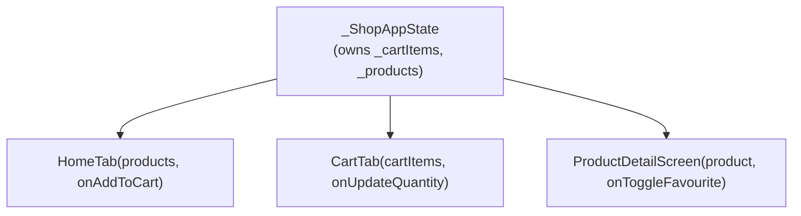
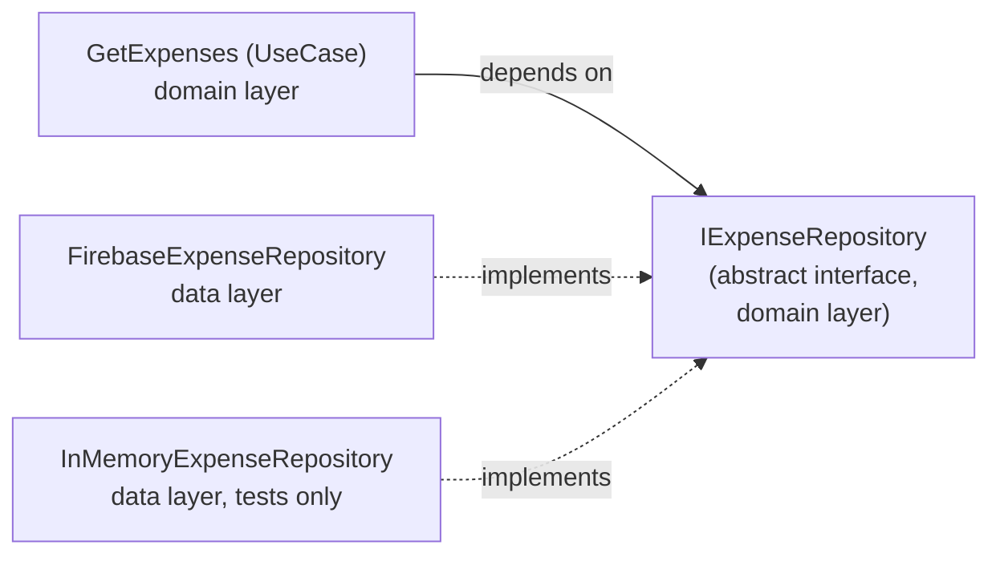

# Patterns & Anti-Patterns

### The recurring shapes — good and bad — that show up across every week of this bootcamp

---

## Why This Doc Is Different From the Other Seven

Every other Reference doc explains one *mechanism* — how rendering works, what a `BuildContext` is, how ADB connects a device. This one is about **judgment**: recognizing a shape of code as good or bad *before* it becomes a bug, because you've seen the shape before. Most of the anti-patterns below aren't hypothetical — they're the exact bugs this bootcamp's challenge files spent 27 weeks reproducing on purpose. This doc is where those individual lessons get named, collected, and cross-referenced as a single vocabulary.

---

## Part 1 — Patterns Worth Reaching For

### Composition Over Inheritance

Flutter doesn't really support widget inheritance the way OOP-heavy languages encourage — and that's deliberate. The idiomatic way to add behavior to a widget is to **wrap** it, not subclass it.

```dart
// Anti-pattern instinct: ScalableIcon extends Icon, ScalableContainer extends Container...
// Idiomatic: one wrapper, applied to anything
Widget tapScale({required Widget child, required VoidCallback onTap}) {
  return _TapScale(onTap: onTap, child: child);
}
```

This is [Week 10's `tapScale` Boss Battle](../Phase_2_Core_UI/Week_10b_Gesture_Challenges.md#-boss-battle--composable-widget-wrapping-effects) — write the effect once as something that wraps an arbitrary `child`, instead of writing a parallel subclass hierarchy for every widget you want the effect applied to.

### Single Source of Truth, Derived On Demand

Don't cache a computed value in a field and hope you remember to update it everywhere the inputs change. Compute it fresh, every time, from the one place the real data lives.

```dart
// The pattern, seen three separate times across this bootcamp:
List<Skill> get _filteredSkills => _selectedCategory == null
    ? widget.skills
    : widget.skills.where((s) => s.category == _selectedCategory).toList();
```

This exact shape — a getter, not a cached field reassigned in `setState` — appears in [Week 6's Profile App](../Phase_1_Dart_and_Foundations/Week_06_Project_ProfileApp.md) (`_filteredSkills`), [its own Boss Battle extension](../Phase_1_Dart_and_Foundations/Week_06b_ProfileApp_Challenges.md#-boss-battle--a-sortable-work-tab) (`_sortedProjects`), and the Shopping App's `_cartTotal`/`_cartCount` getters. A getter can never go stale, because there's nothing cached to go stale — it's recomputed from the source every single access.

### Lifting State Up

State lives in the nearest common ancestor of everything that needs to read *or* write it — not in whichever widget happened to need it first.



The [Shopping App's `_ShopAppState`](../Phase_2_Core_UI/Week_11_Project_ShoppingApp.md) is the textbook version of this — every screen receives only the slice of data and the specific callbacks it needs, and every mutation flows back up to the one place `_cartItems` actually lives. [Week 6's favourite-toggle Bug Hunt](../Phase_1_Dart_and_Foundations/Week_06b_ProfileApp_Challenges.md#-bug-hunt--the-favourite-star-that-un-favourites-itself) is what happens when a screen *doesn't* follow this and mutates its own local copy instead.

### `child:` vs `builder:` — Choosing Deliberately

```dart
// child: — caller builds it ONCE, reused across your widget's rebuilds (cheaper)
// builder: — called fresh each time, sees anything YOUR widget injected into the tree
```

Covered in full in [Week 10's `child` vs `builder` challenge](../Phase_2_Core_UI/Week_10b_Gesture_Challenges.md#-code-review--child-vs-builder-an-api-design-decision-not-a-style-choice) — the rule that decides which one a widget's API should offer: does the content need to see something the wrapping widget itself introduces into the tree (a new `Theme`, a new `MediaQuery`)? If yes, `builder:`. If the content is genuinely independent, `child:` is cheaper and simpler.

### Sealed Classes for Exhaustive State Modeling

```dart
sealed class OrderState {}
class OrderLoading extends OrderState {}
class OrderLoaded extends OrderState { final Order order; OrderLoaded(this.order); }
class OrderFailed extends OrderState { final String message; OrderFailed(this.message); }
```

A `switch` over a `sealed class` with no `default` branch is a **compile error** if a case is missing — covered in depth in [Week 1's sealed-class challenge](../Phase_1_Dart_and_Foundations/Week_01b_Dart_Coding_Challenges.md#t3-3-medium--sealed-classes-let-the-compiler-catch-missing-cases) and used throughout every BLoC state hierarchy in [Week 20](../Phase_5_Advanced_Patterns/Week_20_BLoC_Pattern.md) onward. This is the pattern that turns "forgot to handle the error state" from a runtime surprise into something the compiler catches before you ship.

### Dependency Inversion

High-level code depends on an **interface**; low-level code implements it. The direction of the dependency arrow — not just "using an interface somewhere" — is the actual pattern.



Proven concretely — not just asserted — in [Week 21's Boss Battle](../Phase_5_Advanced_Patterns/Week_21b_Clean_Architecture_Challenges.md#-boss-battle--swap-the-backend-without-touching-the-usecase), where `GetExpenses` never changes while the concrete repository swaps between a real Firebase-backed implementation and an in-memory fake used purely for tests.

---

## Part 2 — Anti-Patterns This Bootcamp Caught, By Name

Every one of these has a real, reproduced example somewhere in this bootcamp — not a hypothetical. Cross-references point at the exact Bug Hunt.

### The God Widget

**Shape:** one `build()` method, hundreds of lines, doing layout, business logic, and API calls all in the same place.

**Why it's bad:** every unrelated `setState` call rebuilds *everything*, because there's no smaller widget boundary for Flutter's reconciliation to stop at. [Week 2's `BadCounter` Bug Hunt](../Phase_1_Dart_and_Foundations/Week_02b_Widget_Rebuild_Challenges.md#w2-1-easy--one-build-method-vs-three) proves this directly with a `debugPrint` count — an "expensive" header re-executes on every counter tap purely because it's a method call inside one giant `build()`, not its own widget.

**Fix:** extract into smaller `StatelessWidget`/`const` pieces, each with its own reconciliation boundary.

### Resources Created Inside `build()`

**Shape:** `AnimationController(...)`, `Timer(...)`, `.snapshots().listen(...)`, or any other resource-holding object constructed directly inside `build()` instead of `initState`/a field initializer.

**Why it's bad:** `build()` can run dozens of times a second for reasons that have nothing to do with the resource itself — every rebuild silently creates a *new* resource while the old one, still running, is never disposed. This exact bug was reproduced **three separate times** across this bootcamp, in three different resource types, because it's genuinely one of the most common real Flutter mistakes:

- [Week 9 — `AnimationController` built in `build()`](../Phase_2_Core_UI/Week_09b_Animation_Challenges.md#-bug-hunt--the-animation-that-runs-once-and-never-again): a new, running, never-disposed controller leaks on every rebuild
- [Week 16 — Firestore `.listen()` called in `build()`](../Phase_4_Firebase_and_Storage/Week_16b_Firestore_Challenges.md#-bug-hunt--the-listener-that-multiplies): duplicate subscriptions, each firing `setState` redundantly
- [Week 27 — a `Stream` obtained fresh in `build()`](../Phase_6_Quality_and_Deployment/Week_27b_ChatApp_Challenges.md#-bug-hunt--the-typing-indicator-that-resubscribes-constantly): `StreamBuilder` correctly tears down and resubscribes on every rebuild — no leak this time, but real wasted work and a visible glitch

**Fix, every time, identically:** construct once, in `initState` or a `late final` field initializer; release in `dispose()`.

### Missing Keys in Dynamic Lists

**Shape:** rendering a `List` of `StatefulWidget`s via `.map()` with no `key:`, where the underlying data can be reordered, filtered, or have items removed.

**Why it's bad:** Flutter matches elements by type-and-position, not by what the data actually is — reorder the data and a `StatefulWidget`'s internal state (a checked box, an expanded panel) stays glued to the *position*, following whatever new item lands there. Covered directly in [Week 2's reordering Bug Hunt](../Phase_1_Dart_and_Foundations/Week_02b_Widget_Rebuild_Challenges.md#w2-2-medium--keys-and-the-reordering-bug) and its `ObjectKey`-specific variant in [DOC_05](DOC_05b_InheritedWidget_Keys_Challenges.md#-bug-hunt--the-objectkey-that-doesnt-actually-key-anything), where even using *a* key doesn't help if the object it wraps is reconstructed fresh every build.

**Fix:** `ValueKey(item.id)` on a stable identifier — never `ValueKey(index)`.

### Layer Violations in Clean Architecture

**Shape:** a `UseCase` (domain layer) importing Firestore/Dio/any concrete data-layer package directly, bypassing the repository interface that exists specifically to prevent this.

**Why it's bad:** nothing crashes. That's what makes it dangerous — the code compiles and runs fine, and the cost only shows up later, as "why can't I unit-test this without a real Firebase project." Reproduced directly in [Week 21's layer-violation Bug Hunt](../Phase_5_Advanced_Patterns/Week_21b_Clean_Architecture_Challenges.md#-bug-hunt--spot-the-layer-violation-nothing-crashes-here).

**Fix:** the domain layer depends only on abstract interfaces it defines itself; concrete implementations live in the data layer and are wired in via dependency injection.

### Silent `Future.wait` Failure Coupling

**Shape:** several genuinely independent async calls wrapped in one `Future.wait([...])` inside a single `try/catch`.

**Why it's bad:** `Future.wait` fails on the **first** error and gives up on the rest — three independent pieces of data become "all or nothing," so one optional call failing (a spending-trend calculation with too little data for a new user) blanks out two calls that would have succeeded perfectly fine. Reproduced in [Week 23's dashboard Bug Hunt](../Phase_5_Advanced_Patterns/Week_23b_ExpenseTracker_Challenges.md#-bug-hunt--one-failed-call-blanks-the-entire-dashboard).

**Fix:** handle genuinely independent calls independently — separate `try/catch` per call, or `.catchError()` per future, so one optional piece failing doesn't take down the rest.

### The Async Gap / Stale `BuildContext`

**Shape:** capturing `context` before an `await`, then using it afterward with no liveness check.

**Why it's bad:** the widget that `context` refers to may have been removed from the tree during the `await` — a slow network call is exactly the window where a user has time to navigate away. Covered in [DOC_04's context-across-async-gap Bug Hunt](DOC_04b_BuildContext_Challenges.md#-bug-hunt--the-snackbar-that-sometimes-crashes-the-app) and, in `State`-object form, [Week 3's `mounted` crash](../Phase_1_Dart_and_Foundations/Week_03b_Lifecycle_Challenges.md#w3-2-medium--reproduce-the-mounted-crash-then-fix-it).

**Fix:** `if (!context.mounted) return;` (or `if (!mounted) return;` inside a `State`) immediately after every `await`, before touching `context` again.

### Optimistic UI With No Rollback Path

**Shape:** updating local/UI state immediately for responsiveness, but with no handling for what happens if the underlying write actually fails.

**Why it's bad:** the UI silently lies to the user — it shows success for an action that never actually completed, and in the worst version (a chat message stuck showing "sending" forever), the user genuinely cannot tell whether it worked. Covered in [Week 27's Code Review](../Phase_6_Quality_and_Deployment/Week_27b_ChatApp_Challenges.md#-code-review--what-happens-when-optimistic-send-actually-fails) and solved correctly in [Week 16's optimistic-update Boss Battle](../Phase_4_Firebase_and_Storage/Week_16b_Firestore_Challenges.md#-boss-battle--optimistic-update-with-rollback).

**Fix:** capture the pre-optimistic value before mutating, and explicitly roll back (or mark the item as failed with a retry affordance) in the failure branch — never just the happy path.

---

## Quick Reference — Spotting These in a Code Review

| If you see... | Ask... |
|---|---|
| A `build()` method over ~80 lines | Can this be split into smaller widgets with their own reconciliation boundaries? |
| `AnimationController(`, `Timer(`, or `.listen(` anywhere inside `build()` | Should this be in `initState`/a field initializer instead? |
| `.map()` producing a list of `StatefulWidget`s | Does the underlying list ever reorder/filter? If yes, is there a `key:`? |
| A domain-layer class importing a concrete package (`firebase_*`, `dio`, `sqflite`) | Should this go through an interface instead? |
| `Future.wait([...])` wrapping calls that don't actually depend on each other | Should one failing really block all of them? |
| `context` used after an `await` with no guard | Is there a `mounted`/`context.mounted` check right before it? |
| A `setState`/local mutation with no corresponding failure-path handling | What does the UI show if this eventually fails? |

---

**→ Related files:**
- [DOC_08b_Patterns_and_AntiPatterns_Challenges.md](DOC_08b_Patterns_and_AntiPatterns_Challenges.md) — want to actually get fluent, not just informed? Challenges for this doc
- [DOC_09_Mobile_Debugging_Toolkit.md](DOC_09_Mobile_Debugging_Toolkit.md) — once you've recognized *which* anti-pattern is present, this is how you'd actually confirm it in a real debugging session
- [00_CHALLENGE_TYPES.md](../00_CHALLENGE_TYPES.md) — the challenge-format roster referenced throughout this bootcamp
- [Phase_5_Advanced_Patterns/Week_21_Clean_Architecture.md](../Phase_5_Advanced_Patterns/Week_21_Clean_Architecture.md) — the full dependency-inversion mechanics behind Part 1's DI pattern
