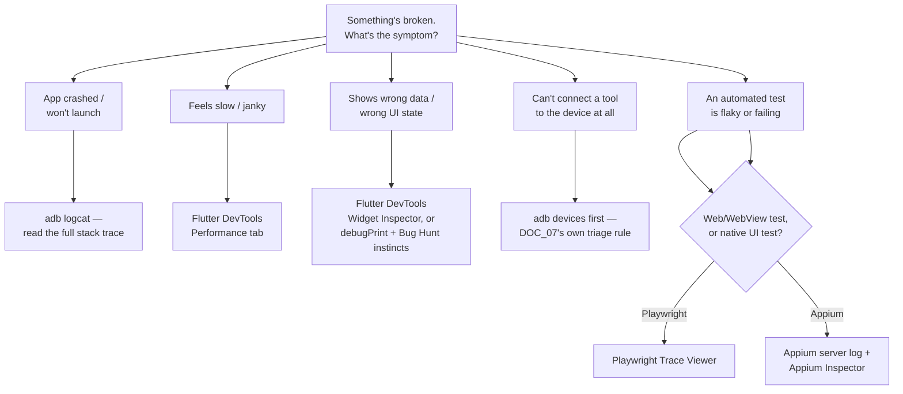
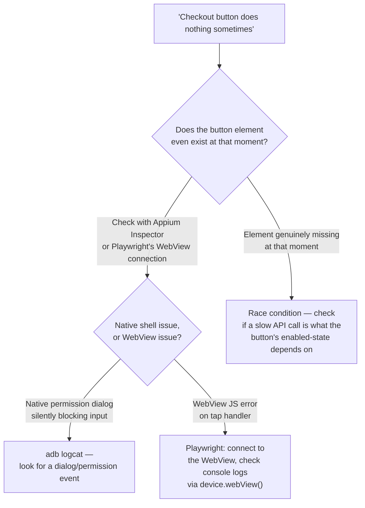

# Mobile Debugging & Troubleshooting Toolkit

### One playbook across every tool this library covers — matching a symptom to the right tool, fast

---

## Why This Doc Exists

By this point in the Reference library you know ADB, Appium Inspector, Flutter DevTools, and Playwright individually. What's still missing is the **triage instinct** — given a bug report with no obvious cause, which tool do you actually open first? Guessing wrong costs you 20 minutes in the wrong tool before you even start on the real problem. This doc is that decision layer, plus real depth on the two tools this library has only touched lightly so far: reading ADB logcat output for real, and Appium's own debugging story.

Every Playwright claim here is checked against [playwright.dev](https://playwright.dev)'s own documentation, matching the standard [DOC_05_Mobile_Web_And_Hybrid_Playwright.md](../../05_Mobile_Web_And_Hybrid_Playwright.md) already set.

---

## The Triage Table — Symptom to Tool



| Symptom | First tool | Why |
|---|---|---|
| App crashes on launch or mid-use | `adb logcat` (Android) / Xcode Console (iOS) | The stack trace is the ground truth — every other tool is downstream of "what actually threw" |
| UI feels laggy or janky | Flutter DevTools Performance tab | Purpose-built for frame-timing; `logcat` won't show you *why* a frame took 40ms |
| Wrong data on screen, no crash | Flutter DevTools Widget Inspector, or a targeted Bug Hunt-style `debugPrint` | This is a logic bug, not an infrastructure bug — see [DOC_08's anti-pattern list](DOC_08_Patterns_and_AntiPatterns.md) for the likely shape |
| A dev tool won't connect to the device at all | `adb devices` | [DOC_07's own rule](DOC_07_ADB_and_Dev_Tooling.md#quick-reference--when-somethings-broken): confirm the connection before touching anything downstream of it (Appium Inspector, `flutter run`, DevTools) |
| A Playwright test is flaky | Trace Viewer, `--trace on` | Shows the exact DOM state, network activity, and timing at the moment of failure — not just a stack trace |
| An Appium test is flaky | Appium server log + Appium Inspector | Confirms whether the driver found the element at all, and whether the locator strategy is even stable |

---

## ADB Logcat — Reading It For Real

[DOC_07](DOC_07_ADB_and_Dev_Tooling.md) introduced `adb logcat` as a command. Here's how to actually read its output under pressure.

```bash
# The raw firehose — every process, every priority level, unfiltered
adb logcat

# Filter to a specific priority and above (V < D < I < W < E < F)
adb logcat *:E              # only errors and fatal — the fastest way to find a crash

# Filter to your app's own tag (Flutter's own logs use this)
adb logcat -s flutter

# Filter to a specific process by package name
adb logcat --pid=$(adb shell pidof -s com.example.myapp)

# Clear the buffer before reproducing a bug — cuts noise dramatically
adb logcat -c && adb logcat
```

**Reading a crash stack trace — what actually matters:**

```
E/AndroidRuntime: FATAL EXCEPTION: main
    Process: com.example.myapp, PID: 14213
    java.lang.NullPointerException: Attempt to invoke virtual method
        'void android.widget.TextView.setText(java.lang.CharSequence)'
        on a null object reference
        at com.example.myapp.MainActivity.onCreate(MainActivity.java:42)
        at android.app.Activity.performCreate(Activity.java:8000)
```

Read **top to bottom, but the fix is at the bottom of your own code's frames** — `FATAL EXCEPTION: main` tells you this crashed the UI thread (the app is genuinely dead, not just logging an error). The exception type and message (`NullPointerException`, calling `.setText()` on `null`) tell you *what* went wrong. The stack trace's first line belonging to **your own package** (`com.example.myapp.MainActivity.onCreate(MainActivity.java:42)`) — not the Android framework frames above or below it — is almost always where the actual fix belongs; framework frames just show how your code was reached.

**The filter that saves the most time in practice:** `adb logcat *:E` combined with `-c` to clear the buffer first. Clear, reproduce the bug once, then read — a fresh buffer means you're not scrolling past unrelated noise from before you started.

---

## Appium Debugging — What Goes Wrong and Where to Look

Appium's failure modes cluster into three categories, each with a different diagnostic path.

### 1. Connection Failures (Session Won't Start)

Covered directly in [DOC_07b's Diff Detective](DOC_07b_ADB_and_Dev_Tooling_Challenges.md#-diff-detective--appium-inspector-wont-connect-two-different-platforms) — check `adb devices` for Android, check the Appium server log for WebDriverAgent installation failures on iOS. The Appium server's own console output (run it with `appium --log-level debug` for verbose output) tells you exactly which step of session setup failed, before assuming anything about your test code.

### 2. Element Not Found (`NoSuchElementException`)

```java
// This throws NoSuchElementException — but WHY is the real question
driver.findElement(AppiumBy.id("login_button"));
```

Three genuinely different causes produce the identical exception:
- **The locator is wrong** — open Appium Inspector, confirm the actual `resource-id`/`accessibility id` at that moment
- **The element hasn't rendered yet** — a race condition, not a wrong locator; needs an explicit wait, not a different selector
- **The element exists in a different context** — a WebView element while the driver is still in `NATIVE_APP` context (or vice versa); check `driver.getContextHandles()` and confirm you've switched context correctly

```java
// Explicit wait — the fix for the "hasn't rendered yet" case specifically
WebDriverWait wait = new WebDriverWait(driver, Duration.ofSeconds(10));
wait.until(ExpectedConditions.presenceOfElementLocated(AppiumBy.id("login_button")));
```

### 3. `StaleElementReferenceException`

```java
WebElement item = driver.findElement(AppiumBy.id("list_item_3"));
// ...list re-renders (a refresh, a scroll, a data update)...
item.click(); // throws StaleElementReferenceException — the element reference is dead
```

This is genuinely the mobile-testing equivalent of [Week 2's reconciliation content](../Phase_1_Dart_and_Foundations/Week_02_Flutter_Core_Concepts.md) — the underlying UI tree changed, and the reference you're holding no longer points at anything real. The fix is always the same shape: **re-locate the element right before interacting with it**, don't cache a `WebElement` reference across any action that might cause the screen to re-render.

---

## Playwright Debugging — The Real Toolchain

[playwright.dev's own debugging guide](https://playwright.dev/docs/debug) documents five genuinely distinct tools, each suited to a different moment in a debugging session:

| Tool | What it actually does | When to reach for it |
|---|---|---|
| `--debug` flag | Launches headed, with Playwright Inspector attached, default timeout set to **0** (no timeout — lets you pause indefinitely) | Stepping through a whole test interactively |
| `page.pause()` | A programmatic breakpoint inserted directly in test code | You know roughly where the problem is and want to jump straight there |
| `PWDEBUG=console` | Exposes a `playwright` object in the browser's own DevTools console (`playwright.$()`, `playwright.inspect()`) | Testing a locator live, without launching the full Inspector UI |
| Trace Viewer | Records DOM snapshots, network activity, console logs, and a screenshot filmstrip for every action in the test | **After the fact** — the test already failed (in CI, most often) and you need to see exactly what happened without re-running it |
| VS Code extension | Breakpoints and live locator highlighting directly in the editor | Day-to-day authoring and debugging, most integrated experience |

**Trace Viewer is the one that matters most for CI failures specifically** — it's the only tool in this list that doesn't require reproducing the bug live:

```bash
# In playwright.config.ts:
use: { trace: 'on-first-retry' }  # capture a trace only when a test actually fails and retries

# After a CI failure, open the recorded trace:
npx playwright show-trace trace.zip
# or upload it to https://trace.playwright.dev with no local install at all
```

The trace gives you the exact DOM state at the moment of failure, every network request with full headers/body/timing, and a visual filmstrip — genuinely more than a screenshot-on-failure gives you, because you can scrub through the *entire* test's timeline, not just the final frame.

---

## The Hybrid App Case — When You Need All of It at Once

This is where the tools in this library actually have to cooperate, not just coexist — a bug report against a Capacitor app that says "checkout button does nothing sometimes" could originate in any of three completely different layers.



The genuinely useful habit: **don't assume which layer the bug lives in before you've looked.** "Does nothing sometimes" is consistent with a native dialog silently eating the tap (native shell — `adb logcat`/Appium Inspector territory), a JavaScript error in the WebView's own click handler (Playwright's `device.webView()` connection, per [DOC_05_Mobile_Web_And_Hybrid_Playwright.md](../../05_Mobile_Web_And_Hybrid_Playwright.md)), or a timing/race condition in whatever the button's enabled state depends on (neither tool alone — this needs actual code reading). The fastest path is almost always: reproduce it once with `adb logcat` running in one terminal and Appium Inspector or a Playwright WebView connection open in another, and let the *first* signal (a native log line, or a JS console error) tell you which of the three branches you're actually in — rather than guessing and debugging the wrong layer for twenty minutes.

---

**→ Related files:**
- [DOC_09b_Mobile_Debugging_Toolkit_Challenges.md](DOC_09b_Mobile_Debugging_Toolkit_Challenges.md) — want to actually get fluent, not just informed? Challenges for this doc
- [DOC_07_ADB_and_Dev_Tooling.md](DOC_07_ADB_and_Dev_Tooling.md) — the ADB mechanics this doc's logcat section builds on
- [DOC_08_Patterns_and_AntiPatterns.md](DOC_08_Patterns_and_AntiPatterns.md) — what to suspect once you've narrowed a bug down to "this is a logic problem, not an infrastructure problem"
- [05_Mobile_Web_And_Hybrid_Playwright.md](../../05_Mobile_Web_And_Hybrid_Playwright.md) — the WebView-connection mechanics referenced in this doc's hybrid-app case
