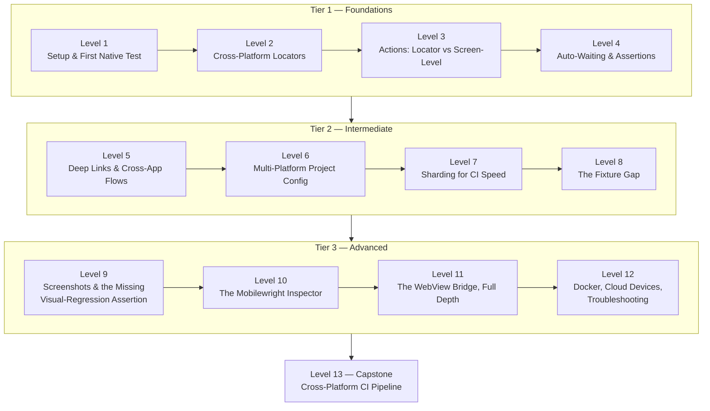

# Mobilewright Native Testing with TypeScript — The Progressive Path

### From `npm init mobilewright@latest` to a real cross-platform CI pipeline, one level at a time

---

## Why This Track Exists Separately From `06_Mobilewright_Native_Testing.md`

[06_Mobilewright_Native_Testing.md](../06_Mobilewright_Native_Testing.md) is a **reference doc** — a single-file overview of what Mobilewright is and when to reach for it, the same role [01_Playwright_vs_Appium_Full_Comparison.md](../01_Playwright_vs_Appium_Full_Comparison.md) plays for the tool landscape. This is different: a genuine **progressive curriculum**, the exact shape of [Playwright_Mobile_TypeScript](../Playwright_Mobile_TypeScript/00_ROADMAP.md) — thirteen levels, each building on skills the previous one actually exercised, none of it assuming you've read ahead.

Every code sample and every documented limitation across this track is checked against [mobilewright.dev](https://mobilewright.dev)'s own documentation as it's written. Several levels exist specifically to teach genuine gaps in what Mobilewright currently offers — no built-in visual-regression assertion, no documented custom-fixture API, iOS tests that can't run inside a Linux Docker container — because knowing a tool's real limitations is as much a part of fluency as knowing its features.

---

## The Three Tiers

| Level | Title | What you can't do before this level, that you can after |
|---|---|---|
| 1 | Setup & First Native Test | Run any Mobilewright test against a real native app at all |
| 2 | Cross-Platform Locators | Write one `getByRole` call that correctly targets Android's `EditText` and iOS's `TextField` |
| 3 | Actions: Locator vs Screen-Level | Choose correctly between element-scoped actions and raw coordinate/hardware actions |
| 4 | Auto-Waiting & Assertions | Know exactly what's checked before an action fires, and which assertions retry and which don't |
| 5 | Deep Links & Cross-App Flows | Test a feature that starts outside your app entirely (a notification, a shared link) |
| 6 | Multi-Platform Project Config | Run the same suite against both iOS and Android from one config |
| 7 | Sharding for CI Speed | Split a large suite across multiple CI machines correctly |
| 8 | The Fixture Gap | Know what Mobilewright *doesn't* give you for free, and the honest workaround |
| 9 | Screenshots & the Missing Assertion | Know exactly what visual testing you'd have to build yourself |
| 10 | The Mobilewright Inspector | Find a reliable locator without guessing, and spot duplicate-locator risk before it bites you |
| 11 | The WebView Bridge, Full Depth | Test a hybrid screen's WebView content with the same fluency as native content |
| 12 | Docker, Cloud Devices, Troubleshooting | Run tests in CI without a local device, and diagnose a broken environment fast |
| 13 | Capstone — Cross-Platform CI Pipeline | Everything above, wired into a real GitHub Actions workflow |

---

## How to Use This Track

Same rule as every other progressive track in this repo: type the code out, run it, don't just read it. **Prerequisite check before Level 1:** you'll need either a connected Android device/emulator or an iOS simulator (macOS only) to actually run the examples — this track can't be followed purely by reading the way a reference doc can, because Mobilewright's entire value is driving a real, running app.

---

**Start → [Level 1: Setup & Your First Native Test](Level_01_Setup_and_First_Native_Test.md)**
