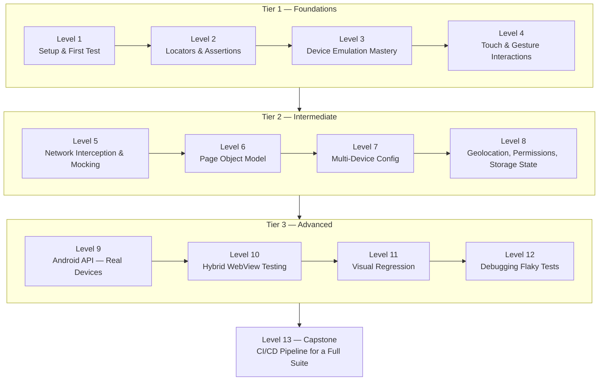

# Playwright Mobile Testing with TypeScript — The Progressive Path

### From `npm init playwright@latest` to a real CI pipeline, one level at a time

---

## Why This Is a Separate Track From the Reference Docs

[05_Mobile_Web_And_Hybrid_Playwright.md](../05_Mobile_Web_And_Hybrid_Playwright.md) and [01_Playwright_vs_Appium_Full_Comparison.md](../01_Playwright_vs_Appium_Full_Comparison.md) are **reference material** — you look things up there when you already know roughly what you're doing. This is different: a genuine **progressive curriculum**, each level building on skills the previous level actually made you practice, the same shape as [Flutter_Bootcamp](../Flutter_Bootcamp/00_MASTER_ROADMAP.md)'s week-by-week structure. No level assumes you've read ahead. No level jumps past something the next one needs.

Every code sample across this track is checked against [playwright.dev](https://playwright.dev)'s own documentation as it's written — not recalled from memory.

**Testing real native UI instead of a WebView?** This track's Level 9 pushes into Playwright's own (Android-only, experimental) device API as far as it goes — for a framework built specifically for native mobile UI, on both platforms, see the companion [Mobilewright_TypeScript/00_ROADMAP.md](../Mobilewright_TypeScript/00_ROADMAP.md) track.

---

## The Three Tiers

| Level | Title | What you can't do before this level, that you can after |
|---|---|---|
| 1 | Setup & Your First Mobile Test | Run any Playwright test at all |
| 2 | Locators & Assertions for Mobile | Find and verify elements the way Playwright's own docs recommend, not brittle CSS |
| 3 | Device Emulation Mastery | Know exactly what a `devices['Pixel 7']` descriptor sets, and build your own |
| 4 | Touch & Gesture Interactions | Simulate swipes, drags, and multi-step gestures correctly (not the nonexistent `.swipe()` mistake) |
| 5 | Network Interception & Mocking | Test offline states, slow networks, and API failures without a real flaky backend |
| 6 | Page Object Model for Mobile | Structure a test suite that survives UI changes without a rewrite |
| 7 | Multi-Device Config | Run the same suite across phone/tablet/desktop projects in one command |
| 8 | Geolocation, Permissions, Storage State | Test location-based features and pre-authenticated sessions |
| 9 | Android API — Real Devices | Move past emulation to a genuinely real device or emulator, via ADB |
| 10 | Hybrid WebView Testing | Reach a Capacitor/Ionic app's actual WebView content, with the honest boundary of what's reachable |
| 11 | Visual Regression Testing | Catch UI regressions pixel-by-pixel, not just logically |
| 12 | Debugging Flaky Tests | Diagnose CI-only failures with Trace Viewer, not guesswork |
| 13 | Capstone — CI/CD Pipeline | Everything above, wired into a real GitHub Actions workflow |

---

## How to Use This Track

Each level is one file: **`Level_NN_Topic_Name.md`**. Read it, actually type out and run the code (don't copy-paste without reading — the whole point is building the muscle, same rule as every challenge file in this repo), then move to the next level only once the previous one's code genuinely runs for you.

**Prerequisite check before Level 1:** Node.js installed, a terminal, and about 20 minutes. Nothing else — Level 1 starts from a completely empty folder.

---

**Start → [Level 1: Setup & Your First Mobile Test](Level_01_Setup_and_First_Mobile_Test.md)**
