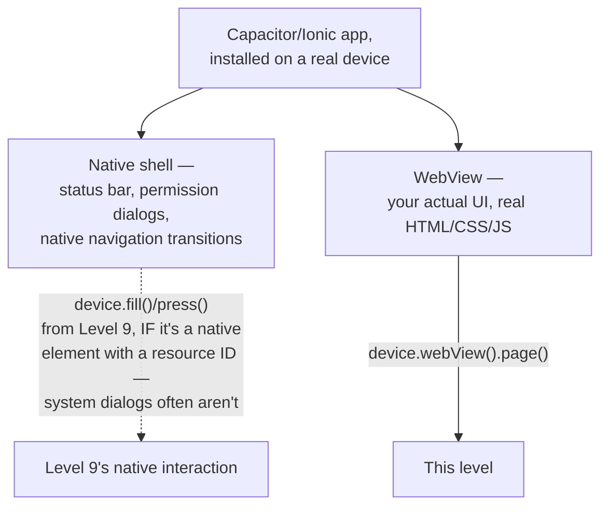

# Level 10 — Hybrid WebView Testing

### Companion track: [Playwright Mobile Testing with TypeScript](00_ROADMAP.md) · Previous: [Level 9](Level_09_Android_API_Real_Devices.md)

---

## Basics — `device.webView()`, the Reason This API Exists at All

Level 9 covered `device.launchBrowser()` — a fresh Chrome instance, unrelated to any installed app. This level covers the genuinely different, more valuable capability: attaching to the **WebView already running inside an installed native app**.

```typescript
import { _android as android } from 'playwright';

const [device] = await android.devices();
await device.shell('am start com.example.myionicapp/.MainActivity');

// Wait for the app's WebView to actually exist before attaching
const webview = await device.webView({ pkg: 'com.example.myionicapp' });
const page = webview.page(); // a normal Playwright Page, from here on

await page.getByRole('button', { name: 'Log In' }).tap();
await expect(page.getByText('Welcome back')).toBeVisible();
```

Once you have `page`, **everything from Levels 1-8 applies unchanged** — locators, dynamic locators from [Level 2](Level_02_Locators_and_Assertions.md), network interception from [Level 5](Level_05_Network_Interception_and_Mocking.md), Page Object Model from [Level 6](Level_06_Page_Object_Model.md). This is the entire value proposition: you're not learning a new testing API for hybrid apps, you're pointing your existing one at a different `page` source.

---

## Concept — The Three-Layer Reality of a Hybrid App, Revisited With Real Tooling

[05_Mobile_Web_And_Hybrid_Playwright.md](../05_Mobile_Web_And_Hybrid_Playwright.md) established this boundary conceptually; this level is where you actually act on it with running code:



**The honest gap worth naming directly:** a native permission dialog ("Allow Camera Access?") is *system* UI, not your app's own native View hierarchy — `device.fill()`/`device.press()` from Level 9 may or may not reach it depending on how the OS renders that specific dialog, and it's genuinely inconsistent across Android versions and dialog types. This is exactly the kind of native-boundary case where [Mobilewright](../06_Mobilewright_Native_Testing.md) or Appium's more mature native-driver ecosystem is the more dependable tool — Playwright's Android API was never built with comprehensive system-dialog handling as a goal.

---

## Real-World Problem — A Login Flow That Crosses the Native/WebView Boundary Twice

```typescript
test('login flow: native splash, WebView login form, native biometric prompt', async () => {
  const [device] = await android.devices();
  await device.shell('am force-stop com.example.myionicapp');
  await device.shell('am start com.example.myionicapp/.MainActivity');

  // Step 1: native splash screen — wait it out, nothing to interact with
  await device.shell('sleep 2'); // crude, but the splash has no testable native element

  // Step 2: WebView login form — this is where Level 1-8 skills apply directly
  const webview = await device.webView({ pkg: 'com.example.myionicapp' });
  const page = webview.page();
  await page.getByLabel('Email').fill('test@example.com');
  await page.getByLabel('Password').fill('testpass123');
  await page.getByRole('button', { name: 'Log In' }).click();

  // Step 3: a native biometric confirmation prompt appears — outside the WebView entirely
  await device.press({ res: 'android:id/button1' }, 'Enter'); // the native dialog's "OK"-equivalent

  // Step 4: back in the WebView, post-login state
  await expect(page.getByText('Welcome back')).toBeVisible();
});
```

Four steps, three different interaction models (a crude wait for something un-testable, Playwright's own web-page API for the WebView, Level 9's native `press()` for the system dialog, then back to the web-page API) — this is genuinely what testing a real hybrid login flow looks like, not a simplified version of it.

---

## Solution — Comparing This Against Mobilewright's Bridge, Concretely

[06_Mobilewright_Native_Testing.md](../06_Mobilewright_Native_Testing.md) covers `screen.getByWebView().page()` — conceptually the same idea as this level's `device.webView().page()`, with real, practical differences worth knowing before choosing one:

| | Playwright's Android API (this level) | Mobilewright's bridge |
|---|---|---|
| Platform coverage | Android only | Android **and** iOS, same API |
| Maturity | Explicitly experimental | Also newer, but purpose-built for exactly this use case |
| Native-side interaction | `device.fill()`/`press()`, resource-ID based | Full native locator API (`getByRole`, `getByType`, etc.), same fixture as the WebView bridge |
| Extra dependency | None — already have Playwright | A separate framework (`mobilewright`, `@mobilewright/test`) |
| Network interception inside the WebView | Supported — normal `page.route()` works, per [Level 5](Level_05_Network_Interception_and_Mocking.md) | **Not** supported through the bridge, per [06's own documented limitation](../06_Mobilewright_Native_Testing.md#the-genuinely-distinctive-feature--webview-bridging-into-real-playwright) |

**The genuinely useful takeaway:** if you need `page.route()`-style network mocking *inside* a hybrid app's WebView specifically, Playwright's own Android API (this level) is currently the more capable choice for that one requirement, despite being Android-only and experimental — Mobilewright's bridge trades that capability away in exchange for cross-platform coverage and a cleaner native-side API. Neither is strictly "better" — they made different trade-offs, and the right choice depends on which specific capability your test suite actually needs.

---

## Challenges

### 🐛 Bug Hunt — The WebView Attach That Times Out

```typescript
test('login screen loads', async () => {
  const [device] = await android.devices();
  await device.shell('am start com.example.myionicapp/.MainActivity');

  const webview = await device.webView({ pkg: 'com.example.myionicapp' }); // times out here
  const page = webview.page();
});
```

The app genuinely launches — you'd see it if you were watching the physical device. `device.webView()` still times out waiting to attach. Using [this level's own three-layer diagram](#concept--the-three-layer-reality-of-a-hybrid-app-revisited-with-real-tooling), name the most likely timing cause.

<details><summary>Diagnosis</summary>

🔴 **Explanation:** `am start` returns as soon as the **activity launch is requested** — it does not wait for the app's WebView to actually initialize and finish loading its content, which for a real hybrid app can take a genuinely noticeable moment (native splash screen, JS bundle loading, initial render). Calling `device.webView()` immediately afterward is racing against that startup sequence — on a fast device or a simple app it might work by luck, on a slower device or a JS-bundle-heavy app it reliably won't. The fix needs an explicit wait for a real readiness signal, not an immediate attach attempt:

```typescript
await device.shell('am start com.example.myionicapp/.MainActivity');

// Give the native shell + WebView initialization a real moment —
// or, more robustly, poll device.webView() with retries instead of one attempt
let webview;
for (let attempts = 0; attempts < 10; attempts++) {
  try {
    webview = await device.webView({ pkg: 'com.example.myionicapp' });
    break;
  } catch {
    await new Promise(r => setTimeout(r, 500));
  }
}
```

This is the same underlying lesson as [Level 1's missing-`await` Bug Hunt](Level_01_Setup_and_First_Mobile_Test.md#-bug-hunt--the-test-that-times-out-for-the-wrong-reason) wearing different clothes — an action that returns before the thing it triggered has actually finished, and the next line pays the price.

</details>

---

### 🏗️ Build It Blind — Design the Test for a Three-Layer Signup Flow

No starter code. Spec only:

> A signup flow: (1) a native "Choose sign-up method" screen with native buttons (Google, Email), (2) tapping Email opens a WebView-rendered form, (3) submitting the form triggers a native "Enable Notifications?" system permission dialog, (4) after responding, the WebView shows a "Welcome" screen. Design the test structure — which parts use `device.press()`/`device.fill()`, which parts use a `page` from `device.webView()`, and where you'd need to re-attach to the WebView (if at all) after the native dialog interrupts it.

<details><summary>One reasonable approach</summary>

```typescript
test('three-layer signup flow', async () => {
  const [device] = await android.devices();
  await device.shell('am start com.example.myapp/.MainActivity');

  // Layer 1: native method-choice screen
  await device.press({ res: 'com.example.myapp:id/email_signup_button' }, 'Enter');

  // Layer 2: WebView form
  const webview = await device.webView({ pkg: 'com.example.myapp' });
  const page = webview.page();
  await page.getByLabel('Email').fill('newuser@example.com');
  await page.getByRole('button', { name: 'Continue' }).click();

  // Layer 3: native system permission dialog interrupts the WebView
  await device.press({ res: 'com.android.permissioncontroller:id/permission_allow_button' }, 'Enter');

  // Layer 4: back in the WebView — the SAME `page` reference, no re-attach needed,
  // because the WebView itself was never destroyed, only temporarily covered
  // by the system dialog
  await expect(page.getByText('Welcome')).toBeVisible();
});
```

🔴 **Explanation:** the design decision worth having made deliberately — the original `page` reference from `device.webView()` remains valid after the native dialog closes, **no re-attach needed**, because the dialog is a separate system overlay that temporarily sits on top of the app, not something that destroys and recreates the WebView underneath it. Re-attaching unnecessarily (calling `device.webView()` a second time) would work too, but understanding *why* it isn't required — the WebView's lifecycle is independent of a transient system overlay's — is the actual test-design skill this exercise is checking, not just producing code that happens to pass.

</details>

---

**Next → [Level 11: Visual Regression Testing](Level_11_Visual_Regression_Testing.md)**
