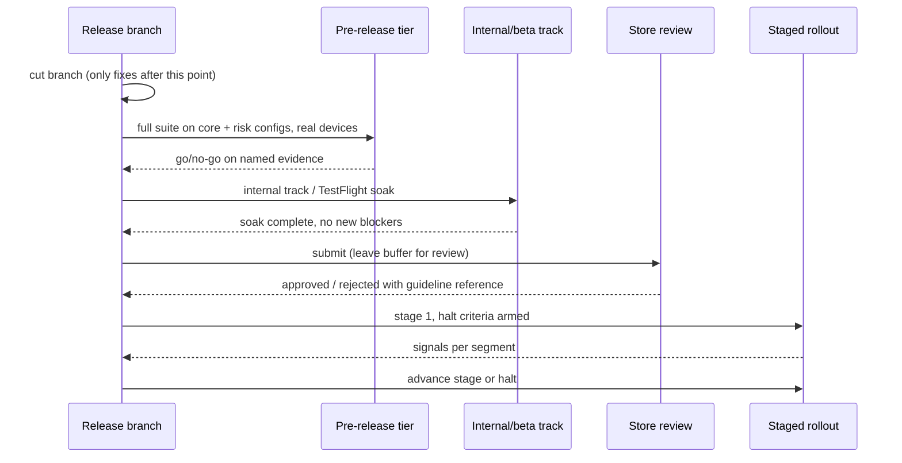

# Mobile Release & Rollout Playbook

> **Purpose**: how to get a mobile release to users in a way you can stop, using the mechanics the stores actually provide. This is the practical companion to the reasoning in the [judgment doc](../10_Senior_Mobile_Engineering_Judgment.md) (§1 reversibility ladder, §5 incident command, §6 go/no-go): that file explains *why* a rollout should be a controlled experiment; this one is *how*, down to which button halts what.
>
> **Verification stamp — read this first.** Every store-mechanics claim in this file was checked against the official documentation on **2026-10-18** (sources at the bottom). Store policies change; before relying on any number or behavior here for a real release, re-check the linked page. Claims this file could **not** verify are listed explicitly in [§9](#9-what-this-playbook-did-not-verify) and are written as open questions, not facts.

---

## Table of Contents

1. [The Principle](#1-the-principle)
2. [The Store Mechanics, Side by Side](#2-the-store-mechanics-side-by-side)
3. [What the Mechanics Imply](#3-what-the-mechanics-imply)
4. [How Long Must a Stage Run? Deriving Soak Time](#4-how-long-must-a-stage-run-deriving-soak-time)
5. [The Release Train](#5-the-release-train)
6. [The Rollout Plan and Halt Criteria (Template)](#6-the-rollout-plan-and-halt-criteria-template)
7. [Flags and Kill-Switches](#7-flags-and-kill-switches)
8. [Hotfix Procedure](#8-hotfix-procedure)
9. [What This Playbook Did Not Verify](#9-what-this-playbook-did-not-verify)
10. [Practice Challenges](#10-practice-challenges)
11. [Reality Check](#11-reality-check)
12. [Sources](#12-sources)

---

## 1. The Principle

A shipped mobile binary cannot be recalled. You can only (a) limit how many more people get it, (b) switch behavior off remotely if you built the switch beforehand, or (c) ship a fix and wait for people to adopt it. A rollout plan is therefore not a deployment step — it is the mechanism that converts one irreversible 100%-at-once bet into a sequence of small, capped bets, each with a pre-agreed stop condition. Everything below serves that.

---

## 2. The Store Mechanics, Side by Side

All rows verified 2026-10-18 against the official pages in [§12](#12-sources). "Not documented" means the official page consulted does not say — not that the behavior doesn't exist.

| | **Apple (App Store Connect)** | **Google Play (Play Console)** |
|---|---|---|
| **Staged mechanism** | *Phased release for automatic updates*: fixed 7-day schedule — day 1: 1%, day 2: 2%, day 3: 5%, day 4: 10%, day 5: 20%, day 6: 50%, day 7: 100% | *Staged rollout*: **you choose the percentage**; it "won't increase automatically"; raise it via Manage rollout → Update rollout |
| **Who is in the sample** | A random sample of users **with automatic updates on** and eligible devices, not notified | Users selected at random, not notified |
| **Not covered by the stage** | Anyone can **manually** download the update from the App Store at any time | Not documented on the page consulted |
| **Pause / halt** | Pause up to **30 days total** across any number of pauses; resuming continues from the day paused | **Halt rollout**: "no additional users" receive the version; those who already have it keep it. Resume only if the bundle has no issues |
| **Release to everyone now** | "Release to All Users" at any time — all users with automatic updates on get the latest version | Raise the percentage to 100% |
| **Availability** | Version *updates* only (not first release) | Updates only — "not when publishing an app for the first time" |
| **Lower the percentage?** | n/a (fixed schedule) | **Not documented** on the page consulted |
| **Remedy for a bad build** | Pause; remove from sale (which **ends** phased release for that version — to resume a controlled rollout you must make the version unavailable and submit a new version with phased release enabled); or submit a new version | "Create and roll out a new release with a fixed app bundle" |
| **Review latency** | Apple: "typically reviewing at least 50% of submissions in less than 24 hours and 90% in less than 48 hours"; incomplete submissions may be delayed | Google: for certain accounts or extended reviews, "up to seven days or longer in exceptional cases" |
| **Expedite path** | Requestable "if you face extenuating circumstances, such as fixing a critical bug" — include the reproduction steps for the bug on the current version | Not documented on the page consulted |
| **Beta channel** | TestFlight: builds testable up to **90 days**; up to 100 internal testers, up to 10,000 external; the first external build may require Beta App Review | Testing tracks (internal → closed → open → production; see the [pre-launch checklist](../Flutter_Bootcamp/Phase_6_Quality_and_Deployment/Week_27_Project_ChatApp.md#pre-launch-checklist--the-shipping-gate)) |
| **Version identity** | — | `versionCode` must be a greater value with each release and a previously used value cannot be uploaded again |
| **Production health signal** | MetricKit / Xcode Organizer hang rate and terminations ([iOS performance](../08_iOS_Performance_Memory_And_Instruments.md#2-ioss-anr-equivalent--watchdog-terminations-and-hang-rate)) | Android vitals: core thresholds below |

**Android vitals core thresholds** (verified 2026-10-18): user-perceived crash rate **1.09%** overall / **8%** per phone model; user-perceived ANR rate **0.47%** overall / **8%** per phone model; excessive partial wake locks **5%**. Exceeding a bad-behavior threshold may reduce your title's visibility and may show a warning on the store listing; Play evaluates a 28-day average, and flags "emerging issues" (affecting devices for more than 7 days) giving 21 days to address. Note that Play evaluates **per phone model separately** — the platform itself segments by device, which is the same instinct as [incident scoping](../10_Senior_Mobile_Engineering_Judgment.md#5-incident-command-for-a-crash-spike-across-a-fragmented-matrix).

---

## 3. What the Mechanics Imply

These are *derived* from §2, not additional sourced facts — each is an inference you should be able to re-derive.

1. **A halt stops growth, not damage.** Both stores keep the build on devices that already have it (Google says so explicitly; Apple's pause pauses the *release*). So halting early only helps if the stage was small — which is why the early stages exist, and why the first stage's size matters more than the last's.
2. **"Rollback" is rolling forward.** Android blocks installing a lower `versionCode` over a higher one (downgrade protection) and Play rejects reuse of a used code, so undoing a release means shipping the *old behavior* under a *higher* version identifier. The documented remedy on both stores is a new release. Plan the hotfix as a normal release that happens to contain old code.
3. **Apple's schedule is fixed; yours isn't.** You can pause and release-to-all, but you can't choose "2% for three days." If you need finer control on iOS than the 7-day curve gives you, the control has to come from flags (§7), not from the store.
4. **The percentage is not "percent of all users."** Apple's sample is automatic-update users only, and manual downloaders bypass it. So a 1% phase can reach more than 1% of your base if people update by hand — and power users who update manually are exactly the users who hit new bugs first.
5. **Review latency sets the floor on rung 4.** A hotfix cannot be faster than build + test + review. With Apple's published figures (90% within 48 hours) and Google's "up to seven days or longer in exceptional cases," the honest planning number for a hotfix is *days*, with the upper tail outside your control. That is why §7's flags are the real incident tool and the hotfix is the backstop.
6. **Remove-from-sale resets the controlled rollout on Apple.** It is a stronger stop than a pause, but it ends the phased release for that version — you cannot simply resume. Treat it as "stop and re-plan," not "pause."

---

## 4. How Long Must a Stage Run? Deriving Soak Time

A halt criterion like "stop if the crash rate rises" is meaningless until you know how much data it takes to *see* a rise. Derive it instead of guessing.

For a crash event rate of `p₁` on the current release and a worry that the new release is `p₂`, the sessions needed **on the new version** (one-sided test, 5% false-alarm rate, 80% power, using the standard two-proportion normal approximation) are:

```
n  =  (z_α + z_β)² · [ p₁(1−p₁) + p₂(1−p₂) ]  /  (p₂ − p₁)²        with z_α = 1.645, z_β = 0.842
```

Computed for several scenarios (sessions needed *on the new version*):

| Baseline crash-session rate | Rate you must detect | Sessions needed |
|---|---|---|
| 0.5% | 1.0% (a doubling) | ≈ 3,700 |
| 0.5% | 0.75% (a 50% increase) | ≈ 12,300 |
| 1.0% | 2.0% | ≈ 1,800 |
| 1.0% | 1.5% | ≈ 6,100 |
| 0.1% | 0.2% | ≈ 18,500 |

Now convert sessions to *time at a stage* (assumption: 1,000,000 daily active users, 3 sessions each per day — substitute your own):

| Stage | Sessions/day on the new version | Time to ~3,700 sessions | Time to ~18,500 sessions |
|---|---|---|---|
| 1% | 30,000 | well under a day | under a day |
| 5% | 150,000 | hours | hours |
| 20% | 600,000 | minutes | minutes |

Three lessons fall out of the arithmetic:

- **Big apps clear the statistical bar fast; small apps don't.** The same stage that gives a million-user app a confident reading in hours gives a 20,000-user app only ~600 sessions a day at 1% — days to see even a doubling. For a small app, stage sizes should be *larger* (the cap on damage is smaller anyway) and soak times *longer*.
- **Statistics are not the bottleneck on big apps — rare segments are.** A bug that hits only 3 GB-RAM Android 13 phones is invisible in the aggregate for a long time. Halt criteria must be evaluated **per segment** (device model, OS version), not just overall — Android vitals' own per-model thresholds are the platform doing exactly this.
- **Also wait for the real-world delays.** Some failures only appear after the first cold start after an update, after a background kill, or after a day of use. A minimum wall-clock soak per stage (e.g., one full day for the first stage) covers what pure session counts miss. The calculation gives you a *floor*, never the whole answer.

*(Caveat: sessions from one user are not independent, which inflates the true requirement above these figures — treat them as lower bounds. The method — derive the sample size, then convert to time — is what to reuse; the numbers are illustrations.)*

---

## 5. The Release Train

A release train is a fixed cadence in which a release moves through the same stages on a schedule, so nobody improvises under pressure. Build in the parts you don't control.



Rules the diagram encodes, each traceable to §2–§3:

- **Submit with a buffer.** Review latency is a distribution, not a number (Apple's own figures are a 50th and 90th percentile; Google's tail is "up to seven days or longer"). Schedule the submission so the *tail*, not the median, still hits your date.
- **Cut early, change nothing but fixes.** Once the branch is cut, only release-blocking fixes enter; otherwise the soak you just ran no longer describes what ships.
- **The beta soak is not optional on irreversible changes.** A change with no rung 1–3 undo (a migration, a launch-path change) should soak on the beta track with real upgrade paths before it ever reaches the store review queue.
- **A rejection costs a cycle.** Keep the submission complete and compliant: Apple notes that an incomplete submission may be delayed or may not pass review. Rejection details cite the specific guideline; you can correspond with App Review or appeal. For a bug-fix submission, Apple also allows accepting an offer to resolve additional issues in the *next* submission rather than blocking this one (as long as there are no legal or safety concerns).

---

## 6. The Rollout Plan and Halt Criteria (Template)

*Fill one in per release. The rule: **the halt criteria are written before stage 1 starts and are not edited during the rollout** — thresholds invented mid-incident drift toward whatever justifies continuing.*

### 6.1 Stage table

| Stage | Android (you choose) | iOS (Apple's fixed curve) | Minimum soak before advancing | Advance only if |
|---|---|---|---|---|
| 1 | <!-- FILL IN: e.g. 1–5% --> | Day 1: 1% | <!-- FILL IN: ≥ the §4 sample-size time AND ≥ 1 full day --> | all halt criteria below pass, per segment |
| 2 | <!-- FILL IN --> | Days 2–3: 2% → 5% | <!-- FILL IN --> | same |
| 3 | <!-- FILL IN --> | Days 4–5: 10% → 20% | <!-- FILL IN --> | same |
| 4 | <!-- FILL IN --> | Days 6–7: 50% → 100% | <!-- FILL IN --> | same |

*If your iOS curve is too coarse for a risky release, add control with a flag (§7) rather than fighting the store schedule.*

### 6.2 Halt criteria (all evaluated per segment as well as overall)

| Signal | Compared against | Threshold (fill in numbers from your data) | Action |
|---|---|---|---|
| Crash-free sessions | The *previous release, concurrently* (cancels day-of-week and event effects) | <!-- FILL IN: e.g. more than X points lower --> | Halt |
| ANR rate (Android) / hang rate (iOS) | Previous release, concurrently | <!-- FILL IN --> | Halt |
| Absolute ceilings | Android vitals: 1.09% crash / 0.47% ANR overall, 8% per phone model | Never approach these | Halt well before |
| Watchdog terminations / launch time | Previous release | <!-- FILL IN: launch-path releases only --> | Halt |
| Business-critical funnel (checkout, login, transfer success) | Previous release | <!-- FILL IN --> | Halt |
| A new crash signature in a flow tagged high-blast-radius | — | Any occurrence above N users | Halt |

**Decision rights:** who may halt without asking (name them): <!-- FILL IN — a halt should never wait for a meeting; it is cheap and reversible, continuing is neither -->. Who may resume: <!-- FILL IN -->.

### 6.3 How to execute the stop

- **Google Play:** Manage rollout → **Halt rollout**. Users who already have the version keep it. Resume only if you've concluded the bundle is fine.
- **App Store:** pause the phased release (30 days total across pauses). If the problem is serious, remove from sale — remembering that this ends the phased release for that version.
- **Either store, if a flag exists:** flip the flag first (rung 1 is faster than either store control), then halt, then diagnose.

---

## 7. Flags and Kill-Switches

Flags are the only fast lever for users who already have the binary (rung 1 of the [ladder](../10_Senior_Mobile_Engineering_Judgment.md#1-the-root-fact--asymmetric-reversibility)), so they are infrastructure to design, not a convenience.

**What must be behind a flag:** payment and money-movement paths, any new third-party SDK initialization, new background work, and anything with a server-side dependency that could degrade. **What cannot be protected by a flag:** a local database migration (it has already run on devices by the time you'd flip anything), and the app's launch path before the flag config has loaded — plan those with extra verification instead (see the [test strategy template](TEST_STRATEGY_TEMPLATE.md#2-reversibility-profile)).

**Design rules:**

1. **Safe default.** Define what the app does when the flag service is unreachable — and test that path. A kill-switch that fails open or crashes on a network error is worse than none.
2. **Fetch early, tolerate stale.** A flag the app only reads at the moment of the risky action is too late for the launch path; but blocking launch on a network fetch is its own risk. Decide deliberately and cache the last known value.
3. **Flag both states in the matrix.** Every flagged feature has two behaviors; the test strategy must exercise both on the device configs that matter.
4. **Expire flags.** An old flag nobody owns is untested code with a switch on it. Each flag gets an owner and a removal date.
5. **Know the propagation time.** "Instant" is rarely true; measure how long a flip takes to reach devices and write the number into the incident runbook.

---

## 8. Hotfix Procedure

When rung 1–3 can't fix it. Time is dominated by build + test + review + adoption (§3.5), so spend the first minutes on the things that shorten it.

1. **Stop exposure now** (halt / flag / remove from sale as appropriate) — before diagnosis completes.
2. **Fix on the release branch**, minimal change, no opportunistic cleanup.
3. **Verify proportionally:** the change touched something with no cheap undo, so run the pre-release tier on the segment where it failed *plus* the core matrix. A hotfix that causes a second incident is the most expensive kind.
4. **Android:** a *higher* `versionCode` is mandatory (§3.2); ship staged, with halt criteria written in advance, not an all-at-once repair.
5. **iOS:** submit with an expedite request if it qualifies as a critical bug fix — Apple asks you to include the steps to reproduce the bug on the current version. Be honest in the request; it is a review of your claim.
6. **Communicate** to support and stakeholders what users on the bad version see, and what the fix timeline's uncertain parts are (review, adoption).
7. **Postmortem** names the specific gap (missing config / missing test / retried-green / missing flag), per the [incident procedure](../10_Senior_Mobile_Engineering_Judgment.md#5-incident-command-for-a-crash-spike-across-a-fragmented-matrix) — and asks why a rung 1 or 2 undo didn't exist.

---

## 9. What This Playbook Did Not Verify

Stated plainly so none of these gets mistaken for a fact:

- **Whether Google Play lets you *lower* the percentage of an active staged rollout.** The official page consulted says you can increase and halt; it does not say. Do not plan around lowering it — plan around halt.
- **How Apple's phased release treats *new installs*.** The page consulted describes automatic *updates* only and is silent on new installs.
- **A guaranteed turnaround for expedited reviews.** Apple documents *when* you may request one and what to include; the only turnaround figures found were from third-party blogs, which this playbook does not repeat as fact.
- **Google Play expedite or emergency-publish paths**, and the **testing requirements for new personal developer accounts** (the review page links to a separate article that was not consulted).
- **Current review-time reality versus Apple's published figures.** Third-party 2026 sources disagree about whether the published percentiles hold in practice (especially for new apps). Treat Apple's figures as the stated benchmark, not a guarantee.
- **Rejection-reason frequencies** (for example, which guideline is cited most). Not verified; do not quote one.

---

## 10. Practice Challenges

### 🐛 Bug Hunt — The Rollout Plan That Can't Fail

```
Release 5.0 plan:
  Android: 100% immediately ("we tested on 12 devices")
  iOS:     phased release, 7 days
  Halt if: "the crash rate looks bad"
  Flag:    login rewrite is shipping un-flagged; migration included
```

Find at least four defects against §3–§7.

<details><summary>Diagnosis</summary>

(1) **Android at 100% immediately** discards rung 2 entirely — a halt can't cap exposure that already happened (§3.1). (2) **"Looks bad" is not a halt criterion** — no metric, no comparison baseline, no per-segment evaluation, no owner (§6.2). (3) **An un-flagged login rewrite** leaves only rung 4 as an undo for the highest-blast-radius path (§7), and **(4) the migration** has no undo at all even after a halt — it already ran on devices that updated (§7, judgment doc §1). (5) The plan has no beta soak for the irreversible parts (§5). (6) "Tested on 12 devices" says nothing about *which* — if the 3 GB-RAM and oldest-OS configs aren't among them, the risk configs are missing (test strategy §4).

🔴 **Explanation:** the plan's structural problem is that it spends all its verification evenly and builds no undo — the opposite of the principle in §1. The fix isn't more testing; it's staged exposure, flags on the un-undoable paths, and halt criteria with numbers.

</details>

---

### 🎭 Two Truths and a Lie — Store Mechanics

**A.** Halting a Google Play staged rollout removes the new version from users who already installed it.

**B.** Apple's phased release is a random sample of users who have automatic updates turned on, and anyone can still download the update manually at any time.

**C.** Because Android blocks installing a lower `versionCode` over a higher one, a "rollback" on Android is shipping the old behavior under a higher version code.

<details><summary>Which one's the lie</summary>

**A is the lie.** Google's documentation states that once halted, "no additional users" receive the version and users who already received it **keep it** — a halt stops growth, not damage (§3.1). B is stated on Apple's phased-release page; C is the inference in §3.2, which follows from the documented downgrade protection and the rule that a used `versionCode` can't be reused.

🔴 **Explanation:** A is the most dangerous misbelief on the list because it makes a halt feel like a recall. It is why the size of the *first* stage matters more than anything you do after it.

</details>

---

### 👹 Boss Battle — Write the Halt Criteria

**The spec:** a ride-hailing app, 800,000 daily active users, 3 sessions per user per day. Baseline crash-session rate is 0.5%; the previous release's rate by segment is known. The release contains a new payments SDK (flagged) and a schema migration (not flaggable). Android uses staged rollout; iOS uses phased release.

Produce: (1) the Android stage plan with soak times justified by §4's arithmetic; (2) the halt-criteria table with at least one **segment-level** criterion; (3) the extra measures the migration demands; (4) what you do if iOS day 1 looks bad but Android is clean.

<details><summary>One reasonable design</summary>

**(1) Stages.** At 800,000 DAU × 3 sessions, 1% gives 24,000 sessions/day on the new version; detecting a doubling from 0.5% needs ≈ 3,700, so the aggregate reading is available within hours — but the minimum soak is set by *real-world* effects, not the statistics: stage 1 = 2% for at least one full day (covers cold-start-after-update and background-kill paths), then 10% for a day, 30%, then 100% only after the per-segment checks pass. **(2) Halt table:** crash-free sessions more than a stated margin below the previous release *concurrently*, overall **and** for each device-model/OS segment with enough volume; ANR rate above the previous release's by a stated margin; and an absolute ceiling well inside Android vitals' 0.47% ANR / 1.09% crash thresholds. Also a funnel criterion: payment-success rate below the previous release's. **(3) Migration:** no flag can help, so verify upgrade paths from the last three versions plus fresh install on the full pre-release set, ship it on the beta track first, and make it the *only* risky change in the release if possible. **(4)** Pause the iOS phased release (cheap, reversible), flip the payments flag if the symptom is payment-related, and treat Android's clean result as evidence about *Android*, not about the shared code — then diagnose on the iOS segment.

🔴 **Explanation:** notice the soak is set by the larger of "statistically enough" and "long enough for delayed failures," and that the migration is handled by pre-release verification and sequencing, because no rollout control can undo it.

</details>

---

## 11. Reality Check

**"A staged rollout means a bad release only hurts a few users"** — only if the stage was small and you halted fast ([§3.1](#3-what-the-mechanics-imply)): a halt stops further exposure but both stores leave the build on devices that already have it. The protection is the *size of the first stage*, which is why "staged" with a large first step is barely staged at all.

**"We can just roll back"** — There is no documented rollback to a previous binary on either store in the pages consulted; the documented remedy is a new release ([§2](#2-the-store-mechanics-side-by-side), [§3.2](#3-what-the-mechanics-imply)). On Android the downgrade protection makes "rollback" literally shipping old code under a higher version code. Plan on rolling forward, and put the fast undo in flags.

**"Apple review takes a day, so a hotfix is a day"** — Apple's published figures are percentiles (50% under 24 hours, 90% under 48), Google's tail is "up to seven days or longer in exceptional cases," and a fix still needs build, verification and user adoption ([§3.5](#3-what-the-mechanics-imply)). Plan the hotfix in days; make the incident tool a flag.

**"1% of users is a safe canary"** — 1% of what, and for how long? Apple's sample is automatic-update users only and manual downloaders bypass it; and statistical sufficiency ([§4](#4-how-long-must-a-stage-run-deriving-soak-time)) says nothing about failures that appear only after a cold start, a background kill, or a day of use. A stage's soak is the larger of "enough sessions" and "long enough for delayed failures," and its criteria must be read per segment.

**"The release is done when it reaches 100%"** — A release is done when its signals stay inside the criteria *after* 100% and the postmortem-level learning is captured: which gap would have caught anything that escaped, in which tier of the pipeline. Reaching 100% is just the point at which the cheap controls are gone.

---

## 12. Sources

All fetched 2026-10-18. Re-verify before relying on a number for a real release.

- Apple — [Release a version update in phases](https://developer.apple.com/help/app-store-connect/update-your-app/release-a-version-update-in-phases/) (7-day schedule, pause rules, manual downloads, remove-from-sale behavior)
- Apple — [App Review](https://developer.apple.com/distribute/app-review/) (50% / 90% review-time statement, expedite conditions, rejection and appeal paths)
- Apple — [TestFlight overview](https://developer.apple.com/help/app-store-connect/test-a-beta-version/testflight-overview/) (90 days; 100 internal / 10,000 external; Beta App Review)
- Google — [Staged rollouts](https://support.google.com/googleplay/android-developer/answer/6346149) (percentage control, halt/resume semantics, updates-only)
- Google — [Review time notice](https://support.google.com/googleplay/android-developer/answer/9859751) ("up to seven days or longer in exceptional cases")
- Android — [Android vitals](https://developer.android.com/topic/performance/vitals) (core thresholds, 28-day evaluation, emerging-issues window)
- Android — [Version your app](https://developer.android.com/studio/publish/versioning) (`versionCode` monotonicity and reuse rule)
