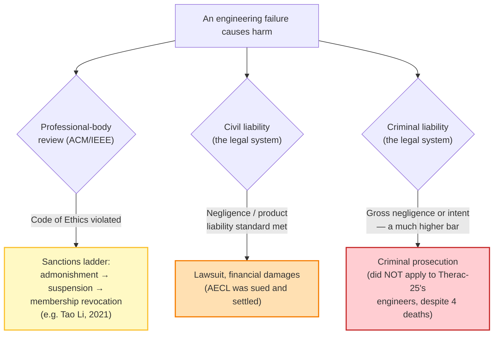

# Chapter 1 — Professional Ethics Frameworks: Codes, Enforcement, and the Cost of Getting It Wrong

> A civil engineer who signs off on a bridge is putting a license on the line — a real, revocable credential tied to a name. A software engineer who ships a build has, in most jurisdictions, no equivalent license to lose. This chapter asks what actually stands in that gap, and uses a machine that killed four people to show why the answer isn't "nothing."

---

## The Problem

Ask a room of software engineers "what stops you from shipping something dangerous" and the honest first answer is usually "the tests pass" or "my manager approved it." Neither is a professional standard — tests only check what someone thought to write, and a manager's approval reflects business pressure, not safety judgment. Compare this to a civil engineer stamping a bridge design: that stamp is tied to a Professional Engineer license, issued by a state licensing board, revocable for negligence, and legally required before the design can be built. A doctor prescribing medication is licensed, board-certified, and can lose the right to practice. Software has no equivalent gate for the overwhelming majority of roles — anyone can call themselves a software engineer, ship code that controls a car's brakes or a hospital's radiation dose, and face no licensing consequence at all, because in most of the world no such license exists for the job title.

This isn't an oversight nobody's gotten around to fixing — professional licensure for software engineers has been tried and mostly abandoned (the U.S. NCEES retired its Software Engineering PE exam in 2019 for lack of demand). What computing has instead is a different, weaker-looking, but real mechanism: **codes of professional ethics**, written and enforced by the field's own professional bodies rather than by government licensing boards. This chapter derives what those codes actually say, whether "enforcement" by a professional society means anything when it can't stop someone from working, and uses a real, verified case — a radiation therapy machine that overdosed six patients — to show exactly which principles a violation looks like in practice, not in the abstract.

## 1.1 The ACM Code of Ethics — Structure, and Why It's Principles, Not Rules

The Association for Computing Machinery's Code of Ethics and Professional Conduct (2018 revision) is organized into four sections: **general ethical principles**, **professional responsibilities**, **professional leadership responsibilities**, and **compliance**. Section 1 — the general principles — is the part every computing professional is expected to internalize, and it's short enough to read as seven lines:

```
1.1  Contribute to society and to human well-being
1.2  Avoid harm
1.3  Be honest and trustworthy
1.4  Be fair and take action not to discriminate
1.5  Respect the work required to produce new ideas, inventions, and creative works
1.6  Respect privacy
1.7  Honor confidentiality
```

Notice what the Code deliberately is *not*: it isn't a checklist of forbidden actions like a terms-of-service agreement. Each principle is "formulated as a statement of responsibility, based on the understanding that the public good is always the primary consideration" and is supplemented by explanatory guidelines — closer to a constitution's bill of rights than a compliance rulebook. That structure isn't incidental; a rules-as-checklist code can only cover situations its authors anticipated, while a principles-based code is meant to be *reasoned from* when a genuinely new situation arises — which, in a field that invents new categories of technology every few years, is constantly.

The principles also **conflict with each other by design**, and the Code expects a professional to weigh them, not mechanically apply whichever one comes first. Concretely: a fraud-detection feature that flags suspicious transactions serves 1.1 (contributing to society by preventing harm) and 1.4 (fairness, if it's applied evenly) — but training it requires analyzing every user's transaction history, which is in direct tension with 1.6 (respect privacy). The Code doesn't resolve this tension for you with a formula; it obligates you to notice the tension exists and make a defensible, documented judgment call rather than defaulting to whichever principle is more convenient for the business case. That obligation — to notice the conflict at all — is most of what separates "I followed the code" from "I used the code as a rubber stamp."

## 1.2 A Second, Separate Code for Engineers — Why the ACM Code Wasn't Enough

The ACM Code covers every computing professional — researchers, IT staff, data scientists, students. Software *engineers* specifically — people building systems other people depend on, often under direct management pressure to cut corners on schedule or cost — got their own code: the **Software Engineering Code of Ethics and Professional Practice**, jointly approved by the ACM and IEEE Computer Society in 1999. It has eight named principles:

```
1. PUBLIC              — act consistently with the public interest
2. CLIENT AND EMPLOYER  — act in the best interests of client/employer,
                          CONSISTENT WITH THE PUBLIC INTEREST
3. PRODUCT              — ensure products meet the highest professional standards
4. JUDGMENT             — maintain integrity and independence of professional judgment
5. MANAGEMENT           — managers/leaders shall promote an ethical approach to development
6. PROFESSION           — advance the integrity and reputation of the profession
7. COLLEAGUES           — be fair to and supportive of colleagues
8. SELF                 — participate in lifelong learning of the practice
```

The ordering here is not alphabetical and not arbitrary — it's a deliberately constructed precedence, and the wording of Principle 2 makes the precedence explicit rather than implicit: "act in a manner that is in the best interests of their client and employer, **consistent with the public interest**." Public interest is written directly into the *second* principle as the constraint the second principle operates under. This is the code's answer to the single most common real pressure a software engineer faces: a manager or client wants something shipped, and the engineer knows it isn't safe or isn't ready. The Code doesn't say "do what your employer says" or "do what's best for the public and ignore your job" — it says the employer's interest is legitimate and worth serving, *but bounded by* the public-interest principle listed one rank above it. Principle 4 (Judgment) then makes explicit that this isn't optional: engineers are obligated to maintain independence of judgment even under pressure, not merely permitted to.

## 1.3 Enforcement — Is Any of This Actually Enforced?

A code with no consequences is a poster on a wall. Whether ACM's code has teeth is worth checking directly rather than assuming either way.

The ACM does run a real enforcement process, through its **Committee on Professional Ethics (COPE)**, with a graduated sanctions ladder: a letter of admonishment, barring from ACM conferences, barring from volunteering in ACM activities, suspension from ACM for a specified period, prohibition from publishing in ACM venues, and — at the top — a recommendation to ACM Council to revoke membership entirely. This isn't purely theoretical: in **June 2021, the ACM Council voted unanimously to revoke the membership of researcher Tao Li** over serious Code of Ethics violations — a real, named, dated enforcement action, not a hypothetical deterrent.

But the honest limit has to sit right next to that fact: **revoking ACM membership does not revoke the right to write software professionally.** Unlike a medical board pulling a doctor's license (which legally bars them from practicing medicine) or a state engineering board pulling a PE license (which legally bars them from stamping designs), ACM membership is voluntary association, not a legal gate to employment. A software engineer expelled from ACM can be hired at another company the next week with no legal barrier at all. The enforcement mechanism is real — reputational, professional-community, and in extreme cases genuinely career-affecting through publicity — but it is categorically weaker than the licensure model civil engineering and medicine rely on, precisely because Section 1.1's "no license required" observation from the opening of this chapter was never actually solved, only partially compensated for.

## 1.4 The Case That Makes This Concrete — Therac-25

Between June 1985 and January 1987, the **Therac-25**, a computer-controlled radiation therapy machine built by Atomic Energy of Canada Limited (AECL), massively overdosed patients on at least six documented occasions — doses estimated at up to 100 times the intended therapeutic dose. **Four patients died; two suffered severe, permanent injuries.** The definitive investigation, Nancy Leveson and Clark Turner's *"An Investigation of the Therac-25 Accidents"* (IEEE Computer, July 1993), remains the canonical case study in software-safety engineering.

This repo already has the *technical* root-cause analysis — a race condition between the operator's data-entry keystrokes and the treatment-parameter table, reachable only if an experienced operator typed fast enough to trigger it (see [`10_Enterprise_Systems/08_RealWorld_Incidents_DSA.md`, Incident 8](../../../10_Enterprise_Systems/08_RealWorld_Incidents_DSA.md) for the concurrency mechanics in full). This chapter isn't repeating that derivation — it's asking the question that file doesn't: **which specific, numbered principles from Sections 1.2 and 1.3 does this incident actually violate, and why does naming them precisely matter more than saying "it was unethical"?**

Two decisions, not the race condition itself, are where the ethics analysis lives:

**AECL removed hardware safety interlocks that its own predecessor machines had.** The Therac-6 and Therac-20 — earlier machines from the same manufacturer — had hardware interlocks that made an overdose physically impossible regardless of what the software did: independent circuits that would cut the beam if parameters were unsafe, enforced by wiring, not code. The Therac-25 removed these interlocks and relied *entirely* on software to enforce safe operation — the same software that had the undiscovered race condition. This is a direct violation of **SE Code Principle 3 (Product)**, which obligates engineers to "strive for high quality, acceptable cost, and a reasonable schedule, ensuring significant tradeoffs are clear to and accepted by the employer and the client, and are available for consideration by the user and the public" — removing a hardware safety net and betting the entire safety case on unverified software is exactly the kind of significant tradeoff the Code requires to be surfaced and justified, not silently substituted in the name of cost savings.

**AECL's initial response to the first reported overdoses was to tell hospitals it was impossible.** After early incident reports, the manufacturer's engineers concluded — without a rigorous investigation — that the machine could not have caused the injuries, and machines continued operating at other sites while additional patients were overdosed. This is a direct violation of **SE Code Principle 1 (Public)**, whose sub-clauses obligate engineers to "report any signs of danger" they observe and to disclose to relevant parties "any actual or potential danger" to the public — a credible external report of a machine causing radiation injuries is precisely the kind of "sign of danger" the Public principle exists to make un-ignorable, and dismissing it without investigation is the failure mode the principle was written to prevent.

The lesson this generalizes: "the code was violated" is a weak, unfalsifiable claim anyone can make about any bad outcome after the fact. "Principle 3 was violated because a hardware interlock was removed without the tradeoff being surfaced, and Principle 1 was violated because a credible danger report was dismissed without investigation" is a claim that can be checked against what the engineers and managers actually did, which is the entire point of having numbered, specific principles instead of a vague appeal to "be ethical."

## 1.5 Three Different Kinds of Consequence — Don't Conflate Them

Therac-25 also cleanly separates three consequence mechanisms that get casually collapsed into one idea of "getting in trouble," and distinguishing them matters for reasoning about any future incident:



**Professional-body sanction** (Section 1.3's ladder) requires only a Code of Ethics violation, judged by peers, and its worst consequence is reputational and community-based, not legal. **Civil liability** requires meeting a legal negligence or product-liability standard, judged by courts, and its consequence is financial (AECL was sued by affected patients and their families, and settled). **Criminal liability** requires meeting a much higher bar — typically gross negligence or intent, not ordinary negligence — and its consequence is prosecution. The Therac-25 engineers, despite four deaths, were never criminally prosecuted; the legal system's judgment was that the failure met a negligence standard (civil), not a gross-negligence-or-intent standard (criminal). This is not a statement that the engineers were blameless — it's a precise statement about which of three separate systems judged the conduct, and by which standard. Treating "they weren't prosecuted" as equivalent to "no one did anything wrong" collapses three distinct questions into one and gets the case wrong; so does treating any bad outcome as automatically criminal, which it usually isn't.

## Section Challenge

<details>
<summary><strong>Q1.</strong> A product team wants to add a "Are you sure?" friction step before users can delete their account, reasoning it reduces accidental data loss (serving users' interests). A teammate objects that this pattern is also used by companies specifically to discourage account deletion regardless of user intent ("dark patterns"). Which two numbered ACM principles are in tension here, and what distinguishes the ethical version of this feature from the exploitative one?</summary>

**1.1 (Contribute to society / human well-being)** is the stated justification — preventing accidental, unrecoverable data loss genuinely serves the user. **1.3 (Be honest and trustworthy)** is the principle at risk — if the friction step exists primarily to make deletion difficult regardless of the user's actual intent (extra dark-pattern steps, guilt-trip messaging, hidden buttons), the feature has been repurposed from "protect against mistakes" to "obstruct a legitimate choice," which is a trustworthiness violation dressed up in 1.1's language.

The distinguishing test isn't the presence of friction — a single confirmation step is defensible under 1.1 regardless of intent — it's **whether the friction is proportional to the risk of an actual mistake, and whether it stops once confirmed.** A single "are you sure, this is permanent" dialog serves 1.1. Multiple pages, obscured buttons, guilt-inducing copy, or friction that reappears after being confirmed serves only retention, and no longer serves the harm-prevention justification it was originally built on — at that point 1.1 has been invoked as cover for a violation of 1.3, which is exactly the kind of principle-conflict the Code expects a professional to notice and refuse to paper over with the more convenient-sounding justification.

</details>

<details>
<summary><strong>Q2.</strong> Your manager tells you to ship a payment feature Friday. You've found that under a specific race condition, a user can be double-charged roughly 1-in-50,000 transactions. Your manager says "that's an acceptable rate, ship it, we'll patch next sprint." Using SE Code Principles 1 and 2 specifically (not "ethics" generally), is this a legitimate business tradeoff or a Code violation — and what's the deciding factor?</summary>

Principle 2 (Client and Employer) explicitly permits acting in the employer's interest — shipping on schedule is a completely legitimate employer interest, and "ship with a known, documented, low-severity issue and patch next sprint" is a normal, defensible engineering tradeoff most SE Code-compliant engineers make routinely. This alone is **not** a violation.

The deciding factor is Principle 2's own qualifier: **"consistent with the public interest,"** read together with Principle 1's obligation to disclose actual or potential danger. A 1-in-50,000 double-charge is a real harm to real users, but it is a *financial, correctable* harm (a double charge can be refunded), not a safety hazard — this is the material difference from Therac-25, where the "acceptable rate" reasoning was applied to an *irreversible, physical* harm. Whether shipping is a legitimate tradeoff versus a Code violation turns on: (a) is the harm disclosed transparently to whoever is accepting the risk on the user's behalf (documented, not buried), (b) is the harm reversible, and (c) is "next sprint" a real, tracked commitment or a way of never fixing it. Shipping a disclosed, reversible, tracked issue under manager approval is Principle 2 working as intended. Shipping an *undisclosed* issue, an *irreversible* one, or treating "next sprint" as a euphemism for "never" collapses back into the Public-interest violation Principle 1 exists to prevent — the same structure as Therac-25's dismissed danger reports, just lower-stakes.

</details>

<details>
<summary><strong>Q3.</strong> A hospital sues a software vendor after a data pipeline bug caused incorrect dosage calculations for three patients (no injuries occurred — a nurse caught the error before administration each time). Map this scenario onto Section 1.5's three consequence tracks: which track(s) plausibly apply, and which plausibly do NOT?</summary>

**Civil liability plausibly applies.** A software defect causing incorrect medical dosage calculations, even without resulting injury, is exactly the shape of claim civil courts handle — negligence (failure to exercise reasonable care in building/testing a medical calculation system) or product liability (a defective product, independent of fault). The hospital suing is itself the civil-liability track playing out; "no injury occurred" affects the *damages* a court might award, not whether the claim is legally viable.

**Professional-body sanction (ACM/IEEE) plausibly applies but is independent of the lawsuit** — if the engineers involved are ACM/IEEE members, a Code of Ethics complaint could be filed separately, following Section 1.3's process, and would be judged on whether the Code's principles (e.g., Principle 3, Product — did the pipeline meet "highest professional standards"?) were violated, regardless of the civil case's outcome. The two tracks don't require each other; a company can lose a civil suit with no ACM involvement at all, or face an ethics complaint even if a lawsuit settles quietly.

**Criminal liability plausibly does NOT apply**, and the "no injuries occurred" detail is the deciding factor here specifically: criminal liability requires gross negligence or intent, a bar the facts as given don't come close to meeting — a caught-in-time bug with no resulting harm, absent evidence of deliberate concealment or reckless disregard after being warned (the aggravating factor that made Therac-25's *response* to early reports, not just the bug itself, ethically damning), gives prosecutors nothing to work with. This is the same distinction Section 1.5 draws for Therac-25 itself, just clearer here because the harm never actually materialized.

</details>

---

## Chapter Summary

| Concept | What it establishes | Concrete anchor from this chapter |
|---|---|---|
| No software licensure (most roles) | Codes of ethics are the primary professional standard, not a fallback | NCEES retired the Software Engineering PE exam in 2019 |
| ACM Code, Section 1 (7 principles) | Principles to reason from, not rules to check off; designed to conflict | 1.1 (contribute to society) vs 1.6 (privacy) in a fraud-detection feature |
| SE Code (8 principles, 1999) | A precedence order exists — Public (1) explicitly bounds Client/Employer (2) | Principle 2's own text: "...consistent with the public interest" |
| ACM enforcement (COPE) | Real, but categorically weaker than licensure — no legal bar to employment | Tao Li membership revocation, June 2021 |
| Therac-25 (1985–1987) | Which numbered principles a real violation maps to, precisely | Principle 3 (interlocks removed, tradeoff unsurfaced); Principle 1 (danger reports dismissed) |
| Three consequence tracks | Professional/civil/criminal are separate systems with separate standards | AECL: civil liability (sued, settled); no criminal prosecution despite 4 deaths |

## Where We Go Next

Codes of ethics tell you what a professional is obligated to weigh. They don't yet tell you *how* to weigh competing claims when the tradeoff is between two things people reasonably disagree about — a business's legitimate interest in your users' data versus those users' right to control it. That's a body of *law*, not just principle, and it's where the next chapter goes: GDPR, CCPA, and what "consent" and "data minimization" actually require an engineer to build, not just believe.

*Next: [02_Data_Privacy_GDPR_CCPA_And_Surveillance.md](02_Data_Privacy_GDPR_CCPA_And_Surveillance.md)*
