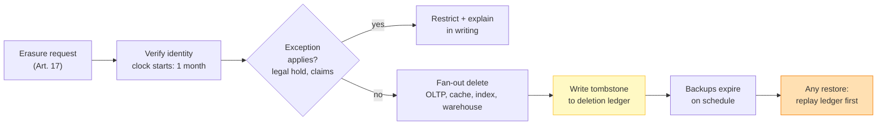

# Chapter 2 — Data Privacy: What GDPR, CCPA, and "Consent" Actually Require You to Build

> Chapter 1 ended on ACM 1.6 (respect privacy) pulling against 1.1 in a fraud-detection feature. A code can tell you to notice that tension. Only law tells you what happens when you resolve it wrongly, and only engineering decides whether the resolution is even possible.

---

## The Problem

A user in Lyon emails support: "Delete everything you have on me." You open the architecture diagram and count where their data lives: a Postgres row (with a `deleted_at` flag, because someone once feared losing data), an immutable event log, a nightly warehouse with derived tables, a Redis cache, a search index, 35 days of database backups, application logs, and a recommendation model retrained weekly on the events. Nobody designed those copies to be findable by *person*. They were designed by time, by table, by shard.

Separately, marketing asks for "just an analytics tag," which turns out to load three third-party scripts before the user has clicked anything.

Both requests are legal questions only because they are engineering facts first. This chapter derives what the main laws demand in terms of things you can build and test: a lawful-basis field, a consent ledger, a deletion fan-out, a 72-hour breach clock, a signal handler for Global Privacy Control, and a release process that can say *why* a dataset is anonymous rather than just asserting it. The ethical anchor from Chapter 1 is the second paragraph of ACM 1.6: collect the minimum necessary, define retention, allow individuals to review, correct and delete, and take precautions against re-identification. The laws below are, in large part, that paragraph made enforceable.

## 2.1 Why Privacy Law Exists: Who Carries the Risk

Start from the economics rather than the statute. A company collects data because it is cheap to collect, cheap to keep, and might be valuable later. The person described by the data cannot see what is collected, who receives it, or how it is combined. That is information asymmetry. Now add breach: if the data leaks, the company pays notification costs and reputation damage, but the person pays identity theft, stalking, a discriminatory decision, or exposure of a health condition. The harm lands on people who never chose the risk and could not price it. A market cannot correct this alone, because the party with the information and the control is not the party who bears the loss.

Privacy law is the standard fix for an externality: move the cost back to the party who creates the risk. GDPR does it with obligations that must be *demonstrable* (Art. 5(2): the controller must be able to show compliance) and with fines large enough to matter (2.6). CCPA does it with disclosure, opt-out rights and enforcement. Everything below is a different mechanism for the same move.

## 2.2 GDPR: Who It Covers and What It Asks

**Territorial scope (Art. 3).** GDPR applies to a controller or processor *established* in the EU, wherever the processing happens. It also applies to a company with no EU presence that (a) offers goods or services to people in the Union, "irrespective of whether a payment" is required, or (b) monitors their behaviour in the Union. Two engineering consequences. A free app with an EU audience is covered, because "free" is explicitly irrelevant. And analytics that track EU visitors' behaviour are covered even if your servers are in Virginia.

**The principles (Art. 5)** are seven, and each one maps to something you either have or lack:

| Principle | The build artifact it demands |
|---|---|
| Lawfulness, fairness, transparency | A recorded lawful basis per purpose; a privacy notice that matches what the code does |
| Purpose limitation | Each dataset tagged with the purpose it was collected for; a review before reuse |
| Data minimisation | Schemas that omit fields you cannot justify; "adequate, relevant and limited to what is necessary" |
| Accuracy | A correction path (Art. 16) that reaches every copy |
| Storage limitation | Retention TTLs that are *enforced*, not documented |
| Integrity and confidentiality | Access control, encryption, audit logs |
| Accountability | Records you can show a regulator |

Notice that four of the seven are about *time and copies*, which is why the Problem paragraph hurts: storage limitation and accuracy are properties of every replica, not just the primary.

## 2.3 Lawful Bases, and Why Consent Is Often the Wrong One

Art. 6(1) says processing is lawful only if at least one of six bases applies: **consent; contract** (necessary to perform it); **legal obligation; vital interests; public task; legitimate interests** (balanced against the person's rights). There is no "we collected it, so we may use it."

Developers reach for consent first because it feels like the honest option. It is frequently the worst one, because consent is the only basis the person can pull out from under you. Art. 7(3) requires that withdrawal be as easy as giving consent, and withdrawal must actually stop the processing. If your pipeline cannot honour a withdrawal mid-stream, you built on a basis you cannot keep. For an *employer*, the problem is worse: the EDPB's Guidelines 05/2020 say it is unlikely an employee can refuse an employer's request without fearing detrimental effects, so employee consent is "problematic" as a basis. Recital 43 makes the same point about any "clear imbalance" and adds that consent is presumed not free if a service is made conditional on consent that is not necessary for it. An employer monitoring badge scans should look at legitimate interests (with a balancing test and a DPIA, 2.5) or a legal obligation, not a checkbox the employee cannot refuse.

When consent *is* the right basis (optional advertising, optional analytics), Art. 4(11) sets four adjectives: **freely given, specific, informed, unambiguous**, signalled by a statement or clear affirmative action. Art. 7(1) adds that the controller must be able to *demonstrate* it. The CJEU's *Planet49* (C-673/17, 1 October 2019) turned the adjectives into a rule you can test: a pre-ticked checkbox is not valid consent, and the information given must include how long the cookies last. (The case applied the ePrivacy Directive's cookie rule, Art. 5(3), read with GDPR's definition of consent.) Silence and defaults, in other words, are not choices.

What that implies for the build is an **append-only consent ledger** plus an **enforcement point** that reads it before any consent-dependent processing:

```ts
type Purpose = "analytics" | "ads";
type Consent = { purpose: Purpose; granted: boolean; at: string; textVersion: string };

// Append-only; the latest row per purpose wins; absence means "not granted".
function granted(ledger: Consent[], p: Purpose): boolean {
  const rows = ledger.filter(r => r.purpose === p);
  return rows.length > 0 && rows[rows.length - 1].granted;
}
// EU: opt-IN. California: opt-OUT, unless a signal or a prior opt-out says otherwise.
function mayLoadAdTech(region: "EU" | "CA", ledger: Consent[], secGpc?: string): boolean {
  if (region === "EU") return granted(ledger, "ads");
  return !(secGpc === "1" || ledger.some(r => r.purpose === "ads" && !r.granted));
}
```

Run with Node 22, this returns `false` for an EU user with no record, `true` after they consent, `false` again after a later withdrawal row; and for California, `true` with no record but `false` when the request carries `Sec-GPC: 1`. Three design choices are visible: the ledger stores the *text version* shown (so you can demonstrate what they agreed to, Art. 7(1)); the default for the EU branch is "off"; and withdrawal is just another row, so history is preserved. Its limit is the region argument: IP geolocation is wrong often enough that many teams apply the stricter rule everywhere, trading some revenue for fewer failure modes.

You can test the gate from outside, which is the point of [Chapter 68 of the Playwright track](../../../21_SDET_Playwright_Automation/03_Real_World_Scenarios/68_Consent_Overlays_And_CAPTCHA.md) and [Lab 02](../../../21_SDET_Playwright_Automation/labs/02-cookie-consent/README.md): its requirement R2 ("no tracking requests are made before the visitor makes a choice") and R3 (none after Reject, even after a reload) are Art. 4(11) and 7(3) restated as network assertions.

## 2.4 Data-Subject Rights and the Engineering Cost of Erasure

GDPR gives people rights of access, rectification, erasure (Art. 17), restriction, portability, and objection, plus protection against some automated decisions (Art. 22). Art. 12(3) sets the clock: answer "without undue delay and in any event within one month," extendable by two further months if you explain within the first month. Rights are cheap to grant on paper. Erasure is expensive in practice, because of what Art. 17 actually says: the person may demand erasure without undue delay when the data are no longer necessary, consent is withdrawn and no other basis exists, they object, or processing was unlawful. Exceptions exist (legal obligations, legal claims, some research and archiving). And where you made the data public, Art. 17(2) requires "reasonable steps, including technical measures" to tell other controllers.

Now trace the Lyon user through the system. Each row is a place where "delete" means something different:

| Store | Why it exists | Why naive delete fails | Mechanism that works |
|---|---|---|---|
| OLTP row | Source of truth | Soft delete keeps the data; [Ch46's soft-delete warning](../../../07_Modern_Java/Ch46_SB_Database_Design.md) already lists the query, FK and unique-index damage | Hard delete or field-level scrub; keep a minimal tombstone |
| Event log | Replay, audit | Append-only by design | Don't put raw PII in events; reference an opaque ID, and drop the ID's mapping |
| Warehouse / aggregates | Fast analytics | Derived rows copy the data; aggregates can't be "un-summed" | Delete on the key; recompute; or aggregate to a level where individuals vanish |
| Cache / search index | Speed (a space-for-time trade, see [Space-Time Tradeoffs](../../../14_Mental_Models/12_Space_Time_Tradeoffs.md)) | Every copy made for speed is a copy to erase | Invalidate by user key; short TTL |
| Backups | Disaster recovery | Immutable, restored whole | Expire by schedule; replay deletions after any restore |
| Logs | Debugging | Free-text PII in messages | Don't log PII; short retention |
| Trained model | Recommendations | Weights are derived from the data | See below |

Two of these deserve derivation.

**Backups.** A snapshot cannot be edited, so deletion from it is impossible until it expires. The UK ICO's position (UK GDPR guidance, the retained UK version) is that if the data cannot be overwritten at once it must be put "beyond use": never restored to serve a purpose, only held until replaced on an established schedule. EU authorities are not uniformly the same text, so treat this as one regulator's tolerance, not a universal rule. The engineering consequence is a **deletion ledger**: you store the minimal facts (the opaque internal ID and the erasure date) and, after *any* restore, replay it before the system serves traffic. Otherwise a disaster recovery silently resurrects people who were deleted. And the backup schedule is itself decidable: with 35-day retention, the worst-case lag from request to disappearance is 35 days; with seven yearly archives, it is seven years, and you must justify that against storage limitation.

**Models.** Weights trained on personal data are not automatically exempt. In Opinion 28/2024 (17 December 2024) the EDPB said a model trained on personal data cannot be assumed anonymous; this must be assessed case by case, asking whether personal data can be extracted from the model or obtained through queries with more than insignificant likelihood. If it cannot be shown anonymous, the honest options are to exclude the person at the next retrain, or to accept that the model is in scope. Chapter 3 returns to what a model *does* with people; the point here is that "we trained on it" is a retention decision.



**How to read this diagram.** Follow the erasure request (Art. 17) left to right: verify identity (the one-month clock starts), then test for an exception such as a legal hold or claims. If one applies, restrict and explain in writing; if not, fan out the delete across OLTP, cache, index and warehouse, write a tombstone to the deletion ledger, let backups expire on schedule, and replay the ledger before any restore. Notice the two highlighted nodes: the ledger and the replay step are what keep a deletion from being undone by a backup restore.

Notice the ledger violates its own purpose slightly (you keep an ID to remember you deleted it). That is deliberate and defensible: the ID is opaque, kept to honour the erasure itself, and holds no profile. Where partitioning by time is available, [dropping a partition](../../../08_SQL/32_Partitioning_Sharding_Replication.md) enforces retention in one metadata operation instead of a billion-row `DELETE`, which is why storage-limitation compliance is often an *architecture* decision made at table-design time.

## 2.5 Obligations That Shape Architecture: Arts. 22, 25, 33, 35

**Art. 22** gives people the right not to be subject to a decision "based solely on automated processing" with legal or similarly significant effects, with exceptions (contract, authorising law, explicit consent) that still require safeguards: human intervention, a way to state a view, and a way to contest. Chapter 3 treats this in depth; the build implication is a human-review path and an explanation record that exist *before* launch.

**Art. 25** is data protection *by design and by default*. By default, only the personal data necessary for each purpose may be processed, in volume, scope, storage period and accessibility, and data must not be made available "to an indefinite number of natural persons" without the individual's action. That sentence is a unit test: a new profile defaults to private, and any "make public" is an explicit act.

**Art. 33** gives a breach clock: notify the supervisory authority "without undue delay and, where feasible, not later than 72 hours after having become aware," unless the breach is unlikely to risk people's rights. If you miss 72 hours you must explain why. Processors must tell the controller without undue delay (Art. 33(2)), so your vendor contracts are part of your clock. The notice must say what happened, approximately to how many people and which categories, a contact, likely consequences, and mitigations. You cannot write that from nothing at hour 71. It requires an inventory of what data lives where and access logs good enough to scope the incident, which is the same data map that erasure needed.

**Art. 35** requires a Data Protection Impact Assessment *before* processing that is likely to be high-risk, including large-scale special-category data and systematic large-scale monitoring, and its minimum content is the processing described, necessity and proportionality, the risk to people, and the measures. Chapter 6 uses it as a template for the capstone.

## 2.6 What a Violation Costs: Art. 83 and the Meta Transfer Fine

Art. 83 sets two ceilings, each a fixed sum *or* a share of worldwide annual turnover of the preceding year, "whichever is higher":

- **Lower tier (Art. 83(4)):** up to €10 million or 2%. Covers, among others, Arts. 25–39 (design by default, security, breach notification, DPIAs).
- **Upper tier (Art. 83(5)):** up to €20 million or 4%. Covers Arts. 5–7 (principles, lawful bases, consent), Arts. 12–22 (data-subject rights, including erasure), and Arts. 44–49 (international transfers).

Art. 83(1) adds that fines must be "effective, proportionate and dissuasive," and 83(3) caps the total for linked infringements at the amount for the gravest one. Computed:

| Worldwide turnover | Upper tier, max(€20M, 4%) | Lower tier, max(€10M, 2%) |
|---|---|---|
| €200M | €20M (4% = €8M, so the fixed sum wins) | €10M |
| €500M | €20M (break-even point) | €10M |
| €2B | €80M | €40M |
| €10B | €400M | €200M |

The two curves cross at €500M for both tiers, because 20M/0.04 = 10M/0.02. Below it the fixed floor is the binding ceiling, so small firms are not safe merely because 4% of their revenue is small; above it the percentage dominates, so for large firms the fixed sum is irrelevant.

Real enforcement: on 12 May 2023 (announced 22 May) Ireland's Data Protection Commission fined Meta Platforms Ireland **€1.2 billion** for continuing to transfer EU Facebook users' data to the US on Standard Contractual Clauses without adequate safeguards, an Art. 46(1) infringement, following a binding EDPB decision under Art. 65. It also ordered Meta to suspend future transfers within five months and bring processing into compliance within six. Chapter V is upper tier. Meta's 2022 revenue was $116.61 billion, so 4% is about $4.66 billion; at an illustrative $1.05 to $1.09 per euro, €1.2 billion is roughly 27% to 28% of that ceiling and about 1.1% of turnover. The ceiling is a ceiling, not a price list. Meta appealed to the Irish High Court, with complainant Max Schrems joined; the sources I found as of April 2026 record the appeal as pending with no final judgment. That fine is still the largest GDPR fine in the 2026 lists I checked.

## 2.7 CCPA/CPRA: Opt-Out Instead of Opt-In

California's law starts from the opposite default. GDPR forbids processing until you have a basis; CCPA (as amended by the CPRA) permits collection and gives the consumer rights to know, delete, correct, **opt out** of sale or sharing, and limit use of sensitive personal information. Response time is 45 days, extendable to 90, against GDPR's one month plus two. The engineering difference is where the gate sits: the EU branch of the function in 2.3 defaults to *off*, the California branch to *on*, and a signal turns it off.

**Who is covered**, any one of: annual gross revenue above a statutory $25 million, adjusted for inflation to **$26,625,000 from 1 January 2025** (the California Attorney General's overview page still shows the original $25 million; the CPPA's adjustment page is the authority, and the next adjustment is 1 January 2027); buying, selling or sharing the data of 100,000 or more consumers or households; or deriving 50% or more of revenue from selling or sharing. The same adjustment moved administrative fines to $2,663 per violation and $7,988 per intentional one, and breach-related statutory damages to $107 to $799 per consumer per incident.

**Global Privacy Control** makes opt-out machine-readable: a browser sends the header `Sec-GPC: 1` and exposes `navigator.globalPrivacyControl` (W3C GPC specification). It matters legally because ignoring it was enforced. In the first CCPA settlement to carry a fine (announced 24 August 2022), Sephora paid **$1.2 million** after the Attorney General alleged it let third-party trackers collect data without disclosing a sale, ignored GPC opt-outs, and did not cure within the 30-day period then in force. In July 2025, Healthline Media's **$1.55 million** settlement, the largest at that time, added purpose limitation: sharing article titles that inferred diagnoses.

**2026 status (as of October 2026).** The CPPA's package on ADMT, risk assessments and cybersecurity audits received OAL approval on 22 September 2025 and took effect 1 January 2026. ADMT obligations (pre-use notice, opt-out, access) bind from **1 January 2027**; risk-assessment attestations are due by 1 April 2028; audit certifications are due 1 April 2028, 2029 or 2030 depending on revenue ($100M+, $50M to $100M, under $50M). AB 566 (signed 8 October 2025) requires browsers to offer an opt-out signal from 1 January 2027. And under the Delete Act, brokers had to start processing the DROP deletion platform's requests on 1 August 2026, within 45 days, at $200 per request per day of delay; over 475,000 Californians had signed up by August 2026. These are moving targets: check dates before relying on them.

## 2.8 Surveillance and Ad Tech: Why "No Cookies" Is Not "No Tracking"

**Third-party tracking and real-time bidding.** When a page loads, the ad slot triggers an auction: a bid request describing the visitor (identifiers, URL, device, often location) is broadcast to many bidders, of whom one wins and all keep what they received. The Irish Council for Civil Liberties, an advocacy group, estimated in 2022 that RTB exposes the average person's data 376 times a day in Europe and 747 in the US, 178 trillion broadcasts a year across both, so treat the figures as an advocate's estimate rather than a regulator's finding. The legal question is who is responsible. In *IAB Europe* (C-604/22, 7 March 2024) the CJEU held that the TC String encoding users' consent choices can be personal data, and that the industry body can be a joint controller. Belgium's authority had fined IAB Europe €250,000 in 2022.

**Fingerprinting: derive it.** To single out one person among N you need log2(N) bits. With about 8.2 billion people (UN, 2024), log2(8.2×10⁹) = **32.9 bits**, so 33 bits of independent, stable information name anyone on Earth. Each attribute contributes −log2(p) bits for a value shared by fraction p of people: a fair coin gives 1 bit; "uses a browser that 1 in 1,024 people use" gives 10.

Peter Eckersley's 2010 Panopticlick study (470,161 browsers) found a fingerprint of ordinary browser attributes had **at least 18.1 bits** of entropy, meaning at best one in 286,777 other browsers shares it. 83.6% of browsers were unique, and 94.2% among those with Flash or Java. Subtract: 32.9 − 18.1 = **14.8 bits remain**, and any one more independent signal of that size, such as a coarse location combined with a timezone and language, completes the job. Three boundaries keep this honest. The sample was *self-selected privacy-conscious users*, so it is biased. "At least" matters: log2(470,161) = 18.84 is the most a sample that size can resolve, so the study could not have measured more. And bits add only when attributes are independent; correlated ones (language and timezone) add less. Eckersley also observed fingerprints changing rapidly, which limits how long one stays useful, but a tracker re-linking changed fingerprints needs few bits to do it. The moral for a regulator and an engineer is the same: removing cookies removes one identifier, not identifiability.

**Dark patterns in consent.** On 6 January 2022 the CNIL announced fines of **€150 million on Google** (€90 million Google LLC, €60 million Google Ireland) and **€60 million on Facebook**, decided 31 December 2021. The infringement was asymmetry: one click to accept all cookies on the sites, several to refuse, which the CNIL held distorts consent in favour of "accept." It is the Chapter 1 account-deletion question (Q1) in regulatory form: friction proportional to risk is a safeguard; friction aimed at the user's choice is a trustworthiness violation.

**Consent-or-pay.** The EDPB's Opinion 08/2024 (17 April 2024) concluded that, in most cases, large online platforms cannot obtain valid consent by offering only a binary choice of consent or pay, and recommended an equivalent alternative without a fee. On 23 April 2025 the Commission found Meta in breach of the Digital Markets Act (Art. 5(2)) and fined it **€200 million**; Meta appealed on 4 July 2025. In December 2025 the Commission acknowledged a commitment to offer a "less personalised ads" choice, rolled out in January 2026, and by March 2026 the European consumer organisation BEUC was calling the changes minor. Treat this as unsettled.

## 2.9 Minimisation as Engineering: Pseudonymised Is Not Anonymous

The legal line is Recital 26: pseudonymised data (Art. 4(5), attributable to a person with additional information kept separately) is *still personal data*. Only data for which identification is not "reasonably likely," judged by the cost, time and technology available, including *singling out*, is anonymous and outside the Regulation.

**Hashing an identifier is pseudonymisation, and weak.** Unsalted SHA-256 of an email can be reversed by hashing a list of candidates. Computed: against a 200,000-email dictionary the plain hash is reversed instantly, while a keyed HMAC of the same value yields no match without the key. For a 10-digit phone number the whole space is 10¹⁰ values; OpenSSL's SHA-256 benchmark on this laptop ran about 2.5 million 16-byte hashes per second per core, so one core walks the space in roughly 68 minutes. (Real phone plans have far fewer valid numbers, and GPUs are much faster; neither was measured here.) The fix is a **keyed** pseudonym with the key held elsewhere, which turns "reversible by anyone" into "reversible by whoever holds the key," exactly the Art. 4(5) definition.

**Why quasi-identifiers matter: Sweeney, Golle, and arithmetic.** Latanya Sweeney found that **87%** of the US population (216 million of 248 million, 1990 census) was likely unique on {5-digit ZIP, gender, full birth date}; Philippe Golle's 2006 redo found **61%** for 1990 and **63%** for 2000 and could not explain the gap. The sources conflict, so state both. A model shows why uniqueness is plausible: 42,000 ZIPs × 31,046 birthdays (85 years) × 2 genders is 2.6 billion cells, 31.3 bits, against 27.9 bits for 248 million people. If people fell uniformly, the chance of sharing a cell is about N/M = 0.095, so about 91% would be unique, an upper bound the real, lumpy distribution drops below. (The ZIP count and age span are my modelling assumptions.) The same effect appears in movement data: de Montjoye et al. (2013) showed four spatio-temporal points identify 95% of 1.5 million mobile users. Sweeney's 1997 re-identification of Governor Weld's hospital record used the same logic against one known person (six people in Cambridge shared his birth date, three were men, one lived in his ZIP), though critical re-examinations question how far that single targeted attack generalises.

**k-anonymity, and the way it fails.** Sweeney's k-anonymity (2002) requires every record to be indistinguishable from at least k−1 others on its quasi-identifiers, by generalising them. A computed 12-row table (ZIP, age, condition) is unique on raw ZIP and age (k = 1). Generalising to a 3-digit ZIP and ten-year age bands gives three groups of four, so **k = 4**:

| Group | Conditions inside |
|---|---|
| 130**, 20–29 | Heart disease ×2, Viral infection ×2 |
| 130**, 30–39 | Cancer ×4 |
| 148**, 40–49 | Viral infection ×2, Cancer, Heart disease |

Every group has four members and the table *is* 4-anonymous, yet an attacker who knows a neighbour is 35 and lives in 13068 learns they have cancer with certainty, since all four share it. This is the **homogeneity attack** (Machanavajjhala et al., ICDE 2006), alongside the background-knowledge attack. The fix, ℓ-diversity, demands at least ℓ distinct sensitive values per group; coarsening to 20-year bands gives k = 4 and ℓ = 3 at the cost of resolution. The tradeoff is the usual one: more generalisation, more privacy, less analytic value.

**Differential privacy (pointer).** Instead of editing the *data*, add calibrated noise to the *answer*. For a count (sensitivity 1, because one person changes it by at most 1), adding Laplace noise of scale 1/ε is ε-differentially private (Dwork, McSherry, Nissim, Smith, TCC 2006). Computed for ε = 0.1: noise standard deviation ≈ 14.1, and an attacker trying to tell "Alice is in the data" from "not in" with one answer is right only **52.4%** of the time (1 − ½e^(−ε/2)), against 100% with no noise. The catch is composition: simulation with 100 queries at ε = 0.1 each, where the attacker averages, rises to about 63.5%, and 1,000 queries to about 86.7%. Privacy is a *budget* that queries spend, so a system must meter them.

## Section Challenge

<details>
<summary><strong>Q1.</strong> A company wants to analyse employees' badge-in times to "optimise office space," collecting a signed consent form from each employee. A works council objects. Which lawful basis is the company reaching for, why is it a poor fit, and what should the pipeline be built on instead?</summary>

The company is reaching for **consent (Art. 6(1)(a))**. It fits badly for two reasons. First, validity: the EDPB's Guidelines 05/2020 say the employment relationship creates dependency, so an employee is unlikely to refuse without fearing detriment, and Recital 43 treats consent as not freely given where there is a clear imbalance. A signature collected under those conditions is evidence of compliance, not of choice. Second, stability: consent can be withdrawn at will (Art. 7(3)), so if one employee withdraws, the analysis must stop for them. A pipeline built on consent must therefore carry a per-person switch, and "optimise space" needs *aggregate* occupancy anyway.

The sturdier design asks what the purpose requires. Space planning needs counts per floor per hour, not who badged in. So build on **legitimate interests (Art. 6(1)(f))** with a documented balancing test, aggregate at ingestion (drop the employee ID before storage), set short retention, and run a DPIA if monitoring is systematic (Art. 35). This also satisfies Art. 25 and ACM 1.6's "minimum amount necessary." The consent form was the wrong tool because the legitimate goal never needed the personal data.

</details>

<details>
<summary><strong>Q2.</strong> A user's erasure request arrives on day 0. Your database backups are retained for 35 days, and last night's snapshot contains the user. On day 12 an outage forces a restore from that snapshot. Walk through what you must have built for the response to be defensible, and name the failure if you had not.</summary>

On day 0 delete from live stores (the OLTP row, cache, search index, warehouse keys) and log the opaque user ID and erasure date in a **deletion ledger**. Within a month (Art. 12(3)) tell the user it is done, and explain that residual copies in backups will expire within 35 days.

The snapshot cannot be edited, so the backup copy persists until it expires, at most 35 days after the request. The ICO's approach (one regulator's position) is to accept this if the backup is put "beyond use," held only until replaced on a schedule.

The day-12 restore is the trap. Restoring the day-0 snapshot **resurrects the user's row** and would put them back into production and onward into the warehouse, undoing the erasure and creating an Art. 17 infringement. The control is to replay the ledger against the restored data *before it serves traffic*. Without the ledger you would have no way to know whom to re-delete, because the only record of who asked was in the database that was just rolled back. Also check that the worst-case lag (35 days) is something you have justified under storage limitation, and that no longer-lived archive holds the person.

</details>

<details>
<summary><strong>Q3.</strong> An analyst says: "We replaced emails with their SHA-256 hash and released the dataset publicly, so it's anonymised and outside GDPR." Evaluate the claim using this chapter's computed results, and say what the release team should do before calling it anonymous.</summary>

The claim confuses pseudonymisation with anonymisation. Under Art. 4(5) and Recital 26, data that can be attributed to a person with additional information is still personal data, and anonymity is judged by means "reasonably likely" to be used, including singling out. Unsalted hashing of a guessable input fails that test: in the computed demonstration, a 200,000-email dictionary reversed the plain hash immediately, while a keyed HMAC did not; and for 10-digit phone numbers, a single core exhausts all 10¹⁰ values in about 68 minutes at the measured rate. A public release invites exactly this dictionary attack.

The remaining columns are a second problem. If the dataset also carries ZIP, birth date and gender, Sweeney and Golle show 63% to 87% of Americans are unique on those three, and de Montjoye shows four location points identify 95% of people; the hash is irrelevant when quasi-identifiers do the singling out.

Before calling it anonymous, the team should: remove or coarsen quasi-identifiers and measure k *and* ℓ; test with an actual linkage attack (the Art. 25 and 35 style of evidence); use a keyed pseudonym internally if linkage is needed; consider releasing noisy aggregates instead of rows, tracking the privacy budget; and record the reasoning, since accountability (Art. 5(2)) means being able to *show* why the data is anonymous. If the answer is only "we hashed it," treat it as personal data and apply a lawful basis.

</details>

---

## Chapter Summary

| Concept | What it establishes | Concrete anchor from this chapter |
|---|---|---|
| Privacy law as externality fix | Moves breach and misuse costs back to the party creating the risk | Harm lands on people who never chose the risk (2.1) |
| GDPR scope and principles (Arts. 3, 5) | Applies to EU-targeting or monitoring processors anywhere; seven principles each map to a build artifact | "Free" is irrelevant under Art. 3(2); 4 of 7 principles are about copies and time |
| Lawful bases and valid consent (Arts. 6, 4(11), 7) | Consent is withdrawable at will, so often the wrong basis, especially for employers | *Planet49* (2019): pre-ticked box invalid; consent ledger with text version |
| Erasure (Art. 17) | "Delete" must reach every copy, derived store, backup and model | Deletion ledger replayed after restore; ICO "beyond use"; EDPB Opinion 28/2024 |
| Arts. 22, 25, 33, 35 | Human review, private-by-default, a 72-hour clock, pre-launch risk assessment | 72 hours needs a data map and logs before the incident |
| Art. 83 fines | Two tiers, "whichever is higher" | Crossover at €500M; Meta €1.2B (May 2023) is about 27% to 28% of its 4% ceiling |
| CCPA/CPRA | Opt-out default; GPC; threshold $26,625,000; 2026-27 ADMT and risk rules | Sephora $1.2M (2022); Healthline $1.55M (2025); ADMT from 1 January 2027 |
| Ad tech and fingerprinting | Identifiability is bits, not cookies | 32.9 bits to single out anyone; Panopticlick at least 18.1 bits; 14.8 remain |
| Dark patterns, consent-or-pay | Friction aimed at the choice distorts consent | CNIL €150M Google, €60M Facebook (Jan 2022); Meta €200M DMA (Apr 2025) |
| Pseudonymisation vs anonymisation | Keyed pseudonyms are reversible by the key holder; anonymity needs measured resistance to linkage | Plain hash reversed instantly; k = 4 yet homogeneity leaks cancer; Laplace ε = 0.1 gives 52.4% |

## Where We Go Next

This chapter treated data as something about people that must be protected. The next question is what happens when that data is used to make *decisions* about them: a model trained on records that encode past unfairness will learn it, and Art. 22 gives people a right to contest, which presupposes you can explain the result. Chapter 3 takes on bias in training data, fairness metrics that provably cannot all hold at once, and explainability, using COMPAS as its test case.

*Next: [03_AI_Ethics_Bias_Fairness_And_Explainability.md](03_AI_Ethics_Bias_Fairness_And_Explainability.md)*
