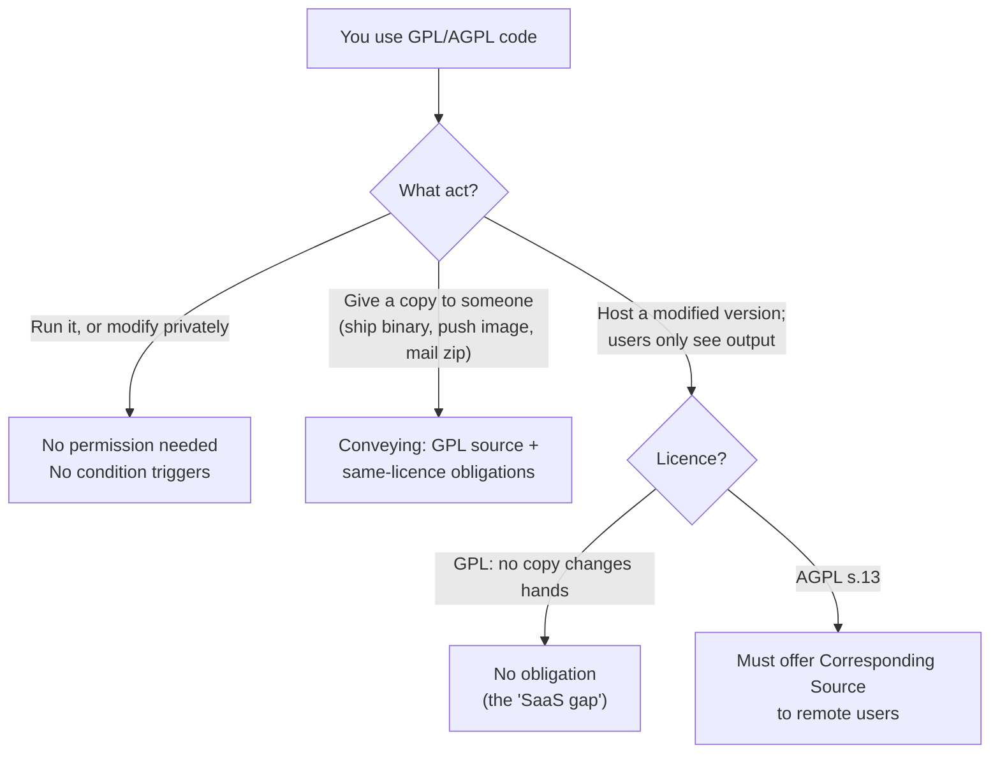

# Chapter 4 — Intellectual Property & Open-Source Licensing: Who Owns the Code, and What the Licence Lets You Do

> You did not write 326 of the packages in your test framework, and a lawyer will never read them. This chapter derives, from what each legal regime is *for*, what you owe the people who did write them, what you can own yourself, and why the answer changed under several companies' feet between 2021 and 2025. (Educational material, not legal advice: a real dispute needs a lawyer in your jurisdiction.)

---

## The Problem

Open [`21_SDET_Playwright_Automation/framework/package.json`](../../../21_SDET_Playwright_Automation/framework/package.json) in this repo and run `npm install`. You now have a `node_modules` tree written by hundreds of strangers. Three questions follow that the codes of ethics in [Chapter 1](01_Professional_Ethics_Frameworks_And_Safety_Critical_Systems.md) cannot answer by themselves. May you ship this? What, if anything, must you hand to the people who receive it? And what happens when one of those strangers, or their employer, changes the terms next year?

ACM Code principle 1.5 is the ethical anchor. Its heading reads "Respect the work required to produce new ideas, inventions, creative works, and computing artifacts", and its guidance (paraphrased) tells professionals to credit creators and to respect copyrights, patents, trade secrets and licence agreements. It also tells them not to unduly oppose reasonable uses, including free and open-source software, and not to claim private ownership of work shared as public resources. (Chapter 1 abbreviated the heading; the full text includes "computing artifacts".) That is a duty with two edges: honour the creator's chosen terms, and do not weaponise ownership against the commons. To honour terms you have to know what the terms *are*, and that requires understanding what law lets anyone impose terms at all.

## 4.1 Four Regimes, Derived From What Each One Is For

The law does not have one thing called "IP". It has four tools, each built to stop a different kind of harm, and each protects a different aspect of software:

| Regime | The harm it stops | What it covers in software | What it does NOT cover |
|---|---|---|---|
| Copyright | Copying a creator's *expression* | Source and object code, docs, UI text, the specific way a program is written | The idea, algorithm or method behind it (17 U.S.C. §102(b) excludes ideas, procedures, processes, systems, methods of operation) |
| Patent | Someone else *practising an invention*, even if they never saw yours | A novel, non-obvious technical method, if it clears eligibility (4.3) | Anything not claimed; abstract ideas |
| Trademark | *Confusing users* about who made something | Names, logos: "Redis", "Terraform", "kik" | The code itself |
| Trade secret | *Breach of confidence* over information whose value depends on secrecy | Unreleased source, model weights, algorithms kept private | Anything you publish; independently re-derived knowledge |

Read the table as consequences of purpose. Copyright regulates *copying*, so two programmers who independently write identical code do not infringe each other, and the protection must attach to the thing copied, the expression, never the idea underneath. Patents regulate *practising*, so independent invention is no defence, and in exchange the inventor must publicly disclose and the monopoly is time-limited. Trademark regulates the *market signal*, which is why a trademark can be enforced even against someone using only unprotected ideas, and why an open licence can license the code while withholding the name. Trade secret exists only while secrecy lasts, so publishing code under an open licence gives that regime up for that code.

This is why open-source licensing works at all. A licence is not a special legal object: it is a *permission from the copyright holder* to do things copyright would otherwise forbid (copy, adapt, distribute), granted on conditions. Every licence term in this chapter, including copyleft, is a condition attached to a permission. Hold on to that sentence; section 4.4 derives the whole copyleft mechanism from it.

## 4.2 Copyright: Automatic, Owned by Someone, and Not About Ideas

**Automatic.** Under the Berne Convention, Article 5(2), enjoyment of these rights is "not subject to any formality": no registration, no © symbol. The moment you write the code, someone owns it. That has a corollary engineers get wrong constantly: code on GitHub *without* a licence file is not "free to use", it is "all rights reserved by default", because the only source of permission would be a licence and none was granted.

**Owned by whom?** The author, unless a work-made-for-hire rule intervenes. Under 17 U.S.C. §201(b) the employer is the author for work an employee produces within the scope of employment. An independent contractor is different: *Community for Creative Non-Violence v. Reid* (1989) held that common-law agency principles decide who is an employee, and commissioned works become works for hire only if they fall in the statute's enumerated categories and a signed writing says so. Custom software for a client generally fits none of the categories, so the contractor owns the code unless a written **assignment** transfers it. Two practical consequences follow. First, a freelancer's contract needs an assignment (or an explicit licence). Second, an employee's invention-assignment clause is bounded by state law; California Labor Code §2870, for example, bars claiming inventions made entirely on your own time without employer resources unless they relate to the employer's business or came from work for the employer. Where those boundaries sit in your jurisdiction is a question for counsel, not folklore.

**Idea versus expression, tested to the limit.** Does copyright protect the *shape* of an API? In *Google LLC v. Oracle America, Inc.* (decided April 5, 2021) the US Supreme Court voted 6–2, Justice Breyer writing, Justice Thomas dissenting with Justice Alito, Justice Barrett not participating. Google had copied about 11,500 lines of Java SE "declaring code", roughly 0.4% of a 2.86-million-line API, so Android developers could reuse their Java skills, and had written its own implementing code. The Court held the copying was **fair use**. It did *not* decide whether that declaring code is copyrightable at all: it assumed so, for argument's sake. So the correct summary is narrow. A fair-use ruling on those facts says nothing like "APIs cannot be copyrighted", and anyone teaching that is repeating a headline the opinion did not write.

The engineering lesson comes from §102(b). The *function* a method performs is free for all; your *particular code* is protected. Reimplementing behaviour from a spec, clean-room, is the safe pole; pasting someone's source is the unsafe pole; copying structural declarations sits in contested territory the Court chose not to map completely.

## 4.3 Patents, Trademarks, Trade Secrets: The Parts That Touch Code

**Software patents and the Alice test.** *Alice Corp. v. CLS Bank International* (June 19, 2014, unanimous, Justice Thomas writing) fixed the filter for whether a software claim is even eligible. Step one asks whether the claim is directed at a patent-ineligible concept (an abstract idea, a law of nature, a natural phenomenon). If so, step two asks whether the claim's elements, individually and as an ordered combination, add something that transforms it into a patent-eligible application. Alice's claims covered intermediated settlement (using a third party to reduce settlement risk), run on a computer. The Court called that an abstract idea, a fundamental economic practice, and held that saying "apply it with a computer" does not rescue it, because generic computer functions add no inventive content.

A worked trace on a made-up claim, "ranking search results by user dwell time, performed by a processor": step one finds an abstract idea (ranking by a measured quantity); step two finds a generic processor doing generic arithmetic, so nothing is added; the claim fails. A claim that improves *how the computer itself operates*, such as a new cache-invalidation scheme with measurable latency effects, has a stronger path through step two. The Alice line moves case by case, but its structure is stable: *the patent must be for a technical improvement, not for an idea plus a computer*. For you as an engineer the live risk is different from eligibility: independently written code can still infringe someone's valid patent, which is exactly why Apache-2.0's patent grant (4.5) matters.

**Trademark** matters to code in two ways this chapter will keep meeting. Apache-2.0 §6 expressly grants no right to use the licensor's names except to describe origin and reproduce a NOTICE file. And Redis's 2024 terms (4.7) added restrictions on using "Redis" in product names. A licence can open the code while the *name* stays closed, which is why every fork renames itself (OpenTofu, Valkey, OpenSearch).

**Trade secret** is the regime for what you do *not* publish: unreleased source, proprietary prompts, model weights. It lasts only while reasonable secrecy lasts, so the decision to open-source something is simultaneously a decision to abandon trade-secret protection for it.

## 4.4 Copyleft, Derived From the Trigger

Start with what copyright regulates and ask what a licence *needs* to condition. Copyright reserves reproduction, adaptation, distribution and public performance to the owner. Running a program on your own machine is not among them; the GPLv2 text says outright that running the program is not restricted, and the GPLv3 defines "propagate" as anything that would make you liable for infringement without permission, "except executing it on a computer or modifying a private copy". So there are exactly three situations:

1. You **run** it. No permission needed; no licence condition can attach.
2. You **modify it privately**. Still no permission needed: GPLv3 §2 grants unconditional permission to make, run and propagate covered works that you do not convey.
3. You **distribute** a copy, original or modified. Now you need permission, so the licence's conditions bite.

Copyleft is a condition on step 3: *if you give someone a copy, you must give them the same freedoms you received, including source.* GPLv3 sharpens the trigger into "convey" and, tellingly, adds that "mere interaction with a user through a computer network, with no transfer of a copy, is not conveying". Now trace the SaaS company:



**How to read this diagram.** Start at "You use GPL/AGPL code" and ask what act you perform. Running it or modifying it privately triggers no condition. Giving someone a copy is conveying, which brings the GPL source and same-licence obligations. Hosting a modified version where users only see output depends on the licence: GPL imposes no obligation (the "SaaS gap"), while AGPL s.13 requires offering Corresponding Source to remote users. Notice that the obligation follows what you do with the code, not merely that you use it.

A company modifies a GPL database, hosts it, and sells access. Users receive query results, never a copy. Nothing in step 3 happened, so no condition triggered, and the improvements stay private. The licence's goal (users can obtain the source of what they depend on) was defeated by a change in *how software reaches people*, not by any violation. The **AGPLv3** closes that gap by attaching a new condition to a different act. Its §13 says that if you *modify* the program, your version must prominently offer all users interacting with it remotely through a computer network the chance to receive the Corresponding Source, from a network server at no charge. Note the failure boundary: the trigger is *modify and let users interact*. Running an unmodified AGPL service imposes no §13 duty, and an AGPL tool you only use internally imposes nothing at all.

The same logic shows why copyleft is not "viral" in the sloppy sense. It reaches *derived or combined works that you convey*, not your whole company, not other programs that merely run alongside it, and not output. (The Linux kernel itself marks its user-space API headers with an SPDX `WITH Linux-syscall-note` exception so non-GPL programs can legally use the syscall interface, which is why "anything touching the kernel must be GPL" is wrong. The one-page licence summary in [`13_Developer_Essentials/Reality_Checks_How_Tech_Actually_Works.md`](../../../13_Developer_Essentials/Reality_Checks_How_Tech_Actually_Works.md) §15 is a good primer; treat its kernel-linking sentence with this caveat.)

## 4.5 The Spectrum, and What Each Licence Actually Obliges

Here is each family, ordered by how much it asks of someone who distributes, with the exact obligations drawn from the licence texts.

| Family | Examples | If you distribute you must... | Notably does NOT require |
|---|---|---|---|
| Permissive | MIT, BSD-2/3 | Keep the copyright and permission notice (BSD binaries: reproduce it in documentation); BSD-3 also forbids using the authors' names to endorse | Releasing your source; any patent grant |
| Permissive + patents | Apache-2.0 | Include the licence, keep notices, mark changes, carry the NOTICE file's attributions; contributors give a patent licence that *ends for you* if you sue over patents in the work | Releasing your source |
| Weak copyleft, file-level | MPL-2.0 | Share changes to the MPL-covered *files*; may combine with proprietary files in a "Larger Work" | Opening the rest of your program |
| Weak copyleft, library-level | LGPL-3.0 | Let users modify the library and relink: either ship relinkable code or use a shared-library mechanism; give notices | Opening the application that merely uses the library |
| Strong copyleft | GPL-2.0, GPL-3.0 | Provide Corresponding Source for the whole covered work, under the same licence | Anything if you never convey |
| Network copyleft | AGPL-3.0 | All of GPL, plus the §13 offer for modified network-facing versions | Anything for unmodified use |

Two differences between GPLv2 and GPLv3 are worth deriving rather than memorising. **Anti-tivoization:** a manufacturer could ship GPL firmware with source published and still make the device refuse to boot a modified build, so the "freedom to modify" existed on paper only. GPLv3 §6 answers that: for a consumer "User Product", the source must come with Installation Information, meaning whatever keys or methods are needed to install and run modified versions, with an exception where nobody retains the ability to install modified code (for example, ROM). **Patents:** GPLv3 §11 gives every contributor's essential patent claims to recipients, and §10 forbids you from suing downstream recipients for patent infringement over the program; GPLv2 is silent on both.

### The audit that measures reality

Everything above is theory until you count it. This script walks `node_modules` of the Playwright framework (the logic is the real script, condensed; unique by `name@version`):

```js
// walk node_modules (scoped @x/y and nested), read each package.json
const lic = j.license || j.licenses?.map(l => l.type).join(' OR ') || 'MISSING';
const hasLicenseFile = files.some(f => /^(licen[sc]e|copying)/i.test(f));
const hasNotice      = files.some(f => /^notice/i.test(f));
```

Result on 2026-10-04: **326 unique name@version pairs (307 distinct names)**.

| Declared licence | Count | Share |
|---|---|---|
| MIT | 272 | 83.4% |
| ISC | 21 | 6.4% |
| Apache-2.0 | 15 | 4.6% |
| BSD-2-Clause / BSD-3-Clause | 7 / 5 | 3.7% |
| **MPL-2.0** | **2** (`axe-core`, `@axe-core/playwright`) | 0.6% |
| Python-2.0, BlueOak-1.0.0, `(MIT OR CC0-1.0)` | 1 each | 0.9% |
| No `license` field | 1 (`thirty-two`; its `LICENSE.txt` is MIT text) | 0.3% |

Counting the one with MIT text, 324 of 326 are permissive; the only copyleft in the tree is the two MPL-2.0 packages. But three findings only appear when you look at files instead of declarations:

- **11 packages ship no licence file** at all (for example `allure-playwright` and `allure-js-commons`, which *declare* Apache-2.0). Apache §4 asks redistributors to give recipients a copy of the licence, so a redistributor of these must source the text elsewhere.
- **3 packages ship a NOTICE** (the `playwright` trio), stating the code derives from Puppeteer under Apache-2.0. That file is a *carried* obligation: Apache §4 requires its attributions to travel with any redistribution.
- **`allure-commandline` (declared Apache-2.0) bundles 50 jars in `dist/lib`**, written in Java and invisible to any scanner that only reads `package.json`. 25 contain no LICENSE file entry, and 23 of those also lack a `Bundle-License` manifest header. One jar, `jaxb-api-2.3.1.jar`, carries a CDDL-1.1 text plus GPLv2 with the Classpath Exception (`Bundle-License: ...CDDL+GPL-1.1`). A missing file is not an unlicensed jar (Maven metadata may say), but it does mean the *evidence* is not in the artifact.

**Where the obligations actually bite.** All of these are `devDependencies`. Nothing here ships to customers, and no obligation above triggers on running or privately modifying. The picture changes the moment you *convey*: push a public Docker image built from [`Dockerfile`](../../../21_SDET_Playwright_Automation/framework/Dockerfile) that contains `node_modules`, and you are redistributing 326 packages and 50 jars. MPL-2.0 then attaches to `axe-core`'s *files* (only if you changed them, you share those changes), and the notice duties in the table apply to the rest. The cost of compliance is a generated notices file, which is what SBOM tooling (4.8) is for.

## 4.6 Compatibility Is a Directional Relation

When you combine code under licence A into a work you convey under licence B, two things must hold. B must still impose everything A demands of recipients, and B must not add conditions A forbids. The second half is why copyleft licences contain a "no further restrictions" rule: GPLv2 §6 says the recipient gets the rights "subject to these terms" and you "may not impose any further restrictions"; GPLv3 §10 repeats it and even gives patent suits as an example.

That is a constraint-satisfaction problem, so model it. Each licence has *R* (what it forces on the combined work) and *T* (extra conditions it tolerates). Embedding A into B is allowed iff `R(A) ⊆ R(B)` and `R(B) ⊆ T(A)`:

```python
L = {"MIT":        ({"attrib"}, ANY),
     "Apache-2.0": ({"attrib","patent_term"}, ANY),
     "GPL-2.0-only":({"attrib","share_alike"}, {"attrib","share_alike"}),
     "GPL-3.0":    ({"attrib","share_alike","patent_term","install_info"},
                    {"attrib","share_alike","patent_term","install_info","indemnity"}),
     "AGPL-3.0":   (GPL3_R | {"net_share"}, GPL3_T | {"net_share"})}
can_embed = lambda a,b: L[a][0] <= L[b][0] and (L[a][1] is ANY or L[b][0] <= L[a][1])
```

Computed output (rows = inbound code, columns = licence of the combined work):

```
inbound -> outbound            MIT    Apache-2.0  GPL-2.0-only  GPL-3.0   AGPL-3.0
MIT                            yes        yes          yes         yes       yes
Apache-2.0                      no        yes           no         yes       yes
GPL-2.0-only                    no         no          yes          no        no
GPL-3.0                         no         no           no         yes        no
AGPL-3.0                        no         no           no          no       yes
```

This is a **toy**: it encodes my reading of the texts in five conditions, and real licences have far more. But it reproduces the two facts the FSF and ASF state. The FSF says Apache-2.0 is compatible with GPLv3 but not GPLv2, because of "certain patent termination and indemnification provisions" the older GPL lacks; the ASF adds the direction, that GPLv3 code cannot be included in Apache-licensed projects. In the model, Apache's patent-termination condition is a "further restriction" GPLv2 cannot tolerate, whereas GPLv3 *absorbed* it (§10's patent-litigation bar) and also allows indemnification terms (§7(f)). Direction falls out of subset logic: a permissive work can flow *up* into a stronger-conditioned licence, never down.

The one cell the model gets "wrong" is instructive: GPLv3 into AGPLv3 shows "no", yet both licences explicitly permit combining (each has a §13 with a bridging permission, and the AGPL's network clause then applies to the combination). Where the licences' *conditions* disagree, a human-written special clause is the only way out. Last, "GPL-2.0-only" versus "GPL-2.0-or-later" is a one-word difference that decides whether the GPLv3 route exists; that is why SPDX makes you say which.

## 4.7 The Licence-Change Era: Why Companies Do It and What It Does to You

Here is the economics. A permissive licence lets a cloud provider host your software and sell it, owing you only a notice. A GPL does too, since hosting conveys nothing. Even AGPL merely obliges the host to publish *modifications*, not to pay. So if the creator's business is hosting its own software, no OSI-approved licence protects that business from a larger host. The only route is a **field-of-use restriction** ("you may not offer this as a competing service"), which by definition is not open source. Three companies took it, in sequence:

- **Elastic**, announced January 14, 2021: from 7.11, Elasticsearch and Kibana moved off Apache-2.0 to the SSPL and Elastic License, citing cloud providers (explicitly Amazon's service) offering the products without investing back. AWS announced its **OpenSearch** fork on April 12, 2021, from 7.10.2, the last Apache release. On August 29, 2024 Elastic added **AGPLv3** as an option alongside SSPL and ELv2, calling it a return to an OSI-approved licence.
- **HashiCorp**, August 10, 2023: future releases of its products moved from MPL-2.0 to the **Business Source License 1.1**, which bars offering them as competitive hosted or embedded services; HashiCorp's published terms convert each release to MPL-2.0 four years after publication. A community fork announced August 25, 2023, as OpenTF, became **OpenTofu**, joining the Linux Foundation on September 20, 2023, under MPL-2.0.
- **Redis**, March 20, 2024: from 7.4, BSD-3 replaced by dual **RSALv2/SSPLv1**; Redis itself acknowledged this was no longer open source by the OSI definition. The Linux Foundation launched **Valkey** on March 28, 2024, a BSD-3 fork of Redis 7.2.4, backed by AWS, Google Cloud, Oracle, Ericsson and Snap. On May 1, 2025 Redis 8 added **AGPLv3** as a third option.

The pattern (restrict, get forked by the hosts, later add an OSI-approved copyleft option) is predictable from the incentives: the restriction protects revenue but costs contributors and trust, the fork is cheap for a host whose product depends on the code, and AGPL buys back an OSI label while still being awkward for a rival host, because their modified code must be published.

**What this means for dependency risk**, derived from the mechanism rather than from fear:

1. **Changes are prospective.** Redis's own FAQ states the change is not retroactive, so releases already published stay BSD. The version you hold keeps the licence you received it under; the risk is in *future* versions and patches (Redis said it would backport critical security fixes to BSD-licensed versions until Community Edition 9.0).
2. **Only someone who holds the rights can relicense.** Each contributor owns their contribution, so a project with many contributors and no assignment cannot change terms without consent. This is why Redis's FAQ notes contributions now require a CLA. Reading a project's governance and contributor agreement is a licence-risk check.
3. **The exit ramp is the fork, and it needs a permissive or copyleft base.** Valkey and OpenTofu were possible because the last open version could be copied and continued. Treat "is there a foundation-hosted fork?" as part of choosing infrastructure dependencies.

## 4.8 Supply Chain: Availability, Identifiers, Inventories

**left-pad.** On March 22, 2016, developer Azer Koçulu unpublished 273 of his npm packages, including `left-pad`, after a dispute with the messaging company Kik over the package name "kik"; builds depending on it broke within minutes. npm restored the original `left-pad` 0.0.3 from backup, and justified its handling by saying users typing `npm install kik` would be confused to receive unrelated code, a trademark-style argument inside a package registry. Note what the licence could *not* do: MIT gave anyone the right to copy `left-pad` (which is how it was restored) but no one the right to demand it stay *available*. Licences grant permissions; they do not guarantee supply. npm then restricted unpublishing: its policy of March 29, 2016 started with a 24-hour window, and as of October 2026 its documentation permits unpublishing only within 72 hours of publication with no dependents, or later only if the package has no dependents, fewer than 300 weekly downloads, and a single owner, with deprecation as the alternative.

**SPDX identifiers.** Prose licence names are ambiguous ("BSD" is at least two licences; "GPL" without a version means nothing). SPDX (ISO/IEC 5962:2021) standardises short identifiers like `Apache-2.0` and expressions with `OR`, `AND` and `WITH`. The audit above already relied on them: `(MIT OR CC0-1.0)` on `type-fest` means the *recipient chooses*, `AND` means all apply, `WITH` adds an exception (as in the kernel's syscall note).

**SBOMs.** Executive Order 14028 (May 2021, §4) had NTIA define minimum elements for a software bill of materials, published July 12, 2021: supplier name, component name, version, other unique identifiers, dependency relationship, author of the SBOM data, and timestamp. Our audit is a primitive SBOM, and it also shows the limit: the `license` field is the *author's self-declaration* and the jars are invisible to npm tooling. An SBOM is only as honest as its inputs, so a team that cares generates one in CI and treats "UNKNOWN" entries as work items, not noise.

## 4.9 AI and IP, as of October 2026

Only two facts here are settled enough to build on, and both follow from earlier sections.

**Who owns AI output?** The US Copyright Office's January 2025 report on copyrightability concluded that copyright protects human-authored expression, not purely AI-generated material or material where human control over the expressive elements is insufficient; that prompts alone, on current technology, do not provide sufficient control; and that human contributions must be judged case by case. In *Thaler v. Perlmutter* the D.C. Circuit (March 18, 2025) held authorship under the Copyright Act requires a human, and the Supreme Court **denied certiorari on March 2, 2026**, so the D.C. Circuit's rule stands without a Supreme Court ruling. Apply 4.1: a licence is a permission granted by a copyright holder. Code with no human author has no holder to grant, or to enforce, a licence, so purely generated code cannot be made copyleft and gives you no ownership to assign. The ethical sibling is Chapter 3's accountability theme in [03_AI_Ethics_Bias_Fairness_And_Explainability.md](03_AI_Ethics_Bias_Fairness_And_Explainability.md): the human who accepts AI output as theirs is the one who answers for it.

**What about training on open-source code?** *Doe v. GitHub* (Copilot and Codex; N.D. Cal. No. 4:22-cv-06823-JST) reached the Ninth Circuit on an interlocutory appeal. On September 16, 2026, the panel (Judges Thomas, Miller and Blumenfeld; opinion by Judge Miller) **affirmed dismissal of the DMCA §1202(b) claims**. Those claims said Copilot removed copyright-management information such as attribution and licence terms. The court held that the plaintiffs' own description of Copilot, a model that learns statistical patterns and generates new code, is not "removing" or "altering" information from a *copy of an existing work*. It also called "identicality" something of a misnomer, noting minor cosmetic changes will not necessarily protect a defendant who substantially reproduces a work and strips attribution, and that a tool acting like a search engine might present a stronger claim. It treated an "input" (training-stage) theory as forfeited, and it expressly expressed **no view** on whether similar output could support a *copyright infringement* claim. The **breach-of-contract (licence) claims remain pending** in the district court. So: the first major appellate ruling on code models is narrow. It does not say training on open-source code is lawful, and it does not say outputs can never infringe; it says one statute does not reach what the plaintiffs pleaded. Treat anything stronger as unverified.

## Section Challenge

<details>
<summary><strong>Q1.</strong> Your startup's web app uses a library under AGPL-3.0. You deploy it unmodified behind your API, and a client later asks you to ship a self-hosted installer containing it. Which acts trigger which obligations, and does your SaaS deployment owe anything?</summary>

Trace by act, not by licence name. Hosting the **unmodified** library as part of your service: AGPLv3 §13 applies only "if you modify the Program", so there is no network-source obligation, and under GPL-family logic running it triggers nothing. (If your team had patched it and users interact with it remotely, §13 would require offering your version's Corresponding Source to those users.) Shipping the **installer** is different in kind: it hands copies to the client, which is *conveying*, so AGPL's GPL-family terms apply to the covered work you convey: source for the covered work under AGPL, notices, licence copy. The key follow-up is what "covered work" includes: the library plus works *derived from or combined with it*, so whether your proprietary app is combined with the library, rather than a separate program talking to it over a network API, decides how far the source obligation reaches, and that is a legal judgment for counsel, not a build-script question. Engineering mitigations: keep AGPL components as separate services behind a documented interface, record them in the SBOM, or buy a commercial licence if the vendor offers one. The ethical point from ACM 1.5 is to honour the author's chosen terms, not to engineer around them in bad faith.
</details>

<details>
<summary><strong>Q2.</strong> A vendor you depend on announces a move from Apache-2.0 to a source-available licence that bars competing hosted offerings. You are not a competitor. Using Section 4.7's mechanism, what exactly is your exposure, and what would you do this quarter?</summary>

Separate three exposures. **Existing releases:** changes are prospective; the versions you already hold stay under the licence you received, so there is no immediate legal exposure for what is deployed. **Future upgrades:** new versions carry the new terms, and "not a competitor" is judged against the licence's own definition (for example "significantly overlaps with the vendor's paid products"), so read the grant language rather than the blog post, and note that a feature release can matter only if the definition covers you. **Strategic:** security patches for old versions may stop, and your own downstream customers may be bound if you redistribute. This quarter: pin versions, record the licence in the SBOM, check whether a foundation-hosted fork exists (OpenSearch, OpenTofu and Valkey did within weeks to months of their triggers), and evaluate the cost of migrating before the support window closes. Do not assume the change affects you merely because it exists, and do not assume it cannot, because the definition of "competing" is the contract.
</details>

<details>
<summary><strong>Q3.</strong> A teammate pastes a 40-line function suggested by an AI assistant into your MIT-licensed project. A reviewer asks (a) can the project claim copyright over those lines, and (b) is there infringement risk. What can you say with confidence after Section 4.9, and what can't you?</summary>

(a) **Probably not as to purely generated lines.** US law currently requires human authorship (Copyright Office January 2025 report; D.C. Circuit in *Thaler*, certiorari denied March 2, 2026). The report says human modification, selection or arrangement of AI output can be protectable case by case, but prompts alone usually are not. The practical result: MIT's permission is irrelevant for lines nobody owns, and the maintainers cannot enforce notice requirements on them. Substantial human editing changes the analysis. (b) **Unresolved.** *Doe v. GitHub* decided only that the DMCA §1202(b) theory failed on the pleadings and left copyright infringement and licence-contract questions open (contract claims remain pending). If the suggestion is a verbatim or near-verbatim copy of copyleft code, normal copyright analysis, not the DMCA, would govern. What a careful project can do is policy: require authors to disclose AI-assisted contributions, run similarity or snippet scanners on non-trivial blocks, and treat large verbatim-looking output like any other third-party paste. What you cannot say is that AI output is "safe" or "clean" simply because a tool produced it.
</details>

---

## Chapter Summary

| Concept | What it establishes | Concrete anchor from this chapter |
|---|---|---|
| Four regimes | Each protects against a different harm, so each covers a different aspect of software | Copyright = expression; patent = invention; trademark = source; trade secret = secrecy |
| Copyright is automatic and licences are permissions | No licence file means all rights reserved; every licence condition attaches to a permission | Berne Art. 5(2); *CCNV v. Reid* means contractors need written assignment |
| *Google v. Oracle* | Fair use found; copyrightability of API declaring code assumed, not decided | April 5, 2021, 6–2; ~11,500 of 2.86M lines |
| *Alice* | Idea plus "do it on a computer" is not patent-eligible | June 19, 2014, 9–0; two-step test |
| Copyleft trigger | Conditions bite on conveying a copy, not on running or private modification | GPLv3 §0 "propagate/convey"; AGPL §13 closes the SaaS gap for modified versions |
| Compatibility is directional | Permissive flows into stronger-conditioned licences, not back | Apache-2.0 into GPLv3, not GPLv2; toy model output |
| Licence-change era | Hosting economics push companies to field-of-use restrictions; forks follow | Elastic (2021, AGPL 2024), HashiCorp BSL (Aug 2023) to OpenTofu, Redis (Mar 2024) to Valkey, AGPL (May 2025) |
| Supply-chain realities | Licences grant permission, not availability; declarations can be missing or wrong | left-pad (March 2016); audit: 326 packages, 2 MPL-2.0, 11 without licence files, 50 bundled jars |
| AI and IP (Oct 2026) | Human authorship required; first appellate code-model ruling is narrow | Thaler cert denied Mar 2, 2026; *Doe v. GitHub* Sept 16, 2026 |

## Where We Go Next

You now have the mechanics: who owns code, what a licence conditions, when a condition fires, and why terms change. But real decisions rarely arrive labelled "IP question". They arrive as a deadline, a dependency, a manager, and a gap in the rules. The next chapter takes the harms and obligations from all four chapters so far and practises the thing the codes of ethics promise: structured reasoning through ambiguous cases, with Therac-25, the Boeing 737 MAX, COMPAS and Cambridge Analytica as the material.

*Next: [05_Case_Studies_And_Ethical_Decision_Making.md](05_Case_Studies_And_Ethical_Decision_Making.md)*
