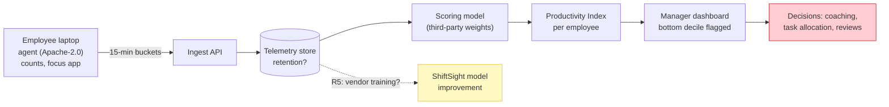

# Chapter 6 — Capstone: An Ethical Risk Assessment, Worked End to End

> Chapters 1–5 each gave you one lens: professional duty, privacy law, fairness, licensing, moral reasoning. A real launch review doesn't arrive sorted by lens. This chapter runs all five on one fictional product, computes what can be computed, and ends with a template and a rubric so you can do it on your own.

---

## The Problem

A launch review that says "legal looked, security looked, we're good" has a structural flaw: each reviewer examines their own slice, and nobody owns the harms between slices. A fairness problem is created by a *data-collection* choice, a licence problem by a *model* choice, and a privacy problem is worsened by *dashboard* design. An ethical risk assessment forces one author to follow a single product decision through every lens, rank what it finds, and attach owners and stop conditions *before* the ship date applies pressure (the pressure Ch01 §1.2 says Principle 2 must stay bounded by Principle 1).

Two warnings. The ranking step is where most assessments quietly go wrong, because the standard tool, a likelihood × severity matrix, has documented failure modes we will derive with our own numbers. And an assessment is evidence of *reasoning*, not a safe harbour: §6.9 names what it cannot catch.

For methodology, this chapter assumes the project-planning habits of [CSE801 Ch01 §1.3](../CSE801_Capstone_Project/01_Scoping_A_Capstone.md) (de-risk early) and the Risks section of [CSE801 Ch02](../CSE801_Capstone_Project/02_Architecture_And_Design_Documents.md) (each risk names its cheapest resolving experiment). Those cover risks *to the project*. This chapter covers risks *to other people*, which need a different register because the people bearing the harm are not in the room.

## 6.1 Scope and Data Flows: The Fictional Product

**ShiftSight** (fictional) is a B2B SaaS product. An employer installs an open-source desktop agent on staff laptops. The agent counts input events per 15-minute bucket, records which application has focus, and pulls ticket and calendar metadata. A cloud model turns this into a weekly per-employee **Productivity Index**. Managers see a dashboard, and the bottom decile is auto-flagged for "coaching". Launch plan: 40 employer customers, about 60,000 monitored employees across the EU and California.

Roles matter because duties attach to roles. ShiftSight is a **processor** for customer telemetry under GDPR (the employer is the controller) and a **provider** under the EU AI Act (the employer is the **deployer**). If ShiftSight also trains its model on customer telemetry for its own purposes, it becomes a controller for that processing, which is exactly risk R5 below.



The employee controls nothing downstream of the first arrow, and the red box is where data becomes a consequence. Every later section asks what can go wrong along that path.

## 6.2 Stakeholder Map, Including People Who Never Use the Product

The Ch05 procedure starts from stakeholders, and the defining feature of this product is that its *users* (managers, HR) are not the people it acts on.

| Stakeholder | Relationship | Interest at stake | Voice in the room? |
|---|---|---|---|
| Employees (60,000) | Subjects, **non-users** | Livelihood, dignity, privacy | None; the employer consents for them |
| Managers/HR | Users | Visibility, defensible decisions | Yes |
| Employer customers | Buyers, GDPR controllers | Output, legal exposure | Yes |
| Employees with disabilities, caregivers, part-timers | Subjects, disproportionately affected by proxy bias | Fair evaluation | None |
| Colleagues and households | Indirect: team dashboards, shared home devices | Privacy, inference about third parties | None |
| Open-source authors upstream | Rights-holders in our dependencies | Attribution, licence terms | None |
| ShiftSight staff | Builders, possible dissenters | Integrity (Ch01 Principle 4) | Partly |

The "None" column is the finding. Any assessment whose stakeholder map has only paying parties will score harms by what the customer notices, and the customer will not notice harms to people who cannot complain to them. Because the employer "consents" for them and employees cannot readily refuse (WP29 treats them as vulnerable, §6.5), Ch02's consent reasoning is weak here and the lawful basis must come from elsewhere.

## 6.3 Harm Identification: One Lens per Chapter

Run each chapter's question against the data-flow diagram. Harms found are given register IDs, and the register is computed in §6.4.

| Lens | The question | What it finds |
|---|---|---|
| Professional duty ([Ch01](01_Professional_Ethics_Frameworks_And_Safety_Critical_Systems.md)) | Is any tradeoff being made silently, and would Principle 1 require disclosure? | The marketing claim "objective productivity" hides that the Index measures *input activity*, a proxy. Silent tradeoff, as with Therac-25's removed interlocks. Drives R1, R8 |
| Privacy ([Ch02](02_Data_Privacy_GDPR_CCPA_And_Surveillance.md)) | Purpose limitation, minimisation, lawful basis, erasure, Art. 25 defaults | Function creep (R2), vendor secondary use (R5), erasure through backups and trained models (R6), small-team re-identification (R7), breach (R4), the monitoring itself (R3) |
| Fairness ([Ch03](03_AI_Ethics_Bias_Fairness_And_Explainability.md)) | Which groups produce systematically different inputs for reasons unrelated to performance? | Screen-reader users generate few pointer events; part-timers and carers have fragmented activity; the bottom-decile flag *guarantees* someone is flagged each week (R1, R8) |
| Licensing ([Ch04](04_Intellectual_Property_And_Open_Source_Licensing.md)) | What are we shipping, under what terms, built from what? | A GPL-2.0-only dependency in an Apache-2.0 agent; non-commercial model weights in a paid product (R9) |
| Moral reasoning ([Ch05](05_Case_Studies_And_Ethical_Decision_Making.md)) | Who bears the harm, who gets the benefit, and are they the same people? | Benefit accrues to employers; harm accrues to employees. That asymmetry is the argument for non-compensatory gates in §6.4 |

Two points arise only because we ran every lens on one product. The bottom-decile flag turns a noisy score into a quota (10% are flagged even if everyone performs identically), so fairness and professional duty object to the same line of code. And the telemetry that worsens R3 (chilling effect) is what makes R4 (breach) damaging, so minimisation mitigates both.

## 6.4 Scoring: Build the Register, Then Test the Method

A register needs numbers you can argue with. For each risk we estimate **p**, the annual probability the event occurs at one or more customers; **N**, the people affected; and **h**, the harm per person in *harm units* (hu). The scale is a stated judgment: 1 hu is a reversible inconvenience (a wrongly flagged week corrected with an apology), 10 hu a missed bonus or sustained stress, 100 hu a lost promotion, 1,000 hu a lost job. The scale can be contested. The point is that it is *written down* where a reader can contest it. **Expected harm** is E = p · N · h.

```python
import math, random
RISKS = [  # id, p, N, h
 ("R1",.55,900,60),   # proxy bias -> adverse employment action
 ("R2",.50,600,20),   # function creep: telemetry used for discipline
 ("R3",.90,60000,.5), # chilling effect on all monitored staff
 ("R4",.06,60000,4),  # telemetry store breach
 ("R5",.35,60000,1),  # vendor trains on customer data, no lawful basis
 ("R6",.50,300,5),    # erasure requests unmet (backups, model)
 ("R7",.70,2000,8),   # small-team dashboards re-identify people
 ("R8",.90,3000,3),   # agent outage scores offline staff idle
 ("R9",.30,40,30)]    # licence non-compliance
LB=[.02,.10,.30,.60]; SB=[1e2,1e3,1e4,1e5]          # bin edges: L1..L5, S1..S5
bin_=lambda x,e: 1+sum(x>=t for t in e)
for i,p,N,h in RISKS:
    print(i, bin_(p,LB)*bin_(N*h,SB), round(p*N*h))    # ordinal L*S vs expected harm
```

Real output:

| ID | L | S | L×S | E (hu) | Matrix rank | E rank |
|---|---|---|---|---|---|---|
| R1 | 4 | 4 | 16 | 29,700 | 3 | 1 |
| R2 | 4 | 4 | 16 | 6,000 | 4 | 7 |
| R3 | 5 | 4 | 20 | 27,000 | 1 | 2 |
| R4 | 2 | 5 | 10 | 14,400 | **9** | 4 |
| R5 | 4 | 4 | 16 | 21,000 | 5 | 3 |
| R6 | 4 | 3 | 12 | 750 | 7 | 8 |
| R7 | 5 | 4 | 20 | 11,200 | 2 | 5 |
| R8 | 5 | 3 | 15 | 8,100 | 6 | 6 |
| R9 | 4 | 3 | 12 | 360 | 8 | 9 |

### Derive the pitfall instead of trusting the grid

Tony Cox's 2008 paper "What's Wrong with Risk Matrices?" (*Risk Analysis* 28(2):497–512) lists four limitations: poor resolution (quantitatively very different risks get the same rating, "range compression"); errors (a matrix can rate a quantitatively *smaller* risk higher, and with negatively correlated frequency and severity can do worse than random); suboptimal resource allocation; and ambiguous inputs and outputs. We can reproduce the first two with the table above, and we can see *why*.

**Why products of ranks misorder.** A likelihood step here multiplies p by roughly 2–5 (the bins are 2%, 10%, 30%, 60%). A severity step multiplies total harm by 10. A rank product treats one step in either as interchangeable, but one is worth a factor of 10 and the other about 3. The honest quantity is log E = log p + log(N·h), roughly "0.5 per L step plus 1.0 per S step", and a product of ranks is not even monotone in that sum.

- **Inversion.** R4 (a 60,000-person breach at 6%) scores 10, the *lowest* in the register, below R9 (a 40-customer licence problem at 30%, scoring 12). Expected harm says R4 is **40×** R9. The tool ranked the largest rare event last because its low likelihood bin outweighed the top severity bin, exactly the "smaller risk rated higher" error.
- **Range compression.** R1, R2 and R5 all score 16. Their expected harms span 6,000 to 29,700, a 5× spread hidden inside one colour.
- **Iso-risk demonstration.** Four risks with the *same* E = 100 hu (p = 0.5, 0.1, 0.01, 0.002 with total harm 200, 1,000, 10,000, 50,000) score 8, 9, 4 and 4. Identical true risk, a 2× spread in matrix score, and the middle one ranks highest.

I chose plausible numbers first and looked for pairs afterwards, and the inversions are not rare: nine of the 36 pairs came out inverted. Cox's worse-than-random result for negatively correlated inputs is his; my quick simulation did not reproduce it under my assumptions, so I do not claim it.

### A justified alternative, and its own limits

Rank by **expected harm**, report the **uncertainty**, and add **non-compensatory gates**. Each part has a reason:

1. *Expected harm* keeps magnitudes, so a rare catastrophe is not rounded away.
2. *Uncertainty.* Every input is a guess, so we sample: p ×/÷ 2, N ×/÷ 1.5, h ×/÷ 3 (90% lognormal intervals), 20,000 draws, and rank each time. Result: R1 median rank 2 (5th–95th: 1–6, in the top 3 in 77% of draws), R3 median 3, R5 median 3, R4 median 4 (1–7). R6 and R9 essentially never reach the top 3 (0.00 to two decimals). The robust output is a *tier* (R1, R3, R5, R4, R7 matter; R6, R9 do not), not a rank order. Anyone who reports "R1 is #1" is over-reading.
3. *Gates.* Expected harm treats harm as fungible: a million minor inconveniences can outweigh one livelihood. Ch05's Rawlsian and Kantian procedures reject that. So some conditions are **pass/fail regardless of E**: a prohibited practice, an unresolved legal conflict, a measured discriminatory disparity above threshold. These are defined in §6.8.

The alternative has weaknesses: E needs probabilities nobody can verify, and gate thresholds are policy choices. It is better only because its assumptions are *visible* and *testable*.

## 6.5 Regulatory Triggers, as of October 2026

**GDPR Art. 35 DPIA.** Art. 35 requires an assessment where processing is "likely to result in a high risk", with automated evaluation and profiling that significantly affects people named in Art. 35(3)(a). The operational test is WP29's guideline **WP248 rev.01** (adopted 4 April 2017, last revised 4 October 2017, endorsed by the EDPB on 25 May 2018), which lists nine criteria: evaluation or scoring; automated decision with legal or similar effect; systematic monitoring; sensitive or highly personal data; large scale; matching or combining datasets; vulnerable data subjects; innovative technology; and processing that prevents exercising a right or using a service. Its rule of thumb: in most cases a processing meeting two criteria would require a DPIA, though sometimes one suffices, and more criteria make it likelier "regardless of the measures" the controller envisages. WP248 itself gives employee workstation and internet monitoring as an example meeting *systematic monitoring* plus *vulnerable data subjects* (it names employees).

ShiftSight (Option A, individual scores) meets evaluation/scoring, systematic monitoring, vulnerable subjects, large scale, and arguably automated decisions with significant effect, so five or six criteria. Even the team-level-only variant (Option B below) still meets monitoring plus vulnerable subjects. **A DPIA is required either way.** It is the controller's duty (the employer), but the processor must assist (Art. 28(3)(f)), so ShiftSight should ship a DPIA support pack. Art. 35(9) asks controllers to seek data subjects' views where appropriate, and Art. 36 requires consulting the supervisory authority when residual risk stays high.

**EU AI Act.** Annex III point 4(b) lists AI systems intended to make decisions affecting terms of work-related relationships, promotion or termination, to allocate tasks based on individual behaviour or personal traits, or to monitor and evaluate the performance and behaviour of persons in such relationships. Option A is squarely inside it: per-employee scores, task allocation, performance review. Art. 6(3)'s exemptions (narrow procedural task and so on) cannot rescue it, because they do not apply where the system performs profiling of natural persons.

**Dates.** Annex III high-risk obligations were due 2 August 2026, and that date **did move**: Regulation (EU) 2026/1744 (the "Digital Omnibus on AI", of 8 July 2026, published 24 July, in force 27 July) postpones it to **2 December 2027** for stand-alone systems like this one, and to 2 August 2028 for AI embedded in regulated products. The new dates match the Council's 29 June 2026 press release; the publication and entry-into-force dates come from secondary legal summaries, so confirm them on EUR-Lex. Consequences:

- High-risk *obligations* (provider duties, and deployer duties such as informing workers' representatives before use, Art. 26) are not yet applicable in October 2026, but a product sold now will still be on the market in December 2027, so design for them now.
- The **prohibitions are not postponed.** Art. 5(1)(f) bans AI that infers emotions in the workplace, except for medical or safety reasons; it has applied since 2 February 2025, with fines up to €35 million or 7% of turnover (Art. 99). The Commission's guidelines treat behavioural biometrics such as keystrokes as in scope. So ShiftSight's rule is: **no inference of emotion, engagement or attention from input patterns**. That becomes a hard gate (G1), and it is why the agent counts events and never records timing patterns.
- Other Art. 26 and provider duties carry fines of up to €15 million or 3% (Art. 99).

**NIST AI RMF 1.0** (NIST AI 100-1, 26 January 2023; voluntary) has four functions, and this chapter maps onto them: *Govern* (accountability, policy) is §6.8's owners and escalation path; *Map* (context, affected groups) is §6.1–6.3; *Measure* (testing, including bias evaluation, Playbook Measure 2.11) is §6.6; *Manage* (prioritise, treat, monitor) is §6.4 and §6.8. NIST notes the framework is under revision, so check the version.

**California.** The CCPA's employee-data exemption expired 1 January 2023, and the CPPA's regulations on automated decision-making technology (ADMT), risk assessments and cybersecurity audits took effect 1 January 2026, with ADMT obligations from 1 January 2027 (per the CPPA announcement and law-firm summaries; confirm with counsel). The EU DPIA and California risk assessment overlap enough for one document to serve both.

## 6.6 Fairness Audit Plan

**Which metric, and why.** The costly error in ShiftSight is a **false positive**: a competent employee wrongly flagged, with consequences up to dismissal. Missing a true low performer costs the employer a delay; it does not injure anyone. When errors have asymmetric harm, equalise the rate of the harmful error: **false-positive-rate parity across groups** (called predictive equality), not overall accuracy.

The impossibility result (Kleinberg, Mullainathan and Raghavan 2016; Chouldechova 2017, Big Data 5(2):153–163, Ch03 derives it) says calibration, equal false-positive rates and equal false-negative rates cannot all hold when base rates differ and the classifier is imperfect. Bayes shows the mechanism in one line (see [CSE203 Ch04](../../S02/CSE203_Probability_And_Statistics/04_Bayes_Theorem_Total_Probability.md)):

```python
fpr = lambda base, ppv, tpr: base/(1-base) * (1-ppv)/ppv * tpr
fpr(.10,.70,.80), fpr(.30,.70,.80)   # -> 0.0381, 0.1469
```

If two groups have the same precision (70%) and recall (80%) but true base rates of 10% and 30%, the false-positive rates are **3.8% and 14.7%**, a 3.9× gap, forced by arithmetic alone. So we cannot promise "fair" in general; we must *choose which parity to give up* and say so. We choose FPR parity and accept unequal precision, with one obligation: tell reviewers that a flag means different things for different groups.

**The label problem comes first.** FPR is measured against a "true underperformer" label, and none exists. The Index measures input activity, so a label derived from it makes the audit circular. Use a **blind, calibrated manager-panel rating** on a stratified sample, and audit the panel itself for the same disparities. A metric on a biased label is bias-in-bias-out.

**Measurement plan.**

1. *Invariance tests (no protected data needed).* Replay anonymised traces with realistic transformations: a 0.6-FTE schedule, a screen-reader workflow (few pointer events; see [CSE802 Ch04](../CSE802_Human_Computer_Interaction/04_Accessibility_POUR_Framework.md)), two weeks of leave. Metric: score shift against the untransformed trace; no transformation may move a person across the flag threshold.
2. *Labelled-sample FPR gap.* Customers hold group attributes; ShiftSight must not collect disability or health data (special-category, Ch02), so customers run an audit script and return aggregates for cells of at least 10 people (k-anonymity, Ch02). To detect FPR 10% vs 15% at α = 0.05, power 0.8, you need about **686 true negatives per group** (10% vs 20%: about 199). With 300 negatives the 95% half-width on a 10% FPR is ±3.4 points, so small customers must pool.
3. *Flag-rate screen.* The four-fifths rule (Ch03) compares *selection* rates, and the answer depends on which outcome you call "selection": flag rates of 12% and 20% give a not-flagged ratio of 0.88/0.80 = 0.91 (passes) but a flag-rate ratio of 0.60 (fails). Require both.
4. *Cadence.* Pre-launch, each model release, and quarterly, because drift changes base rates.

## 6.7 Licensing Audit

Four steps: **inventory** every component (the SBOM, Ch04), record its **SPDX identifier**, list the **obligations** each imposes, and check **compatibility** with how we distribute. The decisive input is the *distribution model*: the agent ships to employees' machines as Apache-2.0 (a distribution event), while the backend is network-only SaaS (not a distribution event for most licences, but exactly what AGPL's network clause targets). This script encodes the rules in my own summary; a lawyer owns the real answer.

```python
OUT_AGENT = "Apache-2.0"   # agent is distributed to employee machines
INV = [("input-hook","MIT","agent","linked"), ("sync-client","Apache-2.0","agent","linked"),
       ("idle-detector","GPL-2.0-only","agent","linked"), ("tray-ui","LGPL-3.0-only","agent","dynamic"),
       ("report-engine","AGPL-3.0-only","backend","modified"), ("scoring-model","CC-BY-NC-4.0","backend","weights"),
       ("train-data","CC-BY-4.0","backend","data")]
def check(spdx, where, how):
    if spdx in {"MIT","Apache-2.0"}: return "OK (keep notices)"
    if spdx=="GPL-2.0-only" and where=="agent" and how=="linked": return "CONFLICT with Apache-2.0"
    if spdx.startswith("LGPL"):   return "OBLIGATION: allow relinking, ship source"
    if spdx.startswith("AGPL"):   return "OBLIGATION: s13 network source offer if modified -> counsel"
    if spdx.endswith("NC-4.0"):   return "BLOCK: non-commercial vs paid SaaS"
    return "OBLIGATION: attribution"
```

Output: MIT and Apache-2.0 pass; `idle-detector` **conflicts**, because the FSF states Apache-2.0 is compatible with GPLv3 but *not* GPLv2 (patent-termination and indemnification terms), and a GPL-2.0-only library linked into the agent cannot be combined; `tray-ui` creates a relinking obligation; the modified AGPL `report-engine` needs a counsel decision on the network-use clause; the CC-BY-NC scoring weights are **blocked** for a paid product; the CC-BY dataset needs attribution in the model card. That makes R9. It also shows why licensing belongs in an *ethics* assessment: the upstream authors are stakeholders with no voice, and Ch01's ACM 1.5 (respect the work that produced new creations) is the principle at issue.

## 6.8 Mitigation Plan, Go/No-Go, and the Override Path

Each control has an owner and a way to *prove* it works. Residuals use the same formula and are targets to validate, not measurements.

| Control | Risks | Owner (role) | Evidence required | Residual E |
|---|---|---|---|---|
| C1 Remove the bottom-decile flag; scores shown only as ranges; contract bars sole reliance; usage logged | R1 | Product lead | Contract clause, UI review, log sample | R1 29,700 → 3,600 |
| C2 Field allow-list; purpose lock; manager views aggregated at k ≥ 10 | R2, R7 | Privacy lead | Schema test in CI, access-control test | R2 → 450; R7 → 200 |
| C3 On-device aggregation, no timing patterns, 90-day retention, encryption | R3, R4 | Security lead | Retention job test, pen-test report | R4 → 3,600; R3 → 8,400 |
| C4 Processor-only: no training on customer telemetry | R5, R6 | Legal + ML lead | Architecture review, deletion test | R5 → 1,800; R6 → 150 |
| C5 Offline = "unknown", never "idle" | R8 | Eng lead | Outage replay test | R8 → 200 |
| C6 Replace the GPL-2.0 library; swap or license the weights; publish SBOM | R9 | Eng lead + counsel | Clean SPDX scan | R9 → 24 |

Total expected harm falls from 118,510 to 18,424 hu (about 6.4×). Read the *remainder*, though. The largest residual is **R3, the chilling effect, at 8,400**, and C3 barely dents it because that harm is the product category itself: being watched changes behaviour. This is the finding the assessment exists to surface. The Ch05 procedure applied here has two options, and the register prices both:

- **Option A**, individual scores with controls C1–C6: residual 18,424 hu; R3 = 8,400.
- **Option B**, *team-level aggregates only*, no per-person Index: R1, R2 and R7 shrink sharply and R3 drops to about 3,000, for a total near 8,900 hu. (Illustrative; the estimates are mine and need the same review.)

**Decision.** Launch Option B. Option A's individual scoring stays behind the gates below. The sales objection that customers want per-person scores is recorded as dissent with its reasoning, per Ch05, not deleted.

**Go/no-go criteria** (all must hold; each is pass/fail, not scored):

| Gate | Criterion |
|---|---|
| G1 | Zero emotion/engagement/attention inference, verified by design review and a test (Art. 5(1)(f)) |
| G2 | Individual-level scores only if: upper 95% bound of the FPR gap ≤ 5 points (point estimate ≤ 3) *and* both four-fifths ratios ≥ 0.8 |
| G3 | DPIA complete, DPO consulted where one exists, Art. 36 consultation decision recorded |
| G4 | Licence scan has no CONFLICT or BLOCK; SBOM published |
| G5 | Human review enforced technically: no flow from score to adverse action without a recorded human decision |
| G6 | No residual risk with E above 5,000 hu unless an *accepting executive* signs in writing (R3 qualifies) |
| G7 | Every register row has a named owner and an evidence link |

The 3 and 5 point thresholds and the 5,000 hu line are policy choices, not discoveries. Their job is to be fixed *before* launch pressure, so the number cannot drift to fit the date.

**If the business overrides a no-go.** Escalate in a pre-agreed order, because improvising under pressure favours the loudest voice:

1. **Write the dissent into the decision record** with the gate failed, the evidence, and the person overriding. This is Ch05's "document reasoning and dissent", and it is what turns an argument into evidence.
2. **Require a named executive to sign the override** and route it to the audit or risk committee. A gate that can be waived silently was never a gate.
3. **Use the DPO and counsel.** Art. 38(3) GDPR says a DPO takes no instructions on their tasks and cannot be dismissed for performing them (where one is appointed).
4. **External channels.** The EU Whistleblower Directive 2019/1937 protects reports of breaches in listed areas, including privacy and personal data, and Art. 87 of the AI Act applies the Directive to AI Act infringements. Protection conditions differ by country and by whether you report internally, to an authority, or publicly, so take legal advice first.

The ethical anchor is Ch01: Principle 2 serves the employer "consistent with the public interest", Principle 1 comes first, and ACM 1.2 (avoid harm) does not expire when a manager signs. Ch05's Boeing 737 MAX case is the cost of treating an override as the end of the conversation.

## 6.9 The Failure Boundary: What This Assessment Cannot Catch

- **Harms nobody imagined.** A customer using the dashboard to identify union organisers is outside R1–R9 until someone thinks of it. A pre-mortem and outside reviewers help but cannot guarantee completeness.
- **Invented precision.** p, N and h are judgments. The Monte Carlo propagates uncertainty *within* your stated ranges; it cannot detect wrong ranges or correlated errors (R1 and R8 share the same proxy).
- **Aggregation hides distribution.** E sums harm across people; a severe harm to a small group that no gate names is averaged away.
- **A snapshot, not a process.** It is true on the day it is signed. Tie re-assessment to model releases and incidents.
- **Conflicted author.** The team that built the product shares its blind spots and incentives; independent review of at least the gates is the structural fix.
- **Legal conclusions.** The DPIA, AI Act and licence readings here are engineering readings; counsel decides.
- **"Should this exist at all?"** The method ranks the options you put on the table. If "no product" is never one, it cannot return it.

## 6.10 Template: Copy This

```markdown
# Ethical Risk Assessment: <product>        Date: ____   Version: ____
Author(s): ____   Independent reviewer: ____   Re-assess on: <trigger>

## 1. Scope and data flows
Purpose in one sentence: ____
Data collected (field, source, retention): ____
Flow diagram (who controls each arrow): ____
Roles: GDPR controller/processor ____ ; AI Act provider/deployer ____

## 2. Stakeholders (include non-users and people with no voice)
| Who | Relationship | Interest at stake | Voice in the room? |

## 3. Harm identification (one row per lens)
| Lens (Ch01-05) | Question asked | Finding | Register ID |

## 4. Register
| ID | Risk | p (basis) | N | h (scale used) | E = p*N*h | Uncertainty range | Gate? |
Method note: why not a bare L x S grid? ____

## 5. Regulatory triggers (state the date you checked)
DPIA (WP248 criteria met: ____ ) | AI Act (Annex III point ____ ; dates ____ ) | NIST function mapping | Other: ____

## 6. Fairness plan: metric ____ ; why ____ ; label source ____ ; groups ____ ; n ____ ; cadence ____
## 7. Licensing: inventory -> SPDX -> obligations -> compatibility (attach scan)
## 8. Mitigations: | Control | Risks | Owner | Evidence | Residual E |
## 9. Go/no-go gates (pass/fail) and thresholds fixed BEFORE launch
## 10. Options considered (including "do not build") and decision; dissent recorded
## 11. Override and escalation path (named roles)
## 12. Known limits of this assessment
```

## 6.11 Grading Rubric

Each criterion is scored 0–3: **0** missing, **1** names the topic without derivation, **2** correct and specific to the product, **3** derived, quantified where possible, and states its own failure boundary.

| Criterion | Weight | Level 3 looks like |
|---|---|---|
| Scope, roles, data flows | 10 | Diagram shows who controls each arrow; GDPR and AI Act roles assigned correctly |
| Stakeholder map | 8 | Includes non-users and voiceless parties; says whose harm is invisible to the customer |
| Harm identification across all five lenses | 12 | Every chapter's lens produces specific findings, with at least one cross-lens interaction |
| Scoring and method awareness | 15 | Real register with units; shows a concrete matrix failure with own numbers; justified alternative with uncertainty |
| Regulatory triggers | 12 | WP248 criteria counted; Annex III point cited; dates correct *and dated*; no stale assumption |
| Fairness plan | 12 | Metric tied to harm asymmetry and the impossibility result; label problem addressed; sample size computed |
| Licensing audit | 8 | Inventory, SPDX, obligations and compatibility all done against the real distribution model |
| Mitigation and go/no-go | 13 | Owners, evidence, recomputed residual, pass/fail gates with thresholds fixed in advance |
| Escalation and dissent | 5 | Ordered override path; dissent recorded; ties to Ch01/Ch05 duties |
| Honest limits | 5 | Names what the assessment cannot catch, specific to this product |

Deduct from "Regulatory triggers" for any date or article asserted without a checked source, and from "Scoring" for any score without its basis.

## Section Challenge

<details>
<summary><strong>Q1.</strong> A reviewer says: "Our fairness gate passes. Flagged 12% of group A and 20% of group B; the four-fifths ratio is 0.91." Do you accept it?</summary>

Not yet. 0.91 is the ratio of *not-flagged* rates (88% / 80%). The four-fifths screen compares selection rates, and which outcome counts as "selection" is a framing choice. The ratio of *flag* rates is 12/20 = 0.60, and group B is flagged 1.67× as often. The same data passes or fails depending on framing. Compute both ratios and require both ≥ 0.8. Even then, four-fifths screens *rates*, not *errors*: the harmful error is the false positive, so G2 also requires the FPR gap with a confidence bound, against an audited label. A passing screen is not a passing audit.

</details>

<details>
<summary><strong>Q2.</strong> A customer says: "You are the vendor, so the DPIA is your job." And a colleague says: "The AI Act high-risk date moved to December 2027, so we can ignore Annex III this year." Evaluate both.</summary>

*DPIA:* the duty falls on the **controller**, the employer. As processor, ShiftSight must assist (Art. 28(3)(f)), so it ships a DPIA support pack (data flows, register, measures). If it trains on customer telemetry for its own purposes it becomes a controller for that processing and owes its own DPIA. A DPIA is required either way: WP248 counts systematic monitoring plus vulnerable subjects (employees) as two criteria.

*Dates:* half right. Regulation (EU) 2026/1744 moved Annex III high-risk application to 2 December 2027, so those conformity duties are not yet applicable. But the Art. 5(1)(f) ban has applied since 2 February 2025, the product will still be on the market in December 2027, and retrofitting logging and oversight costs more than designing them in. "Ignore it" confuses *when the duty attaches* with *when the design must exist*.

</details>

<details>
<summary><strong>Q3.</strong> Gate G2 fails: the FPR gap's upper bound is 8 points. Sales wants individual scores shipped anyway, "behind a feature flag, off by default". Walk the response.</summary>

"Off by default" lowers p (fewer customers enable it) but not h for those who do, and paying enterprises will turn it on, so re-estimate R1 rather than assuming the flag zeroes it. Because G2 is a gate, expected-harm arithmetic cannot waive it: a measured disparity in the harmful error, borne by people with no voice in the sale, is the Rawls/Kant case for a non-compensatory rule (Ch05).

Procedure: (1) record the failed gate, evidence and dissent; (2) offer the alternatives already priced: Option B, or Option A restricted to design partners with the audit running and a contractual bar on sole reliance; (3) if the business still ships, require a named executive's written override routed to the risk committee (G6 logic); (4) inform the DPO and counsel, keeping external reporting as a last resort under the Whistleblower Directive, on legal advice. The engineer's duty under SE Code Principles 1 and 2 (Ch01) is to make the risk visible and the decision attributable, not to win the argument.

</details>

---

## Chapter Summary

| Concept | What it establishes | Concrete anchor from this chapter |
|---|---|---|
| Stakeholder map with non-users | Users and affected people can be disjoint | 60,000 employees affected; managers are the users |
| Matrix failure, derived | Products of ordinal ranks misorder and compress (Cox 2008) | R4 breach ranked last, 40× R9 by expected harm; R1/R2/R5 tie at 16 over a 5× spread |
| Expected harm + uncertainty + gates | Keep magnitude, show confidence, protect non-fungible harms | R1 in top 3 in 77% of draws; gates G1–G7 |
| DPIA trigger (WP248) | Count criteria; two usually suffices | Employee monitoring meets monitoring plus vulnerable subjects |
| AI Act status, Oct 2026 | Annex III 4(b) applies; dates moved, prohibitions did not | Reg. (EU) 2026/1744: 2 Dec 2027; Art. 5(1)(f) since 2 Feb 2025 |
| Metric choice from harm asymmetry | Choose which parity to give up, and say so | Equal PPV and TPR with base rates 10% vs 30% gives FPR 3.8% vs 14.7% |
| Licence audit | Distribution model decides obligations | GPL-2.0-only in Apache-2.0 agent; NC weights in a paid product |
| Override path | Pre-agreed, attributable, escalating | Signed override, DPO, Whistleblower Directive, AI Act Art. 87 |
| Failure boundary | State what the method cannot see | Unimagined harms, invented precision, conflicted author |

## Course Wrap-Up

The course built five lenses and this chapter used all of them on one product. Ch01 told you who comes first when interests collide, Ch02 what a data flow must satisfy, Ch03 the arithmetic of unfair error, Ch04 the terms for shipping other people's work, Ch05 a procedure for when the lenses disagree. The capstone's lesson is method: derive the ranking rather than trust the grid, fix thresholds in writing before the deadline, and name what your own assessment cannot see.

For the course map, learning outcomes and assessment, return to the [course README](README.md). For the project methodology this capstone assumes, see [CSE801 Ch06 on documentation and presentation](../CSE801_Capstone_Project/06_Documentation_And_Presentation.md).
